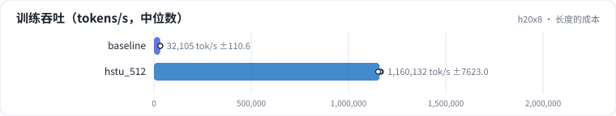
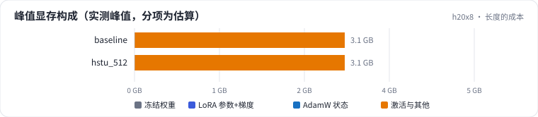

<!-- 本页由 python -m labkit docs 从 ../lesson.yaml 和 results/ 生成，不要手改 -->

[← 整体收益被稀释](08-benefit.md) · [课程首页](../README.md) · [SASRec（softmax）对 HSTU →](10-softmax.md)

# 第 9 步 / 共 17 步：长度的成本

> 阶段 3 / 6：**长度的收益与成本** · 场景：`hstu_512`（对照 `baseline`）

每步的 token 数相同（61440）。L = 512 时一步 120 条短序列，L = 10240 时一步 6 条长序列。

## 这一步跑了什么

| 场景 | 作用 | 说明 | 相对基线改了什么 | 种子（H20） |
| - | - | - | - | - |
| `baseline` | 对照 | 基线：HSTU，最近 10240 个行为（按 query 分块计算注意力） | — | 3 |
| `hstu_512` | 本步 | HSTU，L = 512 | `max_len=512` | 3 |

## 先预测

**每个 token 的训练耗时，L = 10240 是 L = 512 的几倍？**

- **A.** 不到 2 倍
- **B.** 2 - 5 倍
- **C.** 5 - 20 倍
- **D.** 20 倍以上

> 先选定一个（记下来），再展开下面的实测。Recall@10 在 2048 个测试用户上的抽样标准误约 0.01，长程题（约 800 个）约 0.017；均值差小于 0.03（长程题小于 0.05）或小于种子间波动，都按“差不多”算。

## 实测

展开实测：H20 · 合成长序列 1K-10K（回访簇作长程信号）· HSTU d=64、2 层 · 3 种子（已有 6 / 6 个运行）

| 场景 | 类型 | 训练 token/秒 | 训练峰值 GB | 训练秒数 | 训练 token/秒：与 `baseline` 差 | 训练 token/秒：各种子 | 断言 |
| - | - | - | - | - | - | - | - |
| `baseline` | 基线 | 31,431 ± 320 | 3.3 ± 0.0 | 1145 ± 1 | — | s0 31,799 / s1 31,231 / s2 31,262 | 通过 |
| `hstu_512` | 候选改动 | 1,155,154 ± 6,558 | 3.3 ± 0.0 | 144 ± 1 | +1,123,724 | s0 1,160,948 / s1 1,156,479 / s2 1,148,035 |  |

运行目录（每个目录里有 `summary.json` 指标、`evidence.json` 证据摘要、`predictions.jsonl` 逐条预测、`log.txt` 日志）：

- `baseline` [s0](../../../results/h20x8/R02/baseline/s0-7f1334/) · [s1](../../../results/h20x8/R02/baseline/s1-b6ddff/) · [s2](../../../results/h20x8/R02/baseline/s2-b2e97d/)
- `hstu_512` [s0](../../../results/h20x8/R02/hstu_512/s0-c30810/) · [s1](../../../results/h20x8/R02/hstu_512/s1-e2e360/) · [s2](../../../results/h20x8/R02/hstu_512/s2-b64856/)

## 看完实测再想一步

探针里 L 翻 4 倍（2048 → 8192），毫秒数翻了几倍？

---

[← 整体收益被稀释](08-benefit.md) · [课程首页](../README.md) · [SASRec（softmax）对 HSTU →](10-softmax.md)
