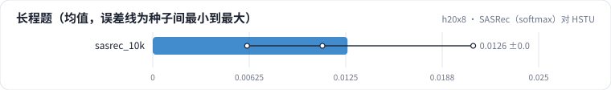
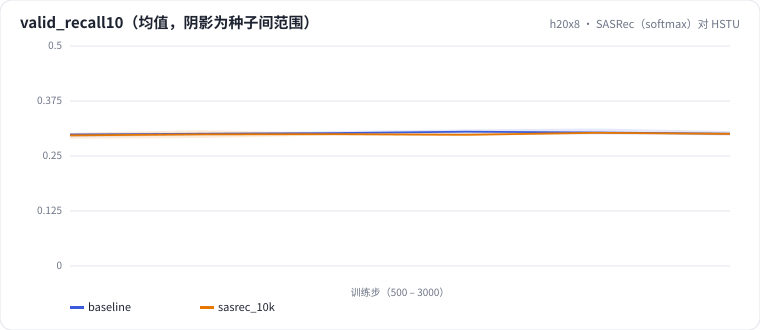

<!-- 本页由 python -m labkit docs 从 ../lesson.yaml 和 results/ 生成，不要手改 -->

[← 长度的成本](09-cost-len.md) · [课程首页](../README.md) · [手写注意力对 SDPA →](11-manual.md)

# 第 10 步 / 共 17 步：SASRec（softmax）对 HSTU

> 阶段 4 / 6：**结构与实现** · 场景：`sasrec_10k`（对照 `baseline`）

同样 10240 的窗口、同样的训练预算，换成 SASRec：softmax 注意力 + MLP，绝对位置，没有时间偏置，SDPA（flash）实现。

## 这一步跑了什么

| 场景 | 作用 | 说明 | 相对基线改了什么 | 种子（H20） |
| - | - | - | - | - |
| `baseline` | 对照 | 基线：HSTU，最近 10240 个行为（按 query 分块计算注意力） | — | 3 |
| `sasrec_10k` | 本步 | SASRec（softmax 注意力，SDPA），L = 10240 | `model=sasrec` | 3 |

## 先预测

**长程题的 Recall@10，SASRec 和 HSTU 比怎样？**

- **A.** SASRec 低 0.05 以上
- **B.** 差不多（±0.05）
- **C.** SASRec 高 0.05 以上

> 先选定一个（记下来），再展开下面的实测。Recall@10 在 2048 个测试用户上的抽样标准误约 0.01，长程题（约 800 个）约 0.017；均值差小于 0.03（长程题小于 0.05）或小于种子间波动，都按“差不多”算。

## 实测

展开实测：H20 · 合成长序列 1K-10K（回访簇作长程信号）· HSTU d=64、2 层 · 3 种子（已有 9 / 6 个运行）

| 场景 | 类型 | 长程题 | 近期题 | 新会话题 | 训练 token/秒 | 主体参数 | 长程题：与 `baseline` 差 | 长程题：各种子 | 断言 |
| - | - | - | - | - | - | - | - | - | - |
| `baseline` | 基线 | 0.021 ± 0.008 | 0.644 ± 0.003 | 0.054 ± 0.003 | 31,431 ± 320 | 42,624.0 ± 0.0 | — | s0 0.018 / s1 0.031 / s2 0.015 | 通过 |
| `sasrec_10k` | 候选改动 | 0.012 ± 0.005 | 0.644 ± 0.001 | 0.052 ± 0.000 | 447,101 ± 3,993 | 754,624.0 ± 0.0 | -0.009 | s0 0.011 / s0 0.011 / s1 0.016 / s1 0.021 / s2 0.007 / s2 0.006 |  |

运行目录（每个目录里有 `summary.json` 指标、`evidence.json` 证据摘要、`predictions.jsonl` 逐条预测、`log.txt` 日志）：

- `baseline` [s0](../../../results/h20x8/R02/baseline/s0-7f1334/) · [s1](../../../results/h20x8/R02/baseline/s1-b6ddff/) · [s2](../../../results/h20x8/R02/baseline/s2-b2e97d/)
- `sasrec_10k` [s0](../../../results/h20x8/R02/sasrec_10k/s0-5dcb8f/) · [s0](../../../results/h20x8/R02/sasrec_10k/s0-9db389/) · [s1](../../../results/h20x8/R02/sasrec_10k/s1-b76534/) · [s1](../../../results/h20x8/R02/sasrec_10k/s1-e4f2b0/) · [s2](../../../results/h20x8/R02/sasrec_10k/s2-130824/) · [s2](../../../results/h20x8/R02/sasrec_10k/s2-a96687/)

## 看完实测再想一步

三类题里，两种结构差得最多的是哪一类？

---

[← 长度的成本](09-cost-len.md) · [课程首页](../README.md) · [手写注意力对 SDPA →](11-manual.md)
