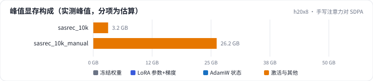
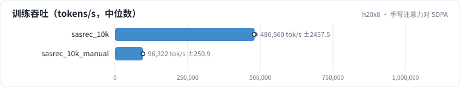

<!-- 本页由 python -m labkit docs 从 ../lesson.yaml 和 results/ 生成，不要手改 -->

[← SASRec（softmax）对 HSTU](10-softmax.md) · [课程首页](../README.md) · [去掉时间偏置 →](12-timebias.md)

# 第 11 步 / 共 17 步：手写注意力对 SDPA

> 阶段 4 / 6：**结构与实现** · 场景：`sasrec_10k_manual`（对照 `sasrec_10k`）

同一个 SASRec，注意力从 SDPA（flash）换成手写：显式构造 [B, H, L, L] 的打分、softmax、再乘 V。数学上完全等价。

## 这一步跑了什么

| 场景 | 作用 | 说明 | 相对基线改了什么 | 种子（H20） |
| - | - | - | - | - |
| `sasrec_10k` | 对照 | SASRec（softmax 注意力，SDPA），L = 10240 | `model=sasrec` | 3 |
| `sasrec_10k_manual` | 本步 | SASRec，手写注意力（显式 [B, H, L, L]），L = 10240 | `model=sasrec`, `attn_impl=manual` | 3 |

## 先预测

**训练峰值显存，手写是 SDPA 的几倍？**

- **A.** 不到 1.5 倍
- **B.** 1.5 - 4 倍
- **C.** 4 - 10 倍
- **D.** 10 倍以上

> 先选定一个（记下来），再展开下面的实测。Recall@10 在 2048 个测试用户上的抽样标准误约 0.01，长程题（约 800 个）约 0.017；均值差小于 0.03（长程题小于 0.05）或小于种子间波动，都按“差不多”算。

## 实测

展开实测：H20 · 合成长序列 1K-10K（回访簇作长程信号）· HSTU d=64、2 层 · 3 种子（已有 12 / 6 个运行）

| 场景 | 类型 | 训练峰值 GB | 训练 token/秒 | Recall@10 | 训练峰值 GB：与 `sasrec_10k` 差 | 训练峰值 GB：各种子 | 断言 |
| - | - | - | - | - | - | - | - |
| `sasrec_10k` | 候选改动 | 3.4 ± 0.0 | 447,101 ± 3,993 | 0.275 ± 0.002 | — | s0 3.4 / s0 3.4 / s1 3.4 / s1 3.4 / s2 3.4 / s2 3.4 |  |
| `sasrec_10k_manual` | 候选改动 | 28.1 ± 0.0 | 92,941 ± 834 | 0.274 ± 0.002 | +24.7 | s0 28.1 / s0 28.1 / s1 28.1 / s1 28.1 / s2 28.1 / s2 28.1 |  |

运行目录（每个目录里有 `summary.json` 指标、`evidence.json` 证据摘要、`predictions.jsonl` 逐条预测、`log.txt` 日志）：

- `sasrec_10k` [s0](../../../results/h20x8/R02/sasrec_10k/s0-5dcb8f/) · [s0](../../../results/h20x8/R02/sasrec_10k/s0-9db389/) · [s1](../../../results/h20x8/R02/sasrec_10k/s1-b76534/) · [s1](../../../results/h20x8/R02/sasrec_10k/s1-e4f2b0/) · [s2](../../../results/h20x8/R02/sasrec_10k/s2-130824/) · [s2](../../../results/h20x8/R02/sasrec_10k/s2-a96687/)
- `sasrec_10k_manual` [s0](../../../results/h20x8/R02/sasrec_10k_manual/s0-0c3274/) · [s0](../../../results/h20x8/R02/sasrec_10k_manual/s0-f53ca5/) · [s1](../../../results/h20x8/R02/sasrec_10k_manual/s1-cf7652/) · [s1](../../../results/h20x8/R02/sasrec_10k_manual/s1-e86c0d/) · [s2](../../../results/h20x8/R02/sasrec_10k_manual/s2-c5a924/) · [s2](../../../results/h20x8/R02/sasrec_10k_manual/s2-eedb80/)

## 看完实测再想一步

两者的 Recall 一样吗？（数学等价时应该在噪声内）

---

[← SASRec（softmax）对 HSTU](10-softmax.md) · [课程首页](../README.md) · [去掉时间偏置 →](12-timebias.md)
