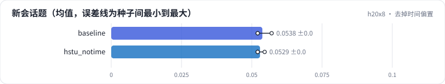

<!-- 本页由 python -m labkit docs 从 ../lesson.yaml 和 results/ 生成，不要手改 -->

[← 手写注意力对 SDPA](11-manual.md) · [课程首页](../README.md) · [回到 ML-1M →](13-ml1m.md)

# 第 12 步 / 共 17 步：去掉时间偏置

> 阶段 4 / 6：**结构与实现** · 场景：`hstu_notime`（对照 `baseline`）

HSTU 去掉相对时间偏置，只保留相对位置偏置。新会话题的输入和"同一个会话的下一步"在位置上看起来一样，区别只在"隔了多久"。

## 这一步跑了什么

| 场景 | 作用 | 说明 | 相对基线改了什么 | 种子（H20） |
| - | - | - | - | - |
| `baseline` | 对照 | 基线：HSTU，最近 10240 个行为（按 query 分块计算注意力） | — | 3 |
| `hstu_notime` | 本步 | HSTU 去掉相对时间偏置 | `time_bias=False` | 3 |

## 先预测

**新会话题的 Recall@10 会怎样？**

- **A.** 降 0.03 以上
- **B.** 差不多（±0.03）
- **C.** 升 0.03 以上

> 先选定一个（记下来），再展开下面的实测。Recall@10 在 2048 个测试用户上的抽样标准误约 0.01，长程题（约 800 个）约 0.017；均值差小于 0.03（长程题小于 0.05）或小于种子间波动，都按“差不多”算。

## 实测

展开实测：H20 · 合成长序列 1K-10K（回访簇作长程信号）· HSTU d=64、2 层 · 3 种子（已有 6 / 6 个运行）

| 场景 | 类型 | 新会话题 | 近期题 | 长程题 | 新会话题：与 `baseline` 差 | 新会话题：各种子 | 断言 |
| - | - | - | - | - | - | - | - |
| `baseline` | 基线 | 0.054 ± 0.003 | 0.644 ± 0.003 | 0.021 ± 0.008 | — | s0 0.052 / s1 0.057 / s2 0.052 | 通过 |
| `hstu_notime` | 候选改动 | 0.053 ± 0.001 | 0.646 ± 0.005 | 0.017 ± 0.002 | -0.001 | s0 0.052 / s1 0.055 / s2 0.052 |  |

运行目录（每个目录里有 `summary.json` 指标、`evidence.json` 证据摘要、`predictions.jsonl` 逐条预测、`log.txt` 日志）：

- `baseline` [s0](../../../results/h20x8/R02/baseline/s0-7f1334/) · [s1](../../../results/h20x8/R02/baseline/s1-b6ddff/) · [s2](../../../results/h20x8/R02/baseline/s2-b2e97d/)
- `hstu_notime` [s0](../../../results/h20x8/R02/hstu_notime/s0-931ce9/) · [s1](../../../results/h20x8/R02/hstu_notime/s1-c9f6dc/) · [s2](../../../results/h20x8/R02/hstu_notime/s2-449e1e/)

## 看完实测再想一步

哪一类题对时间偏置最敏感？

---

[← 手写注意力对 SDPA](11-manual.md) · [课程首页](../README.md) · [回到 ML-1M →](13-ml1m.md)
