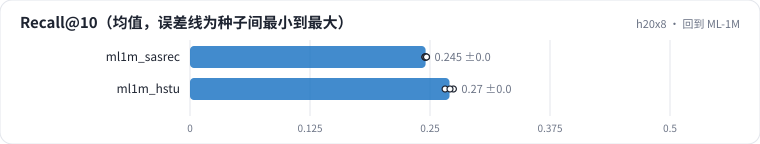

<!-- 本页由 python -m labkit docs 从 ../lesson.yaml 和 results/ 生成，不要手改 -->

[← 去掉时间偏置](12-timebias.md) · [课程首页](../README.md) · [补齐 vs jagged →](14-jagged.md)

# 第 13 步 / 共 17 步：回到 ML-1M

> 阶段 4 / 6：**结构与实现** · 场景：`ml1m_hstu`（对照 `ml1m_sasrec`）

把两个结构搬回 R01 的 ML-1M（L = 200、每步 128 条、4000 步）。ML-1M 的远处信息很少，同一秒的评分顺序也是任意的。

## 这一步跑了什么

| 场景 | 作用 | 说明 | 相对基线改了什么 | 种子（H20） |
| - | - | - | - | - |
| `ml1m_sasrec` | 对照 | ML-1M 上的 SASRec（L = 200） | `dataset=ml1m`, `model=sasrec`, `max_len=200`, `batch_size=128`, `steps=4000`, `valid_frac=0.33`, `probe_lens=50,200` | 3 |
| `ml1m_hstu` | 本步 | ML-1M 上的 HSTU（L = 200） | `dataset=ml1m`, `max_len=200`, `batch_size=128`, `steps=4000`, `valid_frac=0.33`, `probe_lens=50,200` | 3 |

## 先预测

**ML-1M 上 HSTU 和 SASRec 比，测试 Recall@10 怎样？**

- **A.** HSTU 低 0.01 以上
- **B.** 差不多（±0.01）
- **C.** HSTU 高 0.01 以上

> 先选定一个（记下来），再展开下面的实测。Recall@10 在 2048 个测试用户上的抽样标准误约 0.01，长程题（约 800 个）约 0.017；均值差小于 0.03（长程题小于 0.05）或小于种子间波动，都按“差不多”算。

## 实测

展开实测：H20 · 合成长序列 1K-10K（回访簇作长程信号）· HSTU d=64、2 层 · 3 种子（已有 3 / 6 个运行）

| 场景 | 类型 | Recall@10 | NDCG@10 | 训练 样本/秒 | Recall@10：与 `ml1m_sasrec` 差 | Recall@10：各种子 | 断言 |
| - | - | - | - | - | - | - | - |
| `ml1m_sasrec` | 候选改动 | 0.245 ± 0.001 | 0.136 ± 0.001 | 15,449 ± 119 | — | s0 0.245 / s1 0.245 / s2 0.246 |  |
| `ml1m_hstu` | 候选改动 | 〔待 H20 生成〕 | 〔待 H20 生成〕 | 〔待 H20 生成〕 |  | | |

运行目录（每个目录里有 `summary.json` 指标、`evidence.json` 证据摘要、`predictions.jsonl` 逐条预测、`log.txt` 日志）：

- `ml1m_sasrec` [s0](../../../results/h20x8/R02/ml1m_sasrec/s0-f62c9c/) · [s1](../../../results/h20x8/R02/ml1m_sasrec/s1-ce1a2c/) · [s2](../../../results/h20x8/R02/ml1m_sasrec/s2-0eb3f4/)

---

[← 去掉时间偏置](12-timebias.md) · [课程首页](../README.md) · [补齐 vs jagged →](14-jagged.md)
