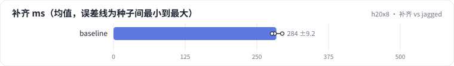

<!-- 本页由 python -m labkit docs 从 ../lesson.yaml 和 results/ 生成，不要手改 -->

[← 回到 ML-1M](13-ml1m.md) · [课程首页](../README.md) · [同事简化了 mask →](15-fault.md)

# 第 14 步 / 共 17 步：补齐 vs jagged

> 阶段 5 / 6：**padding** · 场景：`baseline`

从真实长度分布里抽 6 个用户，两种算法做同样的前向 + 反向：补齐到最长的那个、整批算；不补齐、逐条算再求和（jagged 的朴素版）。

## 这一步跑了什么

| 场景 | 作用 | 说明 | 相对基线改了什么 | 种子（H20） |
| - | - | - | - | - |
| `baseline` | 本步 | 基线：HSTU，最近 10240 个行为（按 query 分块计算注意力） | — | 3 |

## 先预测

**jagged 比补齐快几倍？**

- **A.** 不到 1.5 倍
- **B.** 1.5 - 3 倍
- **C.** 3 - 6 倍
- **D.** 6 倍以上

> 先选定一个（记下来），再展开下面的实测。Recall@10 在 2048 个测试用户上的抽样标准误约 0.01，长程题（约 800 个）约 0.017；均值差小于 0.03（长程题小于 0.05）或小于种子间波动，都按“差不多”算。

## 实测

展开实测：H20 · 合成长序列 1K-10K（回访簇作长程信号）· HSTU d=64、2 层 · 3 种子（已有 3 / 3 个运行）

| 场景 | 类型 | 补齐 ms | 逐条 ms | 加速 | 注意力浪费 | 补齐 ms：各种子 | 断言 |
| - | - | - | - | - | - | - | - |
| `baseline` | 基线 | 283.9 ± 9.2 | 323.6 ± 9.6 | 0.9 ± 0.1 | 79.0% ± 0.0% | s0 294.3 / s1 281.0 / s2 276.5 | 通过 |

运行目录（每个目录里有 `summary.json` 指标、`evidence.json` 证据摘要、`predictions.jsonl` 逐条预测、`log.txt` 日志）：

- `baseline` [s0](../../../results/h20x8/R02/baseline/s0-7f1334/) · [s1](../../../results/h20x8/R02/baseline/s1-b6ddff/) · [s2](../../../results/h20x8/R02/baseline/s2-b2e97d/)

---

[← 回到 ML-1M](13-ml1m.md) · [课程首页](../README.md) · [同事简化了 mask →](15-fault.md)
