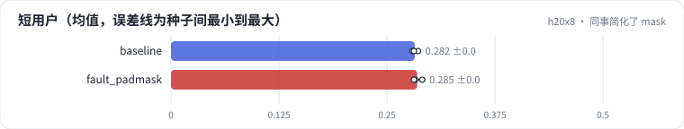
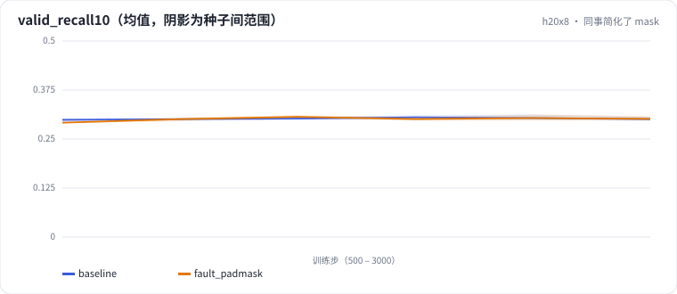

<!-- 本页由 python -m labkit docs 从 ../lesson.yaml 和 results/ 生成，不要手改 -->

[← 补齐 vs jagged](14-jagged.md) · [课程首页](../README.md) · [诊断：短用户为什么掉得多 →](16-diagnose.md)

# 第 15 步 / 共 17 步：同事简化了 mask

> 阶段 5 / 6：**padding** · 场景：`fault_padmask`（对照 `baseline`）

同事觉得 HSTU 的 mask"三个条件太啰嗦，因果就够了"，只保留了因果 mask。序列是左补齐的。训练正常结束。

## 这一步跑了什么

| 场景 | 作用 | 说明 | 相对基线改了什么 | 种子（H20） |
| - | - | - | - | - |
| `baseline` | 对照 | 基线：HSTU，最近 10240 个行为（按 query 分块计算注意力） | — | 3 |
| `fault_padmask` | 本步 | HSTU 的 mask 只做因果（左补齐的 padding 没挡住） | `mask=causal_only` | 3 |

## 先预测

**短用户（总长度 < 2048）的测试 Recall@10 会怎样？**

- **A.** 降不到 0.01
- **B.** 降 0.01 - 0.05
- **C.** 降 0.05 以上

> 先选定一个（记下来），再展开下面的实测。Recall@10 在 2048 个测试用户上的抽样标准误约 0.01，长程题（约 800 个）约 0.017；均值差小于 0.03（长程题小于 0.05）或小于种子间波动，都按“差不多”算。

## 实测

展开实测：H20 · 合成长序列 1K-10K（回访簇作长程信号）· HSTU d=64、2 层 · 3 种子（已有 6 / 6 个运行）

| 场景 | 类型 | 短用户 | 长用户 | 整体 | 短用户：与 `baseline` 差 | 短用户：各种子 | 断言 |
| - | - | - | - | - | - | - | - |
| `baseline` | 基线 | 0.282 ± 0.003 | 0.292 ± 0.003 | 0.279 ± 0.003 | — | s0 0.286 / s1 0.280 / s2 0.281 | 通过 |
| `fault_padmask` | 教学故障 | 0.285 ± 0.005 | 0.287 ± 0.006 | 0.276 ± 0.001 | +0.003 | s0 0.291 / s1 0.283 / s2 0.281 | 通过 |

运行目录（每个目录里有 `summary.json` 指标、`evidence.json` 证据摘要、`predictions.jsonl` 逐条预测、`log.txt` 日志）：

- `baseline` [s0](../../../results/h20x8/R02/baseline/s0-7f1334/) · [s1](../../../results/h20x8/R02/baseline/s1-b6ddff/) · [s2](../../../results/h20x8/R02/baseline/s2-b2e97d/)
- `fault_padmask` [s0](../../../results/h20x8/R02/fault_padmask/s0-1f0937/) · [s1](../../../results/h20x8/R02/fault_padmask/s1-188b29/) · [s2](../../../results/h20x8/R02/fault_padmask/s2-ec7080/)

## 看完实测再想一步

训练 loss 曲线看得出问题吗？

---

[← 补齐 vs jagged](14-jagged.md) · [课程首页](../README.md) · [诊断：短用户为什么掉得多 →](16-diagnose.md)
