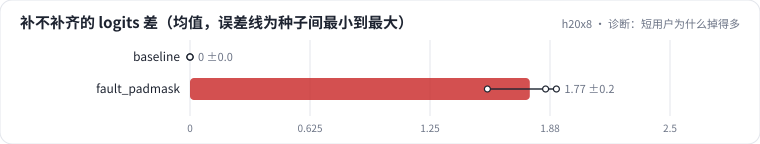

<!-- 本页由 python -m labkit docs 从 ../lesson.yaml 和 results/ 生成，不要手改 -->

[← 同事简化了 mask](15-fault.md) · [课程首页](../README.md) · [回顾 →](17-keycard.md)

# 第 16 步 / 共 17 步：诊断：短用户为什么掉得多

> 阶段 5 / 6：**padding** · 场景：`fault_padmask`（对照 `baseline`）

只改了 mask 一个参数，短用户掉得最多，长用户几乎不变。按需逐级点开线索，然后点选根因。

## 这一步跑了什么

| 场景 | 作用 | 说明 | 相对基线改了什么 | 种子（H20） |
| - | - | - | - | - |
| `baseline` | 对照 | 基线：HSTU，最近 10240 个行为（按 query 分块计算注意力） | — | 3 |
| `fault_padmask` | 本步 | HSTU 的 mask 只做因果（左补齐的 padding 没挡住） | `mask=causal_only` | 3 |

## 线索

逐条展开，看到能下判断为止。

线索 1

按用户长度分组：短用户（< 2048）Recall@10 0.285 ± 0.005（基线 0.282 ± 0.003）；长用户（> 8192）0.287 ± 0.006（基线 0.292 ± 0.003）。

线索 2

同一批用户"各自不补齐"和"补齐到 10240"，最后一个位置 logits 的最大差：基线 0.0e+00 ± 0.0e+00，故障 1.77 ± 0.19。

线索 3

短用户最后一个位置的注意力有多少落在 padding 上：93% ± 2%（基线 0% ± 0%）。看追踪里的 6 × 6 mask。

## 先预测

**根因是什么？**

- **A.** 只用了因果 mask：左补齐的 padding 在过去一侧，被当成历史参与了聚合
- **B.** HSTU 没有 softmax，数值不稳定
- **C.** 短用户本来就没有长程信号
- **D.** padding 的时间戳为 0，落进了越界的时间桶

> 先选定一个（记下来），再展开下面的实测。Recall@10 在 2048 个测试用户上的抽样标准误约 0.01，长程题（约 800 个）约 0.017；均值差小于 0.03（长程题小于 0.05）或小于种子间波动，都按“差不多”算。

## 实测

展开实测：H20 · 合成长序列 1K-10K（回访簇作长程信号）· HSTU d=64、2 层 · 3 种子（已有 6 / 6 个运行）

| 场景 | 类型 | 补不补齐的 logits 差 | 注意力落在 pad 上 | 短用户 | 长用户 | 补不补齐的 logits 差：与 `baseline` 差 | 补不补齐的 logits 差：各种子 | 断言 |
| - | - | - | - | - | - | - | - | - |
| `baseline` | 基线 | 0.000 ± 0.000 | 0.0% ± 0.0% | 0.282 ± 0.003 | 0.292 ± 0.003 | — | s0 0.000 / s1 0.000 / s2 0.000 | 通过 |
| `fault_padmask` | 教学故障 | 1.770 ± 0.193 | 93.2% ± 1.6% | 0.285 ± 0.005 | 0.287 ± 0.006 | +1.770 | s0 1.852 / s1 1.549 / s2 1.909 | 通过 |

运行目录（每个目录里有 `summary.json` 指标、`evidence.json` 证据摘要、`predictions.jsonl` 逐条预测、`log.txt` 日志）：

- `baseline` [s0](../../../results/h20x8/R02/baseline/s0-7f1334/) · [s1](../../../results/h20x8/R02/baseline/s1-b6ddff/) · [s2](../../../results/h20x8/R02/baseline/s2-b2e97d/)
- `fault_padmask` [s0](../../../results/h20x8/R02/fault_padmask/s0-1f0937/) · [s1](../../../results/h20x8/R02/fault_padmask/s1-188b29/) · [s2](../../../results/h20x8/R02/fault_padmask/s2-ec7080/)

---

[← 同事简化了 mask](15-fault.md) · [课程首页](../README.md) · [回顾 →](17-keycard.md)
