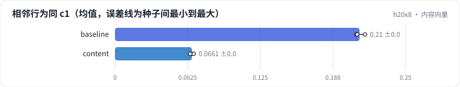

<!-- 本页由 python -m labkit docs 从 ../lesson.yaml 和 results/ 生成，不要手改 -->

[← 先估算](05-estimate.md) · [课程首页](../README.md) · [随机向量 →](07-random.md)

# 第 6 步 / 共 15 步：内容向量

> 阶段 3 / 7：**表示来源** · 场景：`content`（对照 `baseline`）

同样 3 层 × 64 码，物品向量换成内容向量：Qwen2.5-0.5B 读"片名 + 类型"。协同向量反映"谁和谁被同一批人看"，内容向量反映"片名和类型像不像"。用一个第三方视角检验：用户相邻两次评分的两部电影，第 1 层码相同的比例。

## 这一步跑了什么

| 场景 | 作用 | 说明 | 相对基线改了什么 | 种子（H20） |
| - | - | - | - | - |
| `baseline` | 对照 | 基线：ML-1M，SASRec 物品向量，L2 归一化，RQ-KMeans 3 层 × 64 码 | — | 3 |
| `content` | 本步 | 内容向量：Qwen2.5-0.5B 读片名 + 类型 | `item_repr=qwen` | 3 |

## 先预测

**内容 ID 的"相邻行为同 c1 比例"是协同 ID 的几倍？**

- **A.** 不到 0.7 倍
- **B.** 0.7 - 1.1 倍
- **C.** 1.1 倍以上

> 先选定一个（记下来），再展开下面的实测。量化只受种子影响（k-means 初始化），比例类指标的种子间波动通常在 1 个百分点以内；差值小于种子间波动按“差不多”算。

## 实测

展开实测：H20 · ML-1M 3706 部电影 + 合成 100 万 / 1000 万物品 · RQ-KMeans / RQ-VAE · 3 种子（已有 6 / 6 个运行）

| 场景 | 类型 | 相邻行为同 c1 | 同 c1 类型 Jaccard | 碰撞率 | L1 困惑度 / K | 相邻行为同 c1：与 `baseline` 差 | 相邻行为同 c1：各种子 | 断言 |
| - | - | - | - | - | - | - | - | - |
| `baseline` | 基线 | 0.210 ± 0.004 | 0.465 ± 0.011 | 21.4% ± 0.7% | 0.83 ± 0.01 | — | s0 0.208 / s1 0.215 / s2 0.208 | 通过 |
| `content` | 候选改动 | 0.066 ± 0.001 | 0.335 ± 0.005 | 17.9% ± 2.9% | 0.78 ± 0.02 | -0.144 | s0 0.066 / s1 0.068 / s2 0.065 |  |

运行目录（每个目录里有 `summary.json` 指标、`evidence.json` 证据摘要、`predictions.jsonl` 逐条预测、`log.txt` 日志）：

- `baseline` [s0](../../../results/h20x8/R03/baseline/s0-e593ca/) · [s1](../../../results/h20x8/R03/baseline/s1-d942ef/) · [s2](../../../results/h20x8/R03/baseline/s2-389446/)
- `content` [s0](../../../results/h20x8/R03/content/s0-7f9694/) · [s1](../../../results/h20x8/R03/content/s1-aff4a1/) · [s2](../../../results/h20x8/R03/content/s2-f92c68/)

## 看完实测再想一步

两个视角的检验，方向一致吗？

---

[← 先估算](05-estimate.md) · [课程首页](../README.md) · [随机向量 →](07-random.md)
