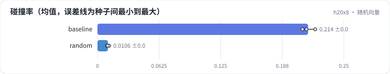

<!-- 本页由 python -m labkit docs 从 ../lesson.yaml 和 results/ 生成，不要手改 -->

[← 内容向量](06-content.md) · [课程首页](../README.md) · [不做归一化 →](08-unnorm.md)

# 第 7 步 / 共 15 步：随机向量

> 阶段 3 / 7：**表示来源** · 场景：`random`（对照 `baseline`）

物品向量换成随机高斯向量：码完全没有语义，只是一个随机的编号方式。随机向量在空间里分布很均匀。

## 这一步跑了什么

| 场景 | 作用 | 说明 | 相对基线改了什么 | 种子（H20） |
| - | - | - | - | - |
| `baseline` | 对照 | 基线：ML-1M，SASRec 物品向量，L2 归一化，RQ-KMeans 3 层 × 64 码 | — | 3 |
| `random` | 本步 | 随机向量（没有任何语义） | `item_repr=random` | 3 |

## 先预测

**随机 ID 的碰撞率和协同 ID 比怎样？**

- **A.** 随机低 5 个点以上
- **B.** 差不多（±5 个点）
- **C.** 随机高 5 个点以上

> 先选定一个（记下来），再展开下面的实测。量化只受种子影响（k-means 初始化），比例类指标的种子间波动通常在 1 个百分点以内；差值小于种子间波动按“差不多”算。

## 实测

展开实测：H20 · ML-1M 3706 部电影 + 合成 100 万 / 1000 万物品 · RQ-KMeans / RQ-VAE · 3 种子（已有 6 / 6 个运行）

| 场景 | 类型 | 碰撞率 | 同 c1 余弦 | 相邻行为同 c1 | L1 困惑度 / K | 碰撞率：与 `baseline` 差 | 碰撞率：各种子 | 断言 |
| - | - | - | - | - | - | - | - | - |
| `baseline` | 基线 | 21.4% ± 0.7% | 0.65 ± 0.00 | 0.210 ± 0.004 | 0.83 ± 0.01 | — | s0 21.2% / s1 22.1% / s2 20.8% | 通过 |
| `random` | 候选改动 | 1.1% ± 0.1% | 0.12 ± 0.00 | 0.016 ± 0.000 | 0.99 ± 0.00 | -20.3% | s0 1.0% / s1 1.2% / s2 1.0% | 通过 |

运行目录（每个目录里有 `summary.json` 指标、`evidence.json` 证据摘要、`predictions.jsonl` 逐条预测、`log.txt` 日志）：

- `baseline` [s0](../../../results/h20x8/R03/baseline/s0-e593ca/) · [s1](../../../results/h20x8/R03/baseline/s1-d942ef/) · [s2](../../../results/h20x8/R03/baseline/s2-389446/)
- `random` [s0](../../../results/h20x8/R03/random/s0-270cdd/) · [s1](../../../results/h20x8/R03/random/s1-2833b5/) · [s2](../../../results/h20x8/R03/random/s2-233d8e/)

---

[← 内容向量](06-content.md) · [课程首页](../README.md) · [不做归一化 →](08-unnorm.md)
