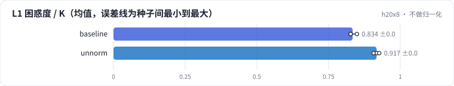

<!-- 本页由 python -m labkit docs 从 ../lesson.yaml 和 results/ 生成，不要手改 -->

[← 随机向量](07-random.md) · [课程首页](../README.md) · [100 万物品，3 × 256 →](09-depth.md)

# 第 8 步 / 共 15 步：不做归一化

> 阶段 3 / 7：**表示来源** · 场景：`unnorm`（对照 `baseline`）

协同向量不做 L2 归一化，直接做 k-means。协同 embedding 的范数往往和物品的热度有关（训练时出现得多，被推得远）。

## 这一步跑了什么

| 场景 | 作用 | 说明 | 相对基线改了什么 | 种子（H20） |
| - | - | - | - | - |
| `baseline` | 对照 | 基线：ML-1M，SASRec 物品向量，L2 归一化，RQ-KMeans 3 层 × 64 码 | — | 3 |
| `unnorm` | 本步 | 不做 L2 归一化 | `normalize=none` | 3 |

## 先预测

**第 1 层码的困惑度 / K（分布有多均匀）会怎样？**

- **A.** 降 10 个点以上
- **B.** 差不多（±10 个点）
- **C.** 升 10 个点以上

> 先选定一个（记下来），再展开下面的实测。量化只受种子影响（k-means 初始化），比例类指标的种子间波动通常在 1 个百分点以内；差值小于种子间波动按“差不多”算。

## 实测

展开实测：H20 · ML-1M 3706 部电影 + 合成 100 万 / 1000 万物品 · RQ-KMeans / RQ-VAE · 3 种子（已有 6 / 6 个运行）

| 场景 | 类型 | L1 困惑度 / K | 热度 η²（c1） | 碰撞率 | L1 困惑度 / K：与 `baseline` 差 | L1 困惑度 / K：各种子 | 断言 |
| - | - | - | - | - | - | - | - |
| `baseline` | 基线 | 0.83 ± 0.01 | 0.82 ± 0.00 | 21.4% ± 0.7% | — | s0 0.83 / s1 0.83 / s2 0.85 | 通过 |
| `unnorm` | 候选改动 | 0.92 ± 0.01 | 0.84 ± 0.00 | 16.4% ± 1.3% | +0.08 | s0 0.91 / s1 0.92 / s2 0.93 |  |

运行目录（每个目录里有 `summary.json` 指标、`evidence.json` 证据摘要、`predictions.jsonl` 逐条预测、`log.txt` 日志）：

- `baseline` [s0](../../../results/h20x8/R03/baseline/s0-e593ca/) · [s1](../../../results/h20x8/R03/baseline/s1-d942ef/) · [s2](../../../results/h20x8/R03/baseline/s2-389446/)
- `unnorm` [s0](../../../results/h20x8/R03/unnorm/s0-9cec49/) · [s1](../../../results/h20x8/R03/unnorm/s1-912ca6/) · [s2](../../../results/h20x8/R03/unnorm/s2-6776ab/)

---

[← 随机向量](07-random.md) · [课程首页](../README.md) · [100 万物品，3 × 256 →](09-depth.md)
