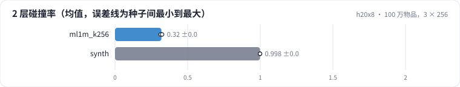
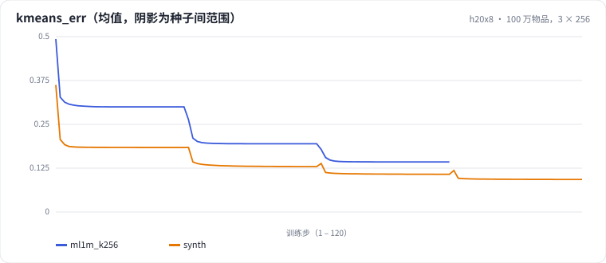

<!-- 本页由 python -m labkit docs 从 ../lesson.yaml 和 results/ 生成，不要手改 -->

[← 不做归一化](08-unnorm.md) · [课程首页](../README.md) · [同样容量，4 × 64 →](10-k64.md)

# 第 9 步 / 共 15 步：100 万物品，3 × 256

> 阶段 4 / 7：**码本形状与规模** · 场景：`synth`

合成 100 万个物品（有顶簇、子簇、微簇三层结构），4 层 × 256 码。逐层贪心的性质：4 层运行的前 3 层，就是一次 3 层运行的结果。3 层的容量 1677 万，均匀基准碰撞率约 5.8%。

## 这一步跑了什么

| 场景 | 作用 | 说明 | 相对基线改了什么 | 种子（H20） |
| - | - | - | - | - |
| `ml1m_k256` | 参照 | ML-1M，3 层 × 256 码 | `sid_k=256` | 3 |
| `synth` | 本步 | 合成 100 万物品，4 层 × 256 码（前 d 层即 d 层的结果） | `items=synth`, `sid_levels=4`, `sid_k=256` | 3 |

## 先预测

**前 3 层的实测碰撞率大约多少？**

- **A.** 不到 6%
- **B.** 6% - 20%
- **C.** 20% - 50%
- **D.** 50% 以上

> 先选定一个（记下来），再展开下面的实测。量化只受种子影响（k-means 初始化），比例类指标的种子间波动通常在 1 个百分点以内；差值小于种子间波动按“差不多”算。

## 实测

展开实测：H20 · ML-1M 3706 部电影 + 合成 100 万 / 1000 万物品 · RQ-KMeans / RQ-VAE · 3 种子（已有 6 / 6 个运行）

| 场景 | 类型 | 2 层碰撞率 | 3 层碰撞率 | 4 层碰撞率 | 最大桶 | 量化秒数 | 2 层碰撞率：各种子 | 断言 |
| - | - | - | - | - | - | - | - | - |
| `ml1m_k256` | 候选改动 | 32.0% ± 0.5% | 7.4% ± 0.2% | — | 119.33333333333333 ± 4.163331998932265 | 0.8 ± 0.0 | s0 32.1% / s1 31.4% / s2 32.4% | 通过 |
| `synth` | 参照 | 99.8% ± 0.0% | 91.5% ± 0.1% | 74.9% ± 0.4% | 919.3333333333334 ± 65.49300217071541 | 7.5 ± 0.2 | s0 99.8% / s1 99.8% / s2 99.8% | 通过 |

运行目录（每个目录里有 `summary.json` 指标、`evidence.json` 证据摘要、`predictions.jsonl` 逐条预测、`log.txt` 日志）：

- `ml1m_k256` [s0](../../../results/h20x8/R03/ml1m_k256/s0-602735/) · [s1](../../../results/h20x8/R03/ml1m_k256/s1-7aa04c/) · [s2](../../../results/h20x8/R03/ml1m_k256/s2-236d25/)
- `synth` [s0](../../../results/h20x8/R03/synth/s0-5f8a12/) · [s1](../../../results/h20x8/R03/synth/s1-de2ed3/) · [s2](../../../results/h20x8/R03/synth/s2-1e6c0c/)

## 看完实测再想一步

kmeans_err 曲线每一层的台阶有多高？哪一层降得最多？

---

[← 不做归一化](08-unnorm.md) · [课程首页](../README.md) · [同样容量，4 × 64 →](10-k64.md)
