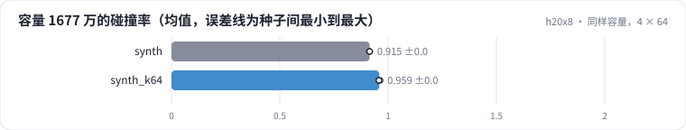

<!-- 本页由 python -m labkit docs 从 ../lesson.yaml 和 results/ 生成，不要手改 -->

[← 100 万物品，3 × 256](09-depth.md) · [课程首页](../README.md) · [1000 万物品 →](11-scale.md)

# 第 10 步 / 共 15 步：同样容量，4 × 64

> 阶段 4 / 7：**码本形状与规模** · 场景：`synth_k64`（对照 `synth`）

4 层 × 64 码和 3 层 × 256 码的容量都是 1677 万。层多、每层小，还是层少、每层大？

## 这一步跑了什么

| 场景 | 作用 | 说明 | 相对基线改了什么 | 种子（H20） |
| - | - | - | - | - |
| `synth` | 对照 | 合成 100 万物品，4 层 × 256 码（前 d 层即 d 层的结果） | `items=synth`, `sid_levels=4`, `sid_k=256` | 3 |
| `synth_k64` | 本步 | 合成 100 万物品，4 层 × 64 码 | `items=synth`, `sid_levels=4`, `sid_k=64` | 3 |

## 先预测

**同容量（1677 万）时，4 × 64 的碰撞率和 3 × 256 比怎样？**

- **A.** 多 5 个点以上
- **B.** 差不多（±5 个点）
- **C.** 少 5 个点以上

> 先选定一个（记下来），再展开下面的实测。量化只受种子影响（k-means 初始化），比例类指标的种子间波动通常在 1 个百分点以内；差值小于种子间波动按“差不多”算。

## 实测

展开实测：H20 · ML-1M 3706 部电影 + 合成 100 万 / 1000 万物品 · RQ-KMeans / RQ-VAE · 3 种子（已有 6 / 6 个运行）

| 场景 | 类型 | 容量 1677 万的碰撞率 | 码组合数 | L1 困惑度 / K | 容量 1677 万的碰撞率：与 `synth` 差 | 容量 1677 万的碰撞率：各种子 | 断言 |
| - | - | - | - | - | - | - | - |
| `synth` | 参照 | 91.5% ± 0.1% | 380,905.6666666667 ± 3,776.513780371168 | 0.82 ± 0.03 | — | s0 91.6% / s1 91.3% / s2 91.5% | 通过 |
| `synth_k64` | 候选改动 | 95.9% ± 0.4% | 108,518.0 ± 6,171.660716533273 | 0.76 ± 0.03 | +4.5% | s0 95.6% / s1 96.3% / s2 95.8% | 通过 |

运行目录（每个目录里有 `summary.json` 指标、`evidence.json` 证据摘要、`predictions.jsonl` 逐条预测、`log.txt` 日志）：

- `synth` [s0](../../../results/h20x8/R03/synth/s0-5f8a12/) · [s1](../../../results/h20x8/R03/synth/s1-de2ed3/) · [s2](../../../results/h20x8/R03/synth/s2-1e6c0c/)
- `synth_k64` [s0](../../../results/h20x8/R03/synth_k64/s0-c6034a/) · [s1](../../../results/h20x8/R03/synth_k64/s1-c81263/) · [s2](../../../results/h20x8/R03/synth_k64/s2-4738c3/)

---

[← 100 万物品，3 × 256](09-depth.md) · [课程首页](../README.md) · [1000 万物品 →](11-scale.md)
