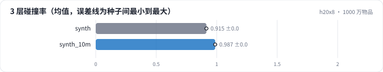

<!-- 本页由 python -m labkit docs 从 ../lesson.yaml 和 results/ 生成，不要手改 -->

[← 同样容量，4 × 64](10-k64.md) · [课程首页](../README.md) · [RQ-VAE →](12-rqvae.md)

# 第 11 步 / 共 15 步：1000 万物品

> 阶段 4 / 7：**码本形状与规模** · 场景：`synth_10m`（对照 `synth`）

物品数从 100 万到 1000 万，同样 4 层 × 256（码本在 100 万个样本上拟合，1000 万个物品分块分配）。3 层的容量还是 1677 万。

## 这一步跑了什么

| 场景 | 作用 | 说明 | 相对基线改了什么 | 种子（H20） |
| - | - | - | - | - |
| `synth` | 对照 | 合成 100 万物品，4 层 × 256 码（前 d 层即 d 层的结果） | `items=synth`, `sid_levels=4`, `sid_k=256` | 3 |
| `synth_10m` | 本步 | 合成 1000 万物品，4 层 × 256 码（码本在 100 万个样本上拟合，全部物品分块分配） | `items=synth`, `sid_levels=4`, `sid_k=256`, `synth_n=10000000` | 3 |

## 先预测

**前 3 层的碰撞率上升多少？**

- **A.** 不到 10 个点
- **B.** 10 - 30 个点
- **C.** 30 个点以上

> 先选定一个（记下来），再展开下面的实测。量化只受种子影响（k-means 初始化），比例类指标的种子间波动通常在 1 个百分点以内；差值小于种子间波动按“差不多”算。

## 实测

展开实测：H20 · ML-1M 3706 部电影 + 合成 100 万 / 1000 万物品 · RQ-KMeans / RQ-VAE · 3 种子（已有 6 / 6 个运行）

| 场景 | 类型 | 3 层碰撞率 | 4 层碰撞率 | 最大桶 | 量化秒数 | 3 层碰撞率：与 `synth` 差 | 3 层碰撞率：各种子 | 断言 |
| - | - | - | - | - | - | - | - | - |
| `synth` | 参照 | 91.5% ± 0.1% | 74.9% ± 0.4% | 919.3333333333334 ± 65.49300217071541 | 7 ± 0 | — | s0 91.6% / s1 91.3% / s2 91.5% | 通过 |
| `synth_10m` | 候选改动 | 98.7% ± 0.1% | 92.8% ± 0.1% | 8,114.0 ± 401.36143312480834 | 8 ± 0 | +7.3% | s0 98.8% / s1 98.7% / s2 98.7% |  |

运行目录（每个目录里有 `summary.json` 指标、`evidence.json` 证据摘要、`predictions.jsonl` 逐条预测、`log.txt` 日志）：

- `synth` [s0](../../../results/h20x8/R03/synth/s0-5f8a12/) · [s1](../../../results/h20x8/R03/synth/s1-de2ed3/) · [s2](../../../results/h20x8/R03/synth/s2-1e6c0c/)
- `synth_10m` [s0](../../../results/h20x8/R03/synth_10m/s0-bf1f92/) · [s1](../../../results/h20x8/R03/synth_10m/s1-388e91/) · [s2](../../../results/h20x8/R03/synth_10m/s2-d0b9df/)

---

[← 同样容量，4 × 64](10-k64.md) · [课程首页](../README.md) · [RQ-VAE →](12-rqvae.md)
