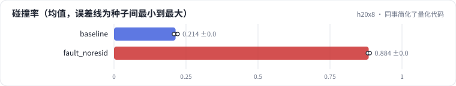
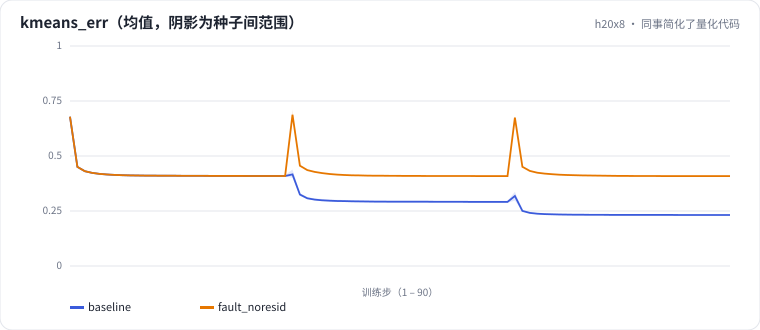

<!-- 本页由 python -m labkit docs 从 ../lesson.yaml 和 results/ 生成，不要手改 -->

[← RQ-VAE](12-rqvae.md) · [课程首页](../README.md) · [诊断：利用率 100%，为什么撞得厉害 →](14-diagnose.md)

# 第 13 步 / 共 15 步：同事简化了量化代码

> 阶段 6 / 7：**故障** · 场景：`fault_noresid`（对照 `baseline`）

同事重构量化代码时觉得"每层都对物品向量聚类更直观"，删掉了减残差那一行，只给每层换了一个随机种子。跑完一看：每层码字利用率都是 100%。

## 这一步跑了什么

| 场景 | 作用 | 说明 | 相对基线改了什么 | 种子（H20） |
| - | - | - | - | - |
| `baseline` | 对照 | 基线：ML-1M，SASRec 物品向量，L2 归一化，RQ-KMeans 3 层 × 64 码 | — | 3 |
| `fault_noresid` | 本步 | 每层都对原向量聚类（没减残差） | `residual=False` | 3 |

## 先预测

**碰撞率会上升多少？**

- **A.** 不到 5 个点
- **B.** 5 - 30 个点
- **C.** 30 个点以上

> 先选定一个（记下来），再展开下面的实测。量化只受种子影响（k-means 初始化），比例类指标的种子间波动通常在 1 个百分点以内；差值小于种子间波动按“差不多”算。

## 实测

展开实测：H20 · ML-1M 3706 部电影 + 合成 100 万 / 1000 万物品 · RQ-KMeans / RQ-VAE · 3 种子（已有 6 / 6 个运行）

| 场景 | 类型 | 碰撞率 | 码组合数 | L2 利用率 | 碰撞率：与 `baseline` 差 | 碰撞率：各种子 | 断言 |
| - | - | - | - | - | - | - | - |
| `baseline` | 基线 | 21.4% ± 0.7% | 3,165.0 ± 19.28730152198591 | 100% ± 0% | — | s0 21.2% / s1 22.1% / s2 20.8% | 通过 |
| `fault_noresid` | 教学故障 | 88.4% ± 0.4% | 800.3333333333334 ± 18.14754345175493 | 100% ± 0% | +67.1% | s0 88.4% / s1 88.1% / s2 88.8% | 通过 |

运行目录（每个目录里有 `summary.json` 指标、`evidence.json` 证据摘要、`predictions.jsonl` 逐条预测、`log.txt` 日志）：

- `baseline` [s0](../../../results/h20x8/R03/baseline/s0-e593ca/) · [s1](../../../results/h20x8/R03/baseline/s1-d942ef/) · [s2](../../../results/h20x8/R03/baseline/s2-389446/)
- `fault_noresid` [s0](../../../results/h20x8/R03/fault_noresid/s0-7918cb/) · [s1](../../../results/h20x8/R03/fault_noresid/s1-0e09cb/) · [s2](../../../results/h20x8/R03/fault_noresid/s2-f02286/)

---

[← RQ-VAE](12-rqvae.md) · [课程首页](../README.md) · [诊断：利用率 100%，为什么撞得厉害 →](14-diagnose.md)
