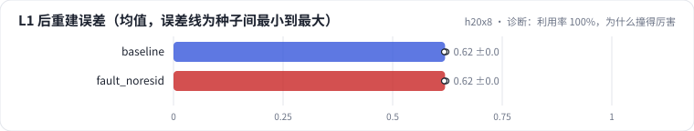

<!-- 本页由 python -m labkit docs 从 ../lesson.yaml 和 results/ 生成，不要手改 -->

[← 同事简化了量化代码](13-fault.md) · [课程首页](../README.md) · [回顾 →](15-keycard.md)

# 第 14 步 / 共 15 步：诊断：利用率 100%，为什么撞得厉害

> 阶段 6 / 7：**故障** · 场景：`fault_noresid`（对照 `baseline`）

每层的码字利用率都是 100%，碰撞率却大幅上升。按需逐级点开线索，然后点选根因。

## 这一步跑了什么

| 场景 | 作用 | 说明 | 相对基线改了什么 | 种子（H20） |
| - | - | - | - | - |
| `baseline` | 对照 | 基线：ML-1M，SASRec 物品向量，L2 归一化，RQ-KMeans 3 层 × 64 码 | — | 3 |
| `fault_noresid` | 本步 | 每层都对原向量聚类（没减残差） | `residual=False` | 3 |

## 线索

逐条展开，看到能下判断为止。

线索 1

每层之后的重建误差：基线 0.620 ± 0.002 → 0.470 ± 0.003；故障 0.620 ± 0.002 → 1.496 ± 0.006。看 kmeans_err 曲线有没有阶梯。

线索 2

利用率 / 困惑度：故障每层 100% ± 0% / 0.82 ± 0.04，和基线接近；但码组合数只有 800 ± 18（基线 3,165 ± 19）。

线索 3

层间归一化互信息 NMI(L1, L2)：故障 0.72 ± 0.01，基线 0.24 ± 0.01。

## 先预测

**根因是什么？**

- **A.** 码本 K 太小
- **B.** 每层都对原向量聚类，没有减残差，层与层重复描述同一件事
- **C.** 没有归一化，码本坍缩
- **D.** SASRec 向量训练不足

> 先选定一个（记下来），再展开下面的实测。量化只受种子影响（k-means 初始化），比例类指标的种子间波动通常在 1 个百分点以内；差值小于种子间波动按“差不多”算。

## 实测

展开实测：H20 · ML-1M 3706 部电影 + 合成 100 万 / 1000 万物品 · RQ-KMeans / RQ-VAE · 3 种子（已有 6 / 6 个运行）

| 场景 | 类型 | L1 后重建误差 | L3 后重建误差 | NMI(L1 | 码组合数 | L1 后重建误差：与 `baseline` 差 | L1 后重建误差：各种子 | 断言 |
| - | - | - | - | - | - | - | - | - |
| `baseline` | 基线 | 0.620 ± 0.002 | 0.470 ± 0.003 | 0.24 ± 0.01 | 3,165.0 ± 19.28730152198591 | — | s0 0.619 / s1 0.622 / s2 0.618 | 通过 |
| `fault_noresid` | 教学故障 | 0.620 ± 0.002 | 1.496 ± 0.006 | 0.72 ± 0.01 | 800.3333333333334 ± 18.14754345175493 | +0.000 | s0 0.619 / s1 0.622 / s2 0.618 | 通过 |

运行目录（每个目录里有 `summary.json` 指标、`evidence.json` 证据摘要、`predictions.jsonl` 逐条预测、`log.txt` 日志）：

- `baseline` [s0](../../../results/h20x8/R03/baseline/s0-e593ca/) · [s1](../../../results/h20x8/R03/baseline/s1-d942ef/) · [s2](../../../results/h20x8/R03/baseline/s2-389446/)
- `fault_noresid` [s0](../../../results/h20x8/R03/fault_noresid/s0-7918cb/) · [s1](../../../results/h20x8/R03/fault_noresid/s1-0e09cb/) · [s2](../../../results/h20x8/R03/fault_noresid/s2-f02286/)

---

[← 同事简化了量化代码](13-fault.md) · [课程首页](../README.md) · [回顾 →](15-keycard.md)
