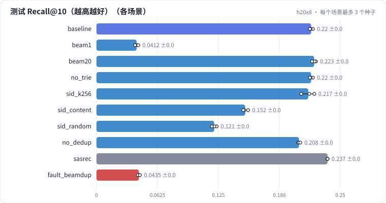

# R04 生成式召回：encoder-decoder + 语义 ID、beam 宽度、trie 约束、去重位、ID 质量，与 SASRec 全量打分对比

用 R03 的语义 ID 做 TIGER 式生成式召回：encoder 读用户历史，decoder 逐层生成目标物品的语义 ID，trie 约束只生成存在的 ID，beam search 出 Top-10。比较 beam 宽度、有没有 trie、码本大小、ID 来源、有没有去重位，和 SASRec 全量打分比效果与成本。最后诊断一次"beam 初始分数全为 0"。

## 怎么学（只看 GitHub 就够）

按下面“步骤”表从第 1 步往下点。每一页先给问题和选项，**先选定一个再展开“实测”**；实测里有结果表、证据图和运行目录链接。作业进度见 [作业看板](../../jobs/README.md)。参考答案和解析只在私有工作台里。

## 任务

**出发点**：生成式召回的卖点是"不用维护物品向量索引，模型直接写出物品 ID"。它的代价和坑在解码：每个用户要做 L+1 步 decoder 前向；beam 太窄会漏掉好物品；不加约束会写出不存在的 ID；beam search 写错一行，结果全是重复的。

做法：ML-1M，语义 ID = R03 基线的做法（SASRec 物品向量、RQ-KMeans 3 × 64 + 去重位，量化种子固定，所以各场景的 ID 相同）。模型是 encoder-decoder：encoder 每个历史物品一个位置（最近 200 个），decoder 从 BOS 开始生成 4 个 token。

| 维度 | 场景 |
| - | - |
| 解码 | beam 1 / 10 / 20；不加 trie |
| ID 质量 | 3 × 256；内容向量；随机向量；不加去重位 |
| 参照 | SASRec 对全部物品打分 |

只改推理参数的场景（beam、trie、故障）复用同一个训练好的模型。

## 规模与边界

- **H20 档**：encoder 4 层、decoder 2 层、d = 128、4 头；12000 步 × 512 个用户，每 1000 步在 1000 个验证用户上用 beam 10 评估、取最好的权重；对 6040 个测试用户 beam 解码；每个场景 3 个种子。
- **保留了**：语义 ID + 去重位、GPU trie（稠密转移表）、按 [B, W] 批量的 beam search、W 条 beam 共享 encoder 输出、全局 top-W。
- **缩小了**：只有 3706 个物品——这个规模下 SASRec 全量打分非常便宜，生成式召回的优势（物品数到千万级时省掉向量索引和巨大的输出层）体现不出来，这一点用千万级的成本基准补上。
- **未验证**：千万级物品上的召回效果；语义 ID 随物品更新的维护；和 ANN 索引的线上延迟对比。

## 步骤

<!-- labkit:path -->
| # | 阶段 | 步骤 | 这一步回答的问题 | 场景 | H20 结果 |
| - | - | - | - | - | - |
| 1 | 理解任务 | [场景与痛点](steps/01-pain.md) | 让模型直接写出物品 ID：解码要花多少、会写出不存在的 ID 吗、beam 写错会怎样？ | — | — |
| 2 | 理解任务 | [流程结构](steps/02-flow.md) |  | — | — |
| 3 | 理解任务 | [追踪一个用户](steps/03-trace.md) |  | — | — |
| 4 | 理解任务 | [代码导读](steps/04-code.md) |  | — | — |
| 5 | 先估算 | [先估算](steps/05-estimate.md) | 3 层 + 去重位、beam 10，每个用户要做几次 decoder 前向（批量算，按步数计）、每步在多少个候选里选？ | — | — |
| 6 | beam 宽度 | [贪心解码](steps/06-beam1.md) | 贪心解码的 Recall@10 是 beam 10 的几倍？ | `beam1` | 3 / 3 |
| 7 | beam 宽度 | [beam 20](steps/07-beam20.md) | beam 20 的 Recall@10 是 beam 10 的几倍？ | `beam20` | 3 / 3 |
| 8 | trie 约束 | [不加 trie](steps/08-notrie.md) | 不加 trie 时，beam 10 返回的元组里非法的占多少？ | `no_trie` | 3 / 3 |
| 9 | ID 质量 | [3 × 256 的语义 ID](steps/09-k256.md) | Recall@10 和 3 × 64 比怎样？ | `sid_k256` | 3 / 3 |
| 10 | ID 质量 | [内容向量做的 ID](steps/10-content.md) | Recall@10 和协同 ID 比怎样？ | `sid_content` | 3 / 3 |
| 11 | ID 质量 | [随机向量做的 ID](steps/11-random.md) | Recall@10 和协同 ID 比怎样？ | `sid_random` | 3 / 3 |
| 12 | ID 质量 | [不加去重位](steps/12-nodedup.md) | Recall@10 和有去重位比怎样？ | `no_dedup` | 3 / 3 |
| 13 | 和 SASRec 比 | [和 SASRec 比](steps/13-sasrec.md) | SASRec 和生成式召回比，Recall@10 怎样？ | `sasrec` | 3 / 3 |
| 14 | 故障 | [同事改了 beam search](steps/14-fault.md) | Recall@10 是基线的几倍？ | `fault_beamdup` | 3 / 3 |
| 15 | 故障 | [诊断：模型没变，召回为什么掉了](steps/15-diagnose.md) | 根因是什么？ | `fault_beamdup` | 3 / 3 |
| 16 | 带走 | [回顾](steps/16-keycard.md) |  | — | — |
<!-- /labkit:path -->

## 场景与结果

<!-- labkit:results -->

展开结果（先自己预测，再看）

**h20x8**：8 × NVIDIA H20，每张卡一个运行。ML-1M，语义 ID 来自 R03 基线的做法（SASRec 物品向量 + RQ-KMeans 3 × 64 + 去重位，量化种子固定）；encoder 4 层、decoder 2 层、d = 128，12000 步 × 512 个用户；对 6040 个测试用户 beam 解码（已有 30 / 30 个运行）

| 场景 | 类型 | Recall@10 | NDCG@10 | 非法元组比例 | 每用户不重复物品数 | 解码 ms/用户 | 训练秒数 | 断言 |
| - | - | - | - | - | - | - | - | - |
| `baseline` | 基线 | 0.2201 ± 0.0016 (n=3) | 0.1243 ± 0.0017 (n=3) | 0.0000 ± 0.0000 (n=3) | 10.0000 ± 0.0000 (n=3) | 0.1126 ± 0.0001 (n=3) | 655.9933 ± 1.0955 (n=3) | 通过 |
| `beam1` | 候选改动 | 0.0412 ± 0.0017 (n=3) | 0.0412 ± 0.0017 (n=3) | 0.0000 ± 0.0000 (n=3) | 1.0000 ± 0.0000 (n=3) | 0.0469 ± 0.0004 (n=3) | 655.9933 ± 1.0955 (n=3) | 通过 |
| `beam20` | 候选改动 | 0.2232 ± 0.0020 (n=3) | 0.1253 ± 0.0017 (n=3) | 0.0000 ± 0.0000 (n=3) | 20.0000 ± 0.0000 (n=3) | 0.2026 ± 0.0080 (n=3) | 655.9933 ± 1.0955 (n=3) |  |
| `no_trie` | 候选改动 | 0.2201 ± 0.0016 (n=3) | 0.1243 ± 0.0017 (n=3) | 0.0002 ± 0.0000 (n=3) | 9.9981 ± 0.0003 (n=3) | 0.1118 ± 0.0005 (n=3) | 655.9933 ± 1.0955 (n=3) |  |
| `sid_k256` | 候选改动 | 0.2172 ± 0.0068 (n=3) | 0.1223 ± 0.0037 (n=3) | 0.0000 ± 0.0000 (n=3) | 10.0000 ± 0.0000 (n=3) | 0.1131 ± 0.0001 (n=3) | 651.9833 ± 1.8803 (n=3) |  |
| `sid_content` | 候选改动 | 0.1525 ± 0.0026 (n=3) | 0.0855 ± 0.0020 (n=3) | 0.0000 ± 0.0000 (n=3) | 10.0000 ± 0.0000 (n=3) | 0.1139 ± 0.0055 (n=3) | 607.3833 ± 1.7543 (n=3) |  |
| `sid_random` | 候选改动 | 0.1207 ± 0.0025 (n=3) | 0.0692 ± 0.0024 (n=3) | 0.0000 ± 0.0000 (n=3) | 10.0000 ± 0.0000 (n=3) | 0.1116 ± 0.0001 (n=3) | 616.7167 ± 1.4896 (n=3) |  |
| `no_dedup` | 候选改动 | 0.2077 ± 0.0011 (n=3) | 0.1142 ± 0.0005 (n=3) | 0.0000 ± 0.0000 (n=3) | 10.0000 ± 0.0000 (n=3) | 0.0864 ± 0.0002 (n=3) | 607.3667 ± 1.9900 (n=3) |  |
| `sasrec` | 参照 | 0.2369 ± 0.0000 (n=3) | 0.1316 ± 0.0000 (n=3) | 0.0000 ± 0.0000 (n=3) | 10.0000 ± 0.0000 (n=3) | 0.0186 ± 0.0023 (n=3) | 26.5900 ± 1.3915 (n=3) |  |
| `fault_beamdup` | 教学故障 | 0.0435 ± 0.0011 (n=3) | 0.0429 ± 0.0012 (n=3) | 0.0000 ± 0.0000 (n=3) | 1.1265 ± 0.0073 (n=3) | 0.1120 ± 0.0006 (n=3) | 655.9933 ± 1.0955 (n=3) | 通过 |

<!-- /labkit:results -->

## 证据图

<!-- labkit:figures -->

展开证据图（先自己预测，再看）

- **h20x8**：[主指标](figures/h20x8-metrics.svg)

  

<!-- /labkit:figures -->

## 代码

<!-- labkit:code -->
| 代码段 | 位置 |
| - | - |
| `cost` | [projects/genrec/cost.py#L10](../../projects/genrec/cost.py#L10) |
| `content_emb` | [projects/genrec/items.py#L64](../../projects/genrec/items.py#L64) |
| `synth` | [projects/genrec/items.py#L91](../../projects/genrec/items.py#L91) |
| `trie` | [projects/genrec/model.py#L34](../../projects/genrec/model.py#L34) |
| `encdec` | [projects/genrec/model.py#L73](../../projects/genrec/model.py#L73) |
| `beam` | [projects/genrec/model.py#L114](../../projects/genrec/model.py#L114) |
| `kmeans` | [projects/genrec/sid.py#L25](../../projects/genrec/sid.py#L25) |
| `rq` | [projects/genrec/sid.py#L52](../../projects/genrec/sid.py#L52) |
| `collide` | [projects/genrec/sid.py#L78](../../projects/genrec/sid.py#L78) |
| `metrics` | [projects/genrec/sid.py#L101](../../projects/genrec/sid.py#L101) |
| `evaluate` | [projects/genrec/train.py#L77](../../projects/genrec/train.py#L77) |
| `train` | [projects/genrec/train.py#L107](../../projects/genrec/train.py#L107) |
<!-- /labkit:code -->
