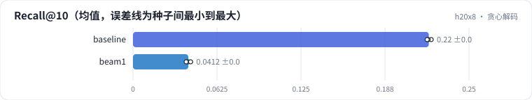
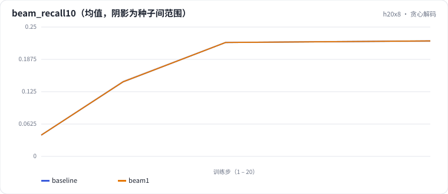

<!-- 本页由 python -m labkit docs 从 ../lesson.yaml 和 results/ 生成，不要手改 -->

[← 先估算](05-estimate.md) · [课程首页](../README.md) · [beam 20 →](07-beam20.md)

# 第 6 步 / 共 16 步：贪心解码

> 阶段 3 / 8：**beam 宽度** · 场景：`beam1`（对照 `baseline`）

同一个模型，beam 从 10 降到 1（每步取概率最高的 token）。只改推理。

## 这一步跑了什么

| 场景 | 作用 | 说明 | 相对基线改了什么 | 种子（H20） |
| - | - | - | - | - |
| `baseline` | 对照 | 基线：3 × 64 + 去重位，trie 约束，beam 10 | — | 3 |
| `beam1` | 本步 | 贪心解码（beam 1） | `beam=1` | 3 |

## 先预测

**贪心解码的 Recall@10 是 beam 10 的几倍？**

- **A.** 不到 0.5 倍
- **B.** 0.5 - 0.9 倍
- **C.** 0.9 倍以上

> 先选定一个（记下来），再展开下面的实测。Recall@10 在 6040 个测试用户上的抽样标准误约 0.005；均值差小于 0.01 或小于种子间波动，都按“差不多”算。

## 实测

展开实测：H20 · ML-1M · 语义 ID 3 × 64 + 去重位 · encoder-decoder（4 + 2 层）· 3 种子（已有 6 / 6 个运行）

| 场景 | 类型 | Recall@10 | 每用户候选数 | 解码 ms/用户 | Recall@10：与 `baseline` 差 | Recall@10：各种子 | 断言 |
| - | - | - | - | - | - | - | - |
| `baseline` | 基线 | 0.220 ± 0.002 | 10.0 ± 0.0 | 0.113 ± 0.000 | — | s0 0.222 / s1 0.220 / s2 0.219 | 通过 |
| `beam1` | 候选改动 | 0.041 ± 0.002 | 1.0 ± 0.0 | 0.047 ± 0.000 | -0.179 | s0 0.041 / s1 0.040 / s2 0.043 | 通过 |

运行目录（每个目录里有 `summary.json` 指标、`evidence.json` 证据摘要、`predictions.jsonl` 逐条预测、`log.txt` 日志）：

- `baseline` [s0](../../../results/h20x8/R04/baseline/s0-1eaff1/) · [s1](../../../results/h20x8/R04/baseline/s1-e8343c/) · [s2](../../../results/h20x8/R04/baseline/s2-24d603/)
- `beam1` [s0](../../../results/h20x8/R04/beam1/s0-0ac832/) · [s1](../../../results/h20x8/R04/beam1/s1-0668cf/) · [s2](../../../results/h20x8/R04/beam1/s2-22b049/)

## 看完实测再想一步

beam 扫描曲线是在哪一段变平的？

---

[← 先估算](05-estimate.md) · [课程首页](../README.md) · [beam 20 →](07-beam20.md)
