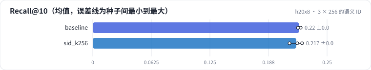

<!-- 本页由 python -m labkit docs 从 ../lesson.yaml 和 results/ 生成，不要手改 -->

[← 不加 trie](08-notrie.md) · [课程首页](../README.md) · [内容向量做的 ID →](10-content.md)

# 第 9 步 / 共 16 步：3 × 256 的语义 ID

> 阶段 5 / 8：**ID 质量** · 场景：`sid_k256`（对照 `baseline`）

语义 ID 换成 3 × 256：碰撞更少、词表 3 倍。重新训练模型。

## 这一步跑了什么

| 场景 | 作用 | 说明 | 相对基线改了什么 | 种子（H20） |
| - | - | - | - | - |
| `baseline` | 对照 | 基线：3 × 64 + 去重位，trie 约束，beam 10 | — | 3 |
| `sid_k256` | 本步 | 语义 ID 3 × 256 | `sid_k=256` | 3 |

## 先预测

**Recall@10 和 3 × 64 比怎样？**

- **A.** 低 0.01 以上
- **B.** 差不多（±0.01）
- **C.** 高 0.01 以上

> 先选定一个（记下来），再展开下面的实测。Recall@10 在 6040 个测试用户上的抽样标准误约 0.005；均值差小于 0.01 或小于种子间波动，都按“差不多”算。

## 实测

展开实测：H20 · ML-1M · 语义 ID 3 × 64 + 去重位 · encoder-decoder（4 + 2 层）· 3 种子（已有 6 / 6 个运行）

| 场景 | 类型 | Recall@10 | 碰撞率 | 词表 | Recall@10：与 `baseline` 差 | Recall@10：各种子 | 断言 |
| - | - | - | - | - | - | - | - |
| `baseline` | 基线 | 0.220 ± 0.002 | 21.2% ± 0.0% | 370 ± 0 | — | s0 0.222 / s1 0.220 / s2 0.219 | 通过 |
| `sid_k256` | 候选改动 | 0.217 ± 0.007 | 7.4% ± 0.0% | 894 ± 0 | -0.003 | s0 0.223 / s1 0.218 / s2 0.210 |  |

运行目录（每个目录里有 `summary.json` 指标、`evidence.json` 证据摘要、`predictions.jsonl` 逐条预测、`log.txt` 日志）：

- `baseline` [s0](../../../results/h20x8/R04/baseline/s0-1eaff1/) · [s1](../../../results/h20x8/R04/baseline/s1-e8343c/) · [s2](../../../results/h20x8/R04/baseline/s2-24d603/)
- `sid_k256` [s0](../../../results/h20x8/R04/sid_k256/s0-9da37f/) · [s1](../../../results/h20x8/R04/sid_k256/s1-8a2d16/) · [s2](../../../results/h20x8/R04/sid_k256/s2-5e11ab/)

---

[← 不加 trie](08-notrie.md) · [课程首页](../README.md) · [内容向量做的 ID →](10-content.md)
