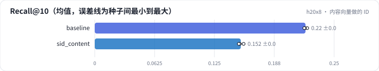

<!-- 本页由 python -m labkit docs 从 ../lesson.yaml 和 results/ 生成，不要手改 -->

[← 3 × 256 的语义 ID](09-k256.md) · [课程首页](../README.md) · [随机向量做的 ID →](11-random.md)

# 第 10 步 / 共 16 步：内容向量做的 ID

> 阶段 5 / 8：**ID 质量** · 场景：`sid_content`（对照 `baseline`）

语义 ID 换成用内容向量（Qwen2.5-0.5B 读片名 + 类型）量化。前缀对应"类型相似"而不是"被连着看"。

## 这一步跑了什么

| 场景 | 作用 | 说明 | 相对基线改了什么 | 种子（H20） |
| - | - | - | - | - |
| `baseline` | 对照 | 基线：3 × 64 + 去重位，trie 约束，beam 10 | — | 3 |
| `sid_content` | 本步 | 用内容向量（Qwen2.5-0.5B）做语义 ID | `item_repr=qwen` | 3 |

## 先预测

**Recall@10 和协同 ID 比怎样？**

- **A.** 低 0.01 以上
- **B.** 差不多（±0.01）
- **C.** 高 0.01 以上

> 先选定一个（记下来），再展开下面的实测。Recall@10 在 6040 个测试用户上的抽样标准误约 0.005；均值差小于 0.01 或小于种子间波动，都按“差不多”算。

## 实测

展开实测：H20 · ML-1M · 语义 ID 3 × 64 + 去重位 · encoder-decoder（4 + 2 层）· 3 种子（已有 6 / 6 个运行）

| 场景 | 类型 | Recall@10 | 碰撞率 | Recall@10：与 `baseline` 差 | Recall@10：各种子 | 断言 |
| - | - | - | - | - | - | - |
| `baseline` | 基线 | 0.220 ± 0.002 | 21.2% ± 0.0% | — | s0 0.222 / s1 0.220 / s2 0.219 | 通过 |
| `sid_content` | 候选改动 | 0.152 ± 0.003 | 14.6% ± 0.0% | -0.068 | s0 0.155 / s1 0.151 / s2 0.150 |  |

运行目录（每个目录里有 `summary.json` 指标、`evidence.json` 证据摘要、`predictions.jsonl` 逐条预测、`log.txt` 日志）：

- `baseline` [s0](../../../results/h20x8/R04/baseline/s0-1eaff1/) · [s1](../../../results/h20x8/R04/baseline/s1-e8343c/) · [s2](../../../results/h20x8/R04/baseline/s2-24d603/)
- `sid_content` [s0](../../../results/h20x8/R04/sid_content/s0-30b80b/) · [s1](../../../results/h20x8/R04/sid_content/s1-935f01/) · [s2](../../../results/h20x8/R04/sid_content/s2-781e47/)

---

[← 3 × 256 的语义 ID](09-k256.md) · [课程首页](../README.md) · [随机向量做的 ID →](11-random.md)
