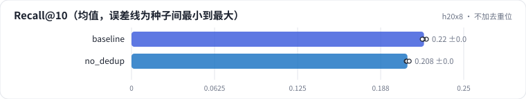

<!-- 本页由 python -m labkit docs 从 ../lesson.yaml 和 results/ 生成，不要手改 -->

[← 随机向量做的 ID](11-random.md) · [课程首页](../README.md) · [和 SASRec 比 →](13-sasrec.md)

# 第 12 步 / 共 16 步：不加去重位

> 阶段 5 / 8：**ID 质量** · 场景：`no_dedup`（对照 `baseline`）

不追加去重位：每个物品只有 3 个 token。解出一个码组合后，如果桶里有多部电影，按热度依次填进结果。

## 这一步跑了什么

| 场景 | 作用 | 说明 | 相对基线改了什么 | 种子（H20） |
| - | - | - | - | - |
| `baseline` | 对照 | 基线：3 × 64 + 去重位，trie 约束，beam 10 | — | 3 |
| `no_dedup` | 本步 | 不追加去重位：解出一个码组合后按热度把桶里的物品依次填进结果 | `collision=none` | 3 |

## 先预测

**Recall@10 和有去重位比怎样？**

- **A.** 低 0.01 以上
- **B.** 差不多（±0.01）
- **C.** 高 0.01 以上

> 先选定一个（记下来），再展开下面的实测。Recall@10 在 6040 个测试用户上的抽样标准误约 0.005；均值差小于 0.01 或小于种子间波动，都按“差不多”算。

## 实测

展开实测：H20 · ML-1M · 语义 ID 3 × 64 + 去重位 · encoder-decoder（4 + 2 层）· 3 种子（已有 6 / 6 个运行）

| 场景 | 类型 | Recall@10 | 目标在碰撞桶里 | 解码 ms/用户 | Recall@10：与 `baseline` 差 | Recall@10：各种子 | 断言 |
| - | - | - | - | - | - | - | - |
| `baseline` | 基线 | 0.220 ± 0.002 | 10.0% ± 0.0% | 0.113 ± 0.000 | — | s0 0.222 / s1 0.220 / s2 0.219 | 通过 |
| `no_dedup` | 候选改动 | 0.208 ± 0.001 | 10.0% ± 0.0% | 0.086 ± 0.000 | -0.012 | s0 0.207 / s1 0.207 / s2 0.209 |  |

运行目录（每个目录里有 `summary.json` 指标、`evidence.json` 证据摘要、`predictions.jsonl` 逐条预测、`log.txt` 日志）：

- `baseline` [s0](../../../results/h20x8/R04/baseline/s0-1eaff1/) · [s1](../../../results/h20x8/R04/baseline/s1-e8343c/) · [s2](../../../results/h20x8/R04/baseline/s2-24d603/)
- `no_dedup` [s0](../../../results/h20x8/R04/no_dedup/s0-07c8cb/) · [s1](../../../results/h20x8/R04/no_dedup/s1-c12189/) · [s2](../../../results/h20x8/R04/no_dedup/s2-f120cd/)

---

[← 随机向量做的 ID](11-random.md) · [课程首页](../README.md) · [和 SASRec 比 →](13-sasrec.md)
