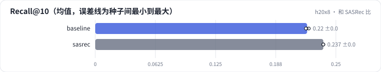

<!-- 本页由 python -m labkit docs 从 ../lesson.yaml 和 results/ 生成，不要手改 -->

[← 不加去重位](12-nodedup.md) · [课程首页](../README.md) · [同事改了 beam search →](14-fault.md)

# 第 13 步 / 共 16 步：和 SASRec 比

> 阶段 6 / 8：**和 SASRec 比** · 场景：`sasrec`（对照 `baseline`）

参照：SASRec（和 R01 基线同一套代码）对全部 3706 部电影打分取 Top-10。

## 这一步跑了什么

| 场景 | 作用 | 说明 | 相对基线改了什么 | 种子（H20） |
| - | - | - | - | - |
| `baseline` | 对照 | 基线：3 × 64 + 去重位，trie 约束，beam 10 | — | 3 |
| `sasrec` | 本步 | SASRec 对全部物品打分（和 R01 基线同一套代码） | `method=sasrec` | 3 |

## 先预测

**SASRec 和生成式召回比，Recall@10 怎样？**

- **A.** SASRec 高 0.02 以上
- **B.** 差不多（±0.02）
- **C.** 生成式召回高 0.02 以上

> 先选定一个（记下来），再展开下面的实测。Recall@10 在 6040 个测试用户上的抽样标准误约 0.005；均值差小于 0.01 或小于种子间波动，都按“差不多”算。

## 实测

展开实测：H20 · ML-1M · 语义 ID 3 × 64 + 去重位 · encoder-decoder（4 + 2 层）· 3 种子（已有 6 / 6 个运行）

| 场景 | 类型 | Recall@10 | NDCG@10 | ms/用户 | Recall@10：与 `baseline` 差 | Recall@10：各种子 | 断言 |
| - | - | - | - | - | - | - | - |
| `baseline` | 基线 | 0.220 ± 0.002 | 0.124 ± 0.002 | 0.113 ± 0.000 | — | s0 0.222 / s1 0.220 / s2 0.219 | 通过 |
| `sasrec` | 参照 | 0.237 ± 0.000 | 0.132 ± 0.000 | 0.019 ± 0.002 | +0.017 | s0 0.237 / s1 0.237 / s2 0.237 |  |

运行目录（每个目录里有 `summary.json` 指标、`evidence.json` 证据摘要、`predictions.jsonl` 逐条预测、`log.txt` 日志）：

- `baseline` [s0](../../../results/h20x8/R04/baseline/s0-1eaff1/) · [s1](../../../results/h20x8/R04/baseline/s1-e8343c/) · [s2](../../../results/h20x8/R04/baseline/s2-24d603/)
- `sasrec` [s0](../../../results/h20x8/R04/sasrec/s0-68a873/) · [s1](../../../results/h20x8/R04/sasrec/s1-a8ce1a/) · [s2](../../../results/h20x8/R04/sasrec/s2-95389e/)

---

[← 不加去重位](12-nodedup.md) · [课程首页](../README.md) · [同事改了 beam search →](14-fault.md)
