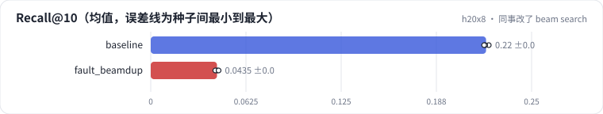

<!-- 本页由 python -m labkit docs 从 ../lesson.yaml 和 results/ 生成，不要手改 -->

[← 和 SASRec 比](13-sasrec.md) · [课程首页](../README.md) · [诊断：模型没变，召回为什么掉了 →](15-diagnose.md)

# 第 14 步 / 共 16 步：同事改了 beam search

> 阶段 7 / 8：**故障** · 场景：`fault_beamdup`（对照 `baseline`）

同事重构 beam search 时把初始化写成了 score = torch.zeros(B, W)——"所有 beam 一开始都是 0 分，很合理"。模型没动（同一个训练好的模型），只改了推理代码。

## 这一步跑了什么

| 场景 | 作用 | 说明 | 相对基线改了什么 | 种子（H20） |
| - | - | - | - | - |
| `baseline` | 对照 | 基线：3 × 64 + 去重位，trie 约束，beam 10 | — | 3 |
| `fault_beamdup` | 本步 | beam 的初始分数全设成 0 | `beam_init=all_zero` | 3 |

## 先预测

**Recall@10 是基线的几倍？**

- **A.** 不到 0.5 倍
- **B.** 0.5 - 0.9 倍
- **C.** 0.9 倍以上

> 先选定一个（记下来），再展开下面的实测。Recall@10 在 6040 个测试用户上的抽样标准误约 0.005；均值差小于 0.01 或小于种子间波动，都按“差不多”算。

## 实测

展开实测：H20 · ML-1M · 语义 ID 3 × 64 + 去重位 · encoder-decoder（4 + 2 层）· 3 种子（已有 6 / 6 个运行）

| 场景 | 类型 | Recall@10 | 不重复物品 | 候选数 | Recall@10：与 `baseline` 差 | Recall@10：各种子 | 断言 |
| - | - | - | - | - | - | - | - |
| `baseline` | 基线 | 0.220 ± 0.002 | 10.0 ± 0.0 | 10.0 ± 0.0 | — | s0 0.222 / s1 0.220 / s2 0.219 | 通过 |
| `fault_beamdup` | 教学故障 | 0.043 ± 0.001 | 1.1 ± 0.0 | 1.1 ± 0.0 | -0.177 | s0 0.044 / s1 0.042 / s2 0.045 | 通过 |

运行目录（每个目录里有 `summary.json` 指标、`evidence.json` 证据摘要、`predictions.jsonl` 逐条预测、`log.txt` 日志）：

- `baseline` [s0](../../../results/h20x8/R04/baseline/s0-1eaff1/) · [s1](../../../results/h20x8/R04/baseline/s1-e8343c/) · [s2](../../../results/h20x8/R04/baseline/s2-24d603/)
- `fault_beamdup` [s0](../../../results/h20x8/R04/fault_beamdup/s0-991eda/) · [s1](../../../results/h20x8/R04/fault_beamdup/s1-066075/) · [s2](../../../results/h20x8/R04/fault_beamdup/s2-bafaf3/)

---

[← 和 SASRec 比](13-sasrec.md) · [课程首页](../README.md) · [诊断：模型没变，召回为什么掉了 →](15-diagnose.md)
