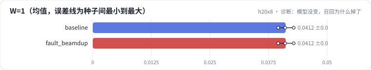

<!-- 本页由 python -m labkit docs 从 ../lesson.yaml 和 results/ 生成，不要手改 -->

[← 同事改了 beam search](14-fault.md) · [课程首页](../README.md) · [回顾 →](16-keycard.md)

# 第 15 步 / 共 16 步：诊断：模型没变，召回为什么掉了

> 阶段 7 / 8：**故障** · 场景：`fault_beamdup`（对照 `baseline`）

模型是同一个（训练缓存命中），只改了 beam search 的初始化。按需逐级点开线索，然后点选根因。

## 这一步跑了什么

| 场景 | 作用 | 说明 | 相对基线改了什么 | 种子（H20） |
| - | - | - | - | - |
| `baseline` | 对照 | 基线：3 × 64 + 去重位，trie 约束，beam 10 | — | 3 |
| `fault_beamdup` | 本步 | beam 的初始分数全设成 0 | `beam_init=all_zero` | 3 |

## 线索

逐条展开，看到能下判断为止。

线索 1

beam 扫描：W = 1 / 10 / 20 时 Recall 0.041 ± 0.002 / 0.043 ± 0.001 / 0.043 ± 0.001；基线 0.041 ± 0.002 / 0.220 ± 0.002 / 0.223 ± 0.002。

线索 2

每用户不重复物品数：故障 1.1 ± 0.0，基线 10.0 ± 0.0；非法元组 0.0% ± 0.0%。

线索 3

看追踪里同一个用户的 10 条 beam：token 元组和分数是否完全相同。

## 先预测

**根因是什么？**

- **A.** trie 掩码错了
- **B.** beam 初始分数全为 0，同一个前缀被扩展了 W 次，W 条 beam 完全相同
- **C.** 模型坍缩到热门物品
- **D.** 去重位让碰撞的物品无法区分

> 先选定一个（记下来），再展开下面的实测。Recall@10 在 6040 个测试用户上的抽样标准误约 0.005；均值差小于 0.01 或小于种子间波动，都按“差不多”算。

## 实测

展开实测：H20 · ML-1M · 语义 ID 3 × 64 + 去重位 · encoder-decoder（4 + 2 层）· 3 种子（已有 6 / 6 个运行）

| 场景 | 类型 | W=1 | W=10 | W=20 | 不重复物品 | W=1：与 `baseline` 差 | W=1：各种子 | 断言 |
| - | - | - | - | - | - | - | - | - |
| `baseline` | 基线 | 0.041 ± 0.002 | 0.220 ± 0.002 | 0.223 ± 0.002 | 10.0 ± 0.0 | — | s0 0.041 / s1 0.040 / s2 0.043 | 通过 |
| `fault_beamdup` | 教学故障 | 0.041 ± 0.002 | 0.043 ± 0.001 | 0.043 ± 0.001 | 1.1 ± 0.0 | +0.000 | s0 0.041 / s1 0.040 / s2 0.043 | 通过 |

运行目录（每个目录里有 `summary.json` 指标、`evidence.json` 证据摘要、`predictions.jsonl` 逐条预测、`log.txt` 日志）：

- `baseline` [s0](../../../results/h20x8/R04/baseline/s0-1eaff1/) · [s1](../../../results/h20x8/R04/baseline/s1-e8343c/) · [s2](../../../results/h20x8/R04/baseline/s2-24d603/)
- `fault_beamdup` [s0](../../../results/h20x8/R04/fault_beamdup/s0-991eda/) · [s1](../../../results/h20x8/R04/fault_beamdup/s1-066075/) · [s2](../../../results/h20x8/R04/fault_beamdup/s2-bafaf3/)

---

[← 同事改了 beam search](14-fault.md) · [课程首页](../README.md) · [回顾 →](16-keycard.md)
