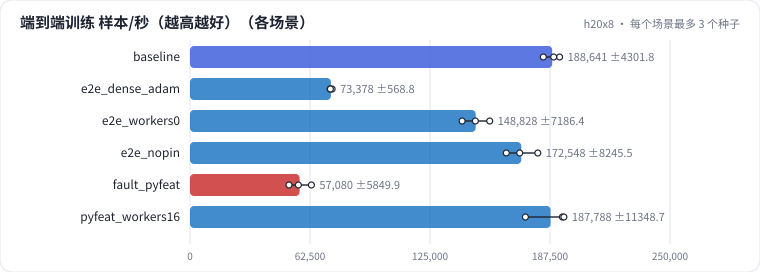

# R05 Embedding 与数据管线：查表的有效带宽、表规模与精度、SparseAdam 与稠密 Adam、端到端逐阶段耗时

推荐训练的瓶颈常常不在矩阵乘：Embedding 查表是随机读、受带宽限制；稠密 Adam 每步要读写整张表和两份状态；数据管线跟不上时 GPU 在等。在 H20 上测查表的有效带宽、表规模与精度的显存、Zipf 热点的影响、SparseAdam 与稠密 Adam，再看一个 28 张表的 DLRM 每一步的时间花在哪。最后诊断一次"Python 逐样本特征处理饿死 GPU"。

## 怎么学（只看 GitHub 就够）

按下面“步骤”表从第 1 步往下点。每一页先给问题和选项，**先选定一个再展开“实测”**；实测里有结果表、证据图和运行目录链接。作业进度见 [作业看板](../../jobs/README.md)。参考答案和解析只在私有工作台里。

## 任务

**出发点**：精排模型的参数 99% 在 Embedding 表里，FLOPs 却大多在 MLP。训练慢、扩不上去时，团队常先想"换更快的卡"，但瓶颈可能在：

| 环节 | 可能的瓶颈 | 这一课量什么 |
| - | - | - |
| 查表 | 随机读 HBM，带宽受限 | 有效带宽、bag 长度、Zipf 热点 |
| 表规模 | 显存放不下 | 行数 × 维度 × 精度的显存 |
| 优化器 | 稠密 Adam 每步读写整张表 | SparseAdam 对 Adam 的每步耗时、状态显存 |
| 数据管线 | CPU 特征处理跟不上 | 端到端逐阶段耗时、等数据占比 |

端到端模型：DLRM，13 个数值特征、26 个单值类别特征、2 个长度 50 的多值特征，每张表 100 万 × 64，batch 4096。

## 规模与边界

- **H20 档**：H20（96 GB HBM，标称 4.0 TB/s、bf16 稠密 148 TFLOPS）；每次计时前冲刷 L2、取中位数；同一张卡上不并发跑别的作业；每个场景 3 个种子（只影响随机输入）。
- **保留了**：EmbeddingBag 查表、稀疏梯度和 SparseAdam、DataLoader 多进程 + 锁页内存、dot interaction。
- **缩小了**：单卡；表只有千万行级；特征处理只有取模哈希和 log1p。
- **未验证**：多卡的表分片（TorchRec 的 table-wise / row-wise sharding）和 all-to-all 通信；UVM / CPU 卸载；真实日志解析的 CPU 开销。

## 步骤

<!-- labkit:path -->
| # | 阶段 | 步骤 | 这一步回答的问题 | 场景 | H20 结果 |
| - | - | - | - | - | - |
| 1 | 理解任务 | [场景与痛点](steps/01-pain.md) | 推荐训练慢，时间到底花在查表、优化器、还是等数据上？ | — | — |
| 2 | 理解任务 | [流程结构](steps/02-flow.md) |  | — | — |
| 3 | 理解任务 | [追踪](steps/03-trace.md) |  | — | — |
| 4 | 理解任务 | [代码导读](steps/04-code.md) |  | — | — |
| 5 | 先估算 | [先估算](steps/05-estimate.md) | EmbeddingBag 求和（每个 id 读 64 个 fp32、做 64 次加法），算术强度大约多少 FLOP/B？ | — | — |
| 6 | 查表 | [bag 长度与有效带宽](steps/06-bw.md) | bag 50 的有效带宽是 bag 1 的几倍？ | `baseline` | 3 / 3 |
| 7 | 查表 | [Zipf 热点](steps/07-zipf.md) | Zipf 分布下查表耗时是均匀分布的多少？ | `baseline` | 3 / 3 |
| 8 | 查表 | [表规模与精度](steps/08-grid.md) | 1 亿 × 128 × fp32 的表能放进 H20 吗？ | `grid` | 3 / 3 |
| 9 | 优化器 | [SparseAdam 对稠密 Adam](steps/09-optim.md) | 稠密 Adam 每步耗时是 SparseAdam 的几倍？ | `baseline` | 3 / 3 |
| 10 | 优化器 | [端到端换稠密 Adam](steps/10-e2e-dense.md) | 端到端吞吐（样本/秒）是 SparseAdam 的多少？ | `e2e_dense_adam` | 3 / 3 |
| 11 | 数据管线 | [一步的时间花在哪](steps/11-stages.md) | 哪个阶段占比最大？ | `baseline` | 3 / 3 |
| 12 | 数据管线 | [不开 worker](steps/12-workers0.md) | 端到端吞吐是基线的多少？ | `e2e_workers0` | 3 / 3 |
| 13 | 数据管线 | [不锁页、阻塞拷贝](steps/13-nopin.md) | 拷到 GPU 这一阶段的耗时是基线的几倍？ | `e2e_nopin` | 3 / 3 |
| 14 | 故障 | [同事改了特征处理](steps/14-fault.md) | 端到端吞吐是基线的多少？ | `fault_pyfeat` | 3 / 3 |
| 15 | 故障 | [诊断：GPU 在等什么](steps/15-diagnose.md) | 根因是什么？ | `fault_pyfeat` | 3 / 3 |
| 16 | 故障 | [加 worker 能救吗](steps/16-fix.md) | 端到端吞吐能恢复到基线的多少？ | `pyfeat_workers16` | 3 / 3 |
| 17 | 带走 | [回顾](steps/17-keycard.md) |  | — | — |
<!-- /labkit:path -->

## 场景与结果

<!-- labkit:results -->

展开结果（先自己预测，再看）

**h20x8**：8 × NVIDIA H20，每张卡一个运行（同一张卡上不并发，避免互相抢带宽）。微基准用随机输入；端到端是 26 + 2 张表（每张 100 万 × 64）的 DLRM（已有 21 / 21 个运行）

| 场景 | 类型 | 端到端 样本/秒 | 等数据占比 | 优化器占比 | 查表有效带宽 GB/s | 稠密 ÷ 稀疏 每步耗时 | 断言 |
| - | - | - | - | - | - | - | - |
| `baseline` | 基线 | 188640.6333 ± 4301.8086 (n=3) | 0.0078 ± 0.0002 (n=3) | 0.7564 ± 0.0013 (n=3) | 715.4667 ± 2.5658 (n=3) | 13.1100 ± 0.0600 (n=3) | 通过 |
| `grid` | 参照 | — | — | — | — | — |  |
| `e2e_dense_adam` | 候选改动 | 73377.7000 ± 568.7658 (n=3) | 0.0046 ± 0.0004 (n=3) | 0.8187 ± 0.0029 (n=3) | — | — |  |
| `e2e_workers0` | 候选改动 | 148828.0333 ± 7186.3888 (n=3) | 0.3381 ± 0.2289 (n=3) | 0.4709 ± 0.1606 (n=3) | — | — |  |
| `e2e_nopin` | 候选改动 | 172547.9333 ± 8245.5343 (n=3) | 0.0835 ± 0.0084 (n=3) | 0.6583 ± 0.0091 (n=3) | — | — |  |
| `fault_pyfeat` | 教学故障 | 57079.8333 ± 5849.8724 (n=3) | 0.4751 ± 0.3997 (n=3) | 0.3762 ± 0.2910 (n=3) | — | — | 未通过 |
| `pyfeat_workers16` | 候选改动 | 187788.2000 ± 11348.7087 (n=3) | 0.0104 ± 0.0011 (n=3) | 0.7263 ± 0.0228 (n=3) | — | — |  |

<!-- /labkit:results -->

## 证据图

<!-- labkit:figures -->

展开证据图（先自己预测，再看）

- **h20x8**：[主指标](figures/h20x8-metrics.svg)

  

<!-- /labkit:figures -->

## 代码

<!-- labkit:code -->
| 代码段 | 位置 |
| - | - |
| `naive` | [projects/recops/attn.py#L24](../../projects/recops/attn.py#L24) |
| `triton_kernel` | [projects/recops/attn.py#L58](../../projects/recops/attn.py#L58) |
| `block_mirror` | [projects/recops/attn.py#L123](../../projects/recops/attn.py#L123) |
| `accounting` | [projects/recops/attn.py#L169](../../projects/recops/attn.py#L169) |
| `timer` | [projects/recops/bench.py#L30](../../projects/recops/bench.py#L30) |
| `roofline` | [projects/recops/bench.py#L108](../../projects/recops/bench.py#L108) |
| `emb_bench` | [projects/recops/embops.py#L33](../../projects/recops/embops.py#L33) |
| `optim` | [projects/recops/embops.py#L74](../../projects/recops/embops.py#L74) |
| `feature_proc` | [projects/recops/embops.py#L124](../../projects/recops/embops.py#L124) |
| `dlrm` | [projects/recops/embops.py#L190](../../projects/recops/embops.py#L190) |
| `e2e` | [projects/recops/embops.py#L218](../../projects/recops/embops.py#L218) |
<!-- /labkit:code -->
