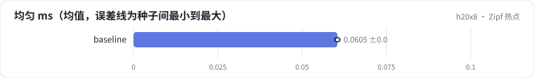

<!-- 本页由 python -m labkit docs 从 ../lesson.yaml 和 results/ 生成，不要手改 -->

[← bag 长度与有效带宽](06-bw.md) · [课程首页](../README.md) · [表规模与精度 →](08-grid.md)

# 第 7 步 / 共 17 步：Zipf 热点

> 阶段 3 / 7：**查表** · 场景：`baseline`

同样 bag 10，id 换成 Zipf 分布（α = 1.05）：少数热门 id 反复出现，读过的行可能还在 L2 里（H20 的 L2 是 60 MB）。

## 这一步跑了什么

| 场景 | 作用 | 说明 | 相对基线改了什么 | 种子（H20） |
| - | - | - | - | - |
| `baseline` | 本步 | 基线：查表微基准（1000 万 × 64 fp32，bag 1 / 10 / 50，均匀与 Zipf）、SparseAdam 与 Adam、数据管线、端到端 DLRM | — | 3 |

## 先预测

**Zipf 分布下查表耗时是均匀分布的多少？**

- **A.** 不到 50%
- **B.** 50% - 90%
- **C.** 90% 以上

> 先选定一个（记下来），再展开下面的实测。微基准的种子只影响随机输入；耗时差小于 10% 或小于种子间波动，都按“差不多”算。

## 实测

展开实测：H20 · 微基准 + 28 张表的 DLRM · 3 种子（已有 3 / 3 个运行）

| 场景 | 类型 | 均匀 ms | Zipf ms | Zipf 不重复 id | 均匀 ms：各种子 | 断言 |
| - | - | - | - | - | - | - |
| `baseline` | 基线 | 0.0605 ± 0.0002 | 0.0484 ± 0.0001 | 22.0% ± 0.1% | s0 0.0606 / s1 0.0602 / s2 0.0605 | 通过 |

运行目录（每个目录里有 `summary.json` 指标、`evidence.json` 证据摘要、`predictions.jsonl` 逐条预测、`log.txt` 日志）：

- `baseline` [s0](../../../results/h20x8/R05/baseline/s0-6c6d33/) · [s1](../../../results/h20x8/R05/baseline/s1-3c85f1/) · [s2](../../../results/h20x8/R05/baseline/s2-de361b/)

---

[← bag 长度与有效带宽](06-bw.md) · [课程首页](../README.md) · [表规模与精度 →](08-grid.md)
