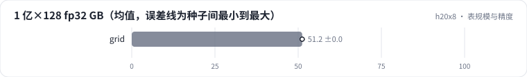

<!-- 本页由 python -m labkit docs 从 ../lesson.yaml 和 results/ 生成，不要手改 -->

[← Zipf 热点](07-zipf.md) · [课程首页](../README.md) · [SparseAdam 对稠密 Adam →](09-optim.md)

# 第 8 步 / 共 17 步：表规模与精度

> 阶段 3 / 7：**查表** · 场景：`grid`

表从 100 万行到 1 亿行，维度 64 / 128，精度 fp32 / bf16。每个组合都测显存和 bag 10 的查表耗时。

## 这一步跑了什么

| 场景 | 作用 | 说明 | 相对基线改了什么 | 种子（H20） |
| - | - | - | - | - |
| `grid` | 本步 | 表规模 × 维度 × 精度（100 万 / 1000 万 / 1 亿行 × 64 / 128 × fp32 / bf16） | `parts=grid` | 3 |

## 先预测

**1 亿 × 128 × fp32 的表能放进 H20 吗？**

- **A.** 能，查表耗时和小表差不多
- **B.** 能，但查表明显变慢
- **C.** 放不下（OOM）

> 先选定一个（记下来），再展开下面的实测。微基准的种子只影响随机输入；耗时差小于 10% 或小于种子间波动，都按“差不多”算。

## 实测

展开实测：H20 · 微基准 + 28 张表的 DLRM · 3 种子（已有 3 / 3 个运行）

| 场景 | 类型 | 1 亿×128 fp32 GB | 1 亿×128 fp32 ms | 1 亿×128 bf16 ms | 100 万×128 fp32 ms | 1 亿×128 fp32 GB：各种子 | 断言 |
| - | - | - | - | - | - | - | - |
| `grid` | 参照 | 51.2 ± 0.0 | 0.1094 ± 0.0000 | 0.1003 ± 0.0001 | 0.1078 ± 0.0001 | s0 51.2 / s1 51.2 / s2 51.2 |  |

运行目录（每个目录里有 `summary.json` 指标、`evidence.json` 证据摘要、`predictions.jsonl` 逐条预测、`log.txt` 日志）：

- `grid` [s0](../../../results/h20x8/R05/grid/s0-f22ee9/) · [s1](../../../results/h20x8/R05/grid/s1-478ed6/) · [s2](../../../results/h20x8/R05/grid/s2-e1829d/)

---

[← Zipf 热点](07-zipf.md) · [课程首页](../README.md) · [SparseAdam 对稠密 Adam →](09-optim.md)
