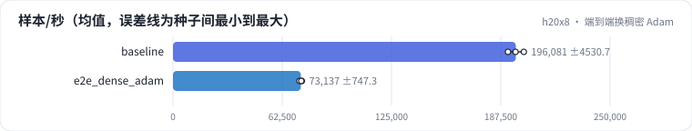

<!-- 本页由 python -m labkit docs 从 ../lesson.yaml 和 results/ 生成，不要手改 -->

[← SparseAdam 对稠密 Adam](09-optim.md) · [课程首页](../README.md) · [一步的时间花在哪 →](11-stages.md)

# 第 10 步 / 共 17 步：端到端换稠密 Adam

> 阶段 4 / 7：**优化器** · 场景：`e2e_dense_adam`（对照 `baseline`）

端到端 DLRM（28 张表，每张 100 万 × 64，共 7.2 GB）的表从 SparseAdam 换成稠密 Adam。

## 这一步跑了什么

| 场景 | 作用 | 说明 | 相对基线改了什么 | 种子（H20） |
| - | - | - | - | - |
| `baseline` | 对照 | 基线：查表微基准（1000 万 × 64 fp32，bag 1 / 10 / 50，均匀与 Zipf）、SparseAdam 与 Adam、数据管线、端到端 DLRM | — | 3 |
| `e2e_dense_adam` | 本步 | 端到端改用稠密梯度 + Adam | `parts=e2e`, `emb_optim=adam` | 3 |

## 先预测

**端到端吞吐（样本/秒）是 SparseAdam 的多少？**

- **A.** 不到 30%
- **B.** 30% - 80%
- **C.** 80% 以上

> 先选定一个（记下来），再展开下面的实测。微基准的种子只影响随机输入；耗时差小于 10% 或小于种子间波动，都按“差不多”算。

## 实测

展开实测：H20 · 微基准 + 28 张表的 DLRM · 3 种子（已有 6 / 6 个运行）

| 场景 | 类型 | 样本/秒 | 优化器占比 | 优化器状态 GB | 峰值 GB | 样本/秒：与 `baseline` 差 | 样本/秒：各种子 | 断言 |
| - | - | - | - | - | - | - | - | - |
| `baseline` | 基线 | 188,641 ± 4,302 | 75.6% ± 0.1% | 14.3 ± 0.0 | 22.2 ± 0.0 | — | s0 184,006 / s1 192,506 / s2 189,410 | 通过 |
| `e2e_dense_adam` | 候选改动 | 73,378 ± 569 | 81.9% ± 0.3% | 14.3 ± 0.0 | 36.0 ± 0.0 | -115,263 | s0 72,968 / s1 74,027 / s2 73,138 |  |

运行目录（每个目录里有 `summary.json` 指标、`evidence.json` 证据摘要、`predictions.jsonl` 逐条预测、`log.txt` 日志）：

- `baseline` [s0](../../../results/h20x8/R05/baseline/s0-6c6d33/) · [s1](../../../results/h20x8/R05/baseline/s1-3c85f1/) · [s2](../../../results/h20x8/R05/baseline/s2-de361b/)
- `e2e_dense_adam` [s0](../../../results/h20x8/R05/e2e_dense_adam/s0-991937/) · [s1](../../../results/h20x8/R05/e2e_dense_adam/s1-ecf43d/) · [s2](../../../results/h20x8/R05/e2e_dense_adam/s2-6ec47b/)

---

[← SparseAdam 对稠密 Adam](09-optim.md) · [课程首页](../README.md) · [一步的时间花在哪 →](11-stages.md)
