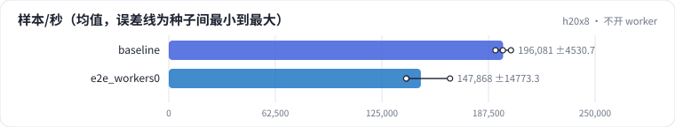

<!-- 本页由 python -m labkit docs 从 ../lesson.yaml 和 results/ 生成，不要手改 -->

[← 一步的时间花在哪](11-stages.md) · [课程首页](../README.md) · [不锁页、阻塞拷贝 →](13-nopin.md)

# 第 12 步 / 共 17 步：不开 worker

> 阶段 5 / 7：**数据管线** · 场景：`e2e_workers0`（对照 `baseline`）

DataLoader 的 num_workers 设成 0：主进程自己取数和处理，取数时 GPU 不工作（不能重叠）。特征处理仍然是向量化的。

## 这一步跑了什么

| 场景 | 作用 | 说明 | 相对基线改了什么 | 种子（H20） |
| - | - | - | - | - |
| `baseline` | 对照 | 基线：查表微基准（1000 万 × 64 fp32，bag 1 / 10 / 50，均匀与 Zipf）、SparseAdam 与 Adam、数据管线、端到端 DLRM | — | 3 |
| `e2e_workers0` | 本步 | 端到端 DataLoader 不开 worker（主进程取数） | `parts=loader,e2e`, `num_workers=0` | 3 |

## 先预测

**端到端吞吐是基线的多少？**

- **A.** 不到 50%
- **B.** 50% - 90%
- **C.** 90% 以上

> 先选定一个（记下来），再展开下面的实测。微基准的种子只影响随机输入；耗时差小于 10% 或小于种子间波动，都按“差不多”算。

## 实测

展开实测：H20 · 微基准 + 28 张表的 DLRM · 3 种子（已有 6 / 6 个运行）

| 场景 | 类型 | 样本/秒 | 等数据 ms | 处理一批 ms | 样本/秒：与 `baseline` 差 | 样本/秒：各种子 | 断言 |
| - | - | - | - | - | - | - | - |
| `baseline` | 基线 | 196,081 ± 4,531 | 0.12 ± 0.01 | 5.89 ± 0.22 | — | s0 200,678 / s1 191,620 / s2 195,945 | 通过 |
| `e2e_workers0` | 候选改动 | 147,868 ± 14,773 | 3.42 ± 0.20 | 3.82 ± 0.19 | -48,213 | s0 164,927 / s1 139,425 / s2 139,254 |  |

运行目录（每个目录里有 `summary.json` 指标、`evidence.json` 证据摘要、`predictions.jsonl` 逐条预测、`log.txt` 日志）：

- `baseline` [s0](../../../results/h20x8/R05/baseline/s0-6c6d33/) · [s1](../../../results/h20x8/R05/baseline/s1-3c85f1/) · [s2](../../../results/h20x8/R05/baseline/s2-de361b/)
- `e2e_workers0` [s0](../../../results/h20x8/R05/e2e_workers0/s0-0d9e3b/) · [s1](../../../results/h20x8/R05/e2e_workers0/s1-12776f/) · [s2](../../../results/h20x8/R05/e2e_workers0/s2-84d631/)

---

[← 一步的时间花在哪](11-stages.md) · [课程首页](../README.md) · [不锁页、阻塞拷贝 →](13-nopin.md)
