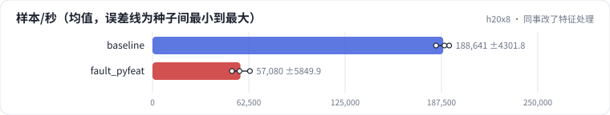

<!-- 本页由 python -m labkit docs 从 ../lesson.yaml 和 results/ 生成，不要手改 -->

[← 不锁页、阻塞拷贝](13-nopin.md) · [课程首页](../README.md) · [诊断：GPU 在等什么 →](15-diagnose.md)

# 第 14 步 / 共 17 步：同事改了特征处理

> 阶段 6 / 7：**故障** · 场景：`fault_pyfeat`（对照 `baseline`）

同事给特征处理加了一个新规则，顺手把整批 numpy 改成了"更好读"的逐样本、逐特征 Python 循环。结果在单元测试里完全一致。上线训练后，nvidia-smi 里 GPU 利用率时高时低。

## 这一步跑了什么

| 场景 | 作用 | 说明 | 相对基线改了什么 | 种子（H20） |
| - | - | - | - | - |
| `baseline` | 对照 | 基线：查表微基准（1000 万 × 64 fp32，bag 1 / 10 / 50，均匀与 Zipf）、SparseAdam 与 Adam、数据管线、端到端 DLRM | — | 3 |
| `fault_pyfeat` | 本步 | 特征处理改成逐样本、逐特征的 Python 循环 | `parts=loader,e2e`, `feature_proc=python` | 3 |

## 先预测

**端到端吞吐是基线的多少？**

- **A.** 不到 30%
- **B.** 30% - 70%
- **C.** 70% 以上

> 先选定一个（记下来），再展开下面的实测。微基准的种子只影响随机输入；耗时差小于 10% 或小于种子间波动，都按“差不多”算。

## 实测

展开实测：H20 · 微基准 + 28 张表的 DLRM · 3 种子（已有 6 / 6 个运行）

| 场景 | 类型 | 样本/秒 | 等数据占比 | 样本/秒：与 `baseline` 差 | 样本/秒：各种子 | 断言 |
| - | - | - | - | - | - | - |
| `baseline` | 基线 | 188,641 ± 4,302 | 0.8% ± 0.0% | — | s0 184,006 / s1 192,506 / s2 189,410 | 通过 |
| `fault_pyfeat` | 教学故障 | 57,080 ± 5,850 | 47.5% ± 40.0% | -131,561 | s0 51,564 / s1 63,215 / s2 56,460 | 未通过 |

运行目录（每个目录里有 `summary.json` 指标、`evidence.json` 证据摘要、`predictions.jsonl` 逐条预测、`log.txt` 日志）：

- `baseline` [s0](../../../results/h20x8/R05/baseline/s0-6c6d33/) · [s1](../../../results/h20x8/R05/baseline/s1-3c85f1/) · [s2](../../../results/h20x8/R05/baseline/s2-de361b/)
- `fault_pyfeat` [s0](../../../results/h20x8/R05/fault_pyfeat/s0-f862e9/) · [s1](../../../results/h20x8/R05/fault_pyfeat/s1-9ed8f1/) · [s2](../../../results/h20x8/R05/fault_pyfeat/s2-16aee2/)

---

[← 不锁页、阻塞拷贝](13-nopin.md) · [课程首页](../README.md) · [诊断：GPU 在等什么 →](15-diagnose.md)
