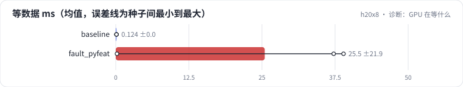

<!-- 本页由 python -m labkit docs 从 ../lesson.yaml 和 results/ 生成，不要手改 -->

[← 同事改了特征处理](14-fault.md) · [课程首页](../README.md) · [加 worker 能救吗 →](16-fix.md)

# 第 15 步 / 共 17 步：诊断：GPU 在等什么

> 阶段 6 / 7：**故障** · 场景：`fault_pyfeat`（对照 `baseline`）

模型和优化器都没变。按需逐级点开线索，然后点选根因。

## 这一步跑了什么

| 场景 | 作用 | 说明 | 相对基线改了什么 | 种子（H20） |
| - | - | - | - | - |
| `baseline` | 对照 | 基线：查表微基准（1000 万 × 64 fp32，bag 1 / 10 / 50，均匀与 Zipf）、SparseAdam 与 Adam、数据管线、端到端 DLRM | — | 3 |
| `fault_pyfeat` | 本步 | 特征处理改成逐样本、逐特征的 Python 循环 | `parts=loader,e2e`, `feature_proc=python` | 3 |

## 线索

逐条展开，看到能下判断为止。

线索 1

逐阶段耗时：等数据 25.5 ± 21.9 ms（基线 0.12 ± 0.00），前向反向 4.3 ± 0.2 ms（基线 3.6 ± 0.1）。

线索 2

只取数不训练：管线每秒 74,174 ± 400 个样本（基线 1,909,221 ± 36,205）；处理一批 174 ± 5 ms（基线 5.1 ± 0.9）。

线索 3

worker 数 2 ± 0：每批平均要多久才能产出？和 GPU 一步比呢？

## 先预测

**根因是什么？**

- **A.** PCIe 带宽不够
- **B.** GPU 被别的进程占用
- **C.** CPU 上逐样本的 Python 特征处理太慢，worker 跟不上，GPU 在等数据
- **D.** Embedding 表太大

> 先选定一个（记下来），再展开下面的实测。微基准的种子只影响随机输入；耗时差小于 10% 或小于种子间波动，都按“差不多”算。

## 实测

展开实测：H20 · 微基准 + 28 张表的 DLRM · 3 种子（已有 6 / 6 个运行）

| 场景 | 类型 | 等数据 ms | 前向反向 ms | 管线 样本/秒 | 处理一批 ms | 等数据 ms：与 `baseline` 差 | 等数据 ms：各种子 | 断言 |
| - | - | - | - | - | - | - | - | - |
| `baseline` | 基线 | 0.1 ± 0.0 | 3.6 ± 0.1 | 1,909,221 ± 36,205 | 5.1 ± 0.9 | — | s0 0.1 / s1 0.1 / s2 0.1 | 通过 |
| `fault_pyfeat` | 教学故障 | 25.5 ± 21.9 | 4.3 ± 0.2 | 74,174 ± 400 | 173.6 ± 4.6 | +25.4 | s0 39.0 / s1 37.3 / s2 0.2 | 未通过 |

运行目录（每个目录里有 `summary.json` 指标、`evidence.json` 证据摘要、`predictions.jsonl` 逐条预测、`log.txt` 日志）：

- `baseline` [s0](../../../results/h20x8/R05/baseline/s0-6c6d33/) · [s1](../../../results/h20x8/R05/baseline/s1-3c85f1/) · [s2](../../../results/h20x8/R05/baseline/s2-de361b/)
- `fault_pyfeat` [s0](../../../results/h20x8/R05/fault_pyfeat/s0-f862e9/) · [s1](../../../results/h20x8/R05/fault_pyfeat/s1-9ed8f1/) · [s2](../../../results/h20x8/R05/fault_pyfeat/s2-16aee2/)

---

[← 同事改了特征处理](14-fault.md) · [课程首页](../README.md) · [加 worker 能救吗 →](16-fix.md)
