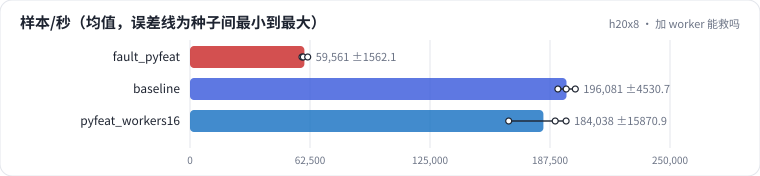

<!-- 本页由 python -m labkit docs 从 ../lesson.yaml 和 results/ 生成，不要手改 -->

[← 诊断：GPU 在等什么](15-diagnose.md) · [课程首页](../README.md) · [回顾 →](17-keycard.md)

# 第 16 步 / 共 17 步：加 worker 能救吗

> 阶段 6 / 7：**故障** · 场景：`pyfeat_workers16`（对照 `fault_pyfeat`）

不改代码，Python 特征处理保持不变，把 worker 从 2 个加到 16 个。

## 这一步跑了什么

| 场景 | 作用 | 说明 | 相对基线改了什么 | 种子（H20） |
| - | - | - | - | - |
| `fault_pyfeat` | 对照 | 特征处理改成逐样本、逐特征的 Python 循环 | `parts=loader,e2e`, `feature_proc=python` | 3 |
| `baseline` | 参照 | 基线：查表微基准（1000 万 × 64 fp32，bag 1 / 10 / 50，均匀与 Zipf）、SparseAdam 与 Adam、数据管线、端到端 DLRM | — | 3 |
| `pyfeat_workers16` | 本步 | Python 特征处理，worker 加到 16 | `parts=loader,e2e`, `feature_proc=python`, `num_workers=16` | 3 |

## 先预测

**端到端吞吐能恢复到基线的多少？**

- **A.** 不到 50%
- **B.** 50% - 90%
- **C.** 90% 以上

> 先选定一个（记下来），再展开下面的实测。微基准的种子只影响随机输入；耗时差小于 10% 或小于种子间波动，都按“差不多”算。

## 实测

展开实测：H20 · 微基准 + 28 张表的 DLRM · 3 种子（已有 9 / 9 个运行）

| 场景 | 类型 | 样本/秒 | 等数据占比 | 实际 worker | 样本/秒：与 `fault_pyfeat` 差 | 样本/秒：各种子 | 断言 |
| - | - | - | - | - | - | - | - |
| `fault_pyfeat` | 教学故障 | 59,561 ± 1,562 | 79.7% ± 2.4% | 2 ± 0 | — | s0 58,344 / s1 59,017 / s2 61,322 | 通过 |
| `baseline` | 基线 | 196,081 ± 4,531 | 0.8% ± 0.0% | 2 ± 0 | +136,520 | s0 200,678 / s1 191,620 / s2 195,945 | 通过 |
| `pyfeat_workers16` | 候选改动 | 184,038 ± 15,871 | 1.1% ± 0.1% | 16 ± 0 | +124,477 | s0 190,201 / s1 166,010 / s2 195,902 |  |

运行目录（每个目录里有 `summary.json` 指标、`evidence.json` 证据摘要、`predictions.jsonl` 逐条预测、`log.txt` 日志）：

- `fault_pyfeat` [s0](../../../results/h20x8/R05/fault_pyfeat/s0-f862e9/) · [s1](../../../results/h20x8/R05/fault_pyfeat/s1-9ed8f1/) · [s2](../../../results/h20x8/R05/fault_pyfeat/s2-16aee2/)
- `baseline` [s0](../../../results/h20x8/R05/baseline/s0-6c6d33/) · [s1](../../../results/h20x8/R05/baseline/s1-3c85f1/) · [s2](../../../results/h20x8/R05/baseline/s2-de361b/)
- `pyfeat_workers16` [s0](../../../results/h20x8/R05/pyfeat_workers16/s0-b0aa42/) · [s1](../../../results/h20x8/R05/pyfeat_workers16/s1-252df1/) · [s2](../../../results/h20x8/R05/pyfeat_workers16/s2-e3b55d/)

---

[← 诊断：GPU 在等什么](15-diagnose.md) · [课程首页](../README.md) · [回顾 →](17-keycard.md)
