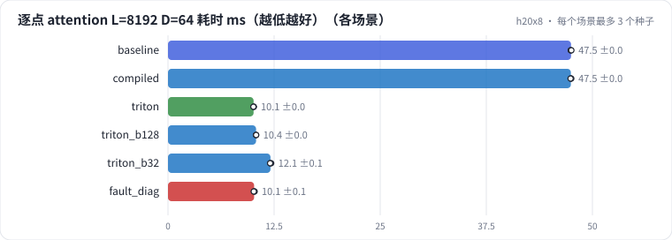

# R06 序列 attention 的融合 kernel：naive / SDPA / torch.compile / Triton，softmax 与逐点打分，roofline，对角块的因果 mask

序列推荐的 attention 有两种打分：标准 softmax（SASRec）和 HSTU 的逐点 SiLU + 相对位置偏置。在 H20 上比较四种实现——PyTorch 逐步（物化 L × L）、SDPA（flash，只支持 softmax）、torch.compile、手写 Triton 融合 kernel——的耗时、显存、误差，以及块大小的影响，放到 roofline 上看离上限多远；再看 attention 在一个 HSTU 层里占多少。最后诊断一次"对角块内漏了因果 mask"。

## 怎么学（只看 GitHub 就够）

按下面“步骤”表从第 1 步往下点。每一页先给问题和选项，**先选定一个再展开“实测”**；实测里有结果表、证据图和运行目录链接。作业进度见 [作业看板](../../jobs/README.md)。参考答案和解析只在私有工作台里。

## 任务

**出发点**：长序列推荐（R02）里 attention 占了绝大部分计算。softmax 打分有现成的 flash kernel（SDPA），但 HSTU 这种逐点打分加相对位置偏置的变体，SDPA 不支持：要么用 PyTorch 逐步算（物化 L × L，显存爆炸），要么指望 torch.compile 自动融合，要么自己写 kernel。

| 实现 | softmax | pointwise | 显存 |
| - | - | - | - |
| naive（PyTorch 逐步） | ✓ | ✓ | O(L²) |
| SDPA（flash） | ✓ | ✗ | O(L) |
| torch.compile(naive) | ✓ | ✓ | 看编译器能不能融合 |
| 手写 Triton | ✓ | ✓ | O(L) |

测试规模：B = 4、H = 8，L = 512 / 2048 / 8192（另加 2000：不是块大小的倍数），D = 64 / 128，bf16。

## 规模与边界

- **H20 档**：bf16；每次计时前冲刷 L2、CUDA event 计时、取中位数；误差和 fp32 的 naive 参照比；每个场景 3 个种子（只影响随机输入）。
- **保留了**：因果 mask、online softmax、逐点打分的块间独立、相对位置偏置查表、右侧整块跳过。
- **缩小了**：只有前向；没有 jagged（变长）输入；没有 autotune。
- **未验证**：反向 kernel、jagged 版本、和 HSTU 官方 Triton 实现的对比。

## 步骤

<!-- labkit:path -->
| # | 阶段 | 步骤 | 这一步回答的问题 | 场景 | H20 结果 |
| - | - | - | - | - | - |
| 1 | 理解任务 | [场景与痛点](steps/01-pain.md) | HSTU 的逐点 attention 用不了 SDPA，写 kernel 值不值、怎么验证写对了？ | — | — |
| 2 | 理解任务 | [流程结构](steps/02-flow.md) |  | — | — |
| 3 | 理解任务 | [追踪](steps/03-trace.md) |  | — | — |
| 4 | 理解任务 | [代码导读](steps/04-code.md) |  | — | — |
| 5 | 先估算 | [先估算](steps/05-estimate.md) | L = 8192 时，naive 实现的一个 [B, H, L, L] bf16 中间张量多大？ | — | — |
| 6 | 四种实现 | [naive 的显存](steps/06-naive-mem.md) | L = 8192 时 naive 逐点 attention 的增量峰值显存大约多少？ | `baseline` | 3 / 3 |
| 7 | 四种实现 | [SDPA](steps/07-sdpa.md) | L = 8192 时 SDPA 比 naive softmax 快几倍？ | `sdpa` | 3 / 3 |
| 8 | 四种实现 | [torch.compile](steps/08-compile.md) | L = 8192 逐点打分，torch.compile 的增量显存比 naive 少多少？ | `compiled` | 3 / 3 |
| 9 | 四种实现 | [手写 Triton](steps/09-triton.md) | L = 8192 逐点打分，Triton 比 naive 快几倍？ | `triton` | 3 / 3 |
| 10 | 块大小与 roofline | [块大小](steps/10-block.md) | L = 8192 逐点打分，BLOCK_M = 128 比 64 快多少？ | `triton_b128` | 3 / 3 |
| 11 | 块大小与 roofline | [离 roofline 多远](steps/11-roofline.md) | 它达到了 roofline 上限的多少？ | `triton` | 3 / 3 |
| 12 | 块大小与 roofline | [attention 在整层里占多少](steps/12-layer.md) | 用 Triton kernel 时，attention 占整层前向耗时的多少？ | `triton` | 3 / 3 |
| 13 | 故障 | [同事改了 kernel](steps/13-fault.md) | 和 fp32 参照比，最大相对误差会是多少？ | `fault_diag` | 3 / 3 |
| 14 | 故障 | [诊断：哪里看到了未来](steps/14-diagnose.md) | 根因是什么？ | `fault_diag` | 3 / 3 |
| 15 | 带走 | [回顾](steps/15-keycard.md) |  | — | — |
<!-- /labkit:path -->

## 场景与结果

<!-- labkit:results -->

展开结果（先自己预测，再看）

**h20x8**：8 × NVIDIA H20，每张卡一个运行。随机输入 B = 4、H = 8，L = 512 / 2048 / 8192 和 2000（非块倍数），D = 64 / 128，bf16；每次计时前冲刷 L2，取中位数（已有 21 / 21 个运行）

| 场景 | 类型 | softmax L=8192 ms | 逐点 L=8192 ms | 逐点 L=8192 增量显存 GB | 逐点 L=8192 占 roofline | 最大相对误差 | HSTU 层里 attention 占比 | 断言 |
| - | - | - | - | - | - | - | - | - |
| `baseline` | 基线 | 42.4896 ± 0.0141 (n=3) | 47.4755 ± 0.0410 (n=3) | 22.0789 ± 0.0000 (n=3) | 0.0912 ± 0.0001 (n=3) | 0.0049 ± 0.0000 (n=3) | 0.9062 ± 0.0003 (n=3) | 通过 |
| `sdpa` | 候选改动 | 2.0994 ± 0.0084 (n=3) | — | — | — | 0.0021 ± 0.0000 (n=3) | 0.9061 ± 0.0002 (n=3) | 通过 |
| `compiled` | 候选改动 | 9.7813 ± 0.0099 (n=3) | 47.4633 ± 0.0448 (n=3) | 22.0789 ± 0.0000 (n=3) | 0.0912 ± 0.0001 (n=3) | 0.0043 ± 0.0003 (n=3) | 0.9062 ± 0.0005 (n=3) |  |
| `triton` | 修复 | 2.2050 ± 0.0020 (n=3) | 10.0848 ± 0.0218 (n=3) | 0.0336 ± 0.0000 (n=3) | 0.1842 ± 0.0004 (n=3) | 0.0024 ± 0.0000 (n=3) | 0.6999 ± 0.0019 (n=3) | 通过 |
| `triton_b128` | 候选改动 | 2.2784 ± 0.0100 (n=3) | 10.3729 ± 0.0075 (n=3) | 0.0336 ± 0.0000 (n=3) | 0.1790 ± 0.0001 (n=3) | 0.0024 ± 0.0000 (n=3) | 0.7179 ± 0.0028 (n=3) | 通过 |
| `triton_b32` | 候选改动 | 4.9102 ± 0.0205 (n=3) | 12.0765 ± 0.0678 (n=3) | 0.0336 ± 0.0000 (n=3) | 0.1538 ± 0.0009 (n=3) | 0.0024 ± 0.0000 (n=3) | 0.7223 ± 0.0017 (n=3) | 通过 |
| `fault_diag` | 教学故障 | 2.1048 ± 0.0123 (n=3) | 10.1460 ± 0.0551 (n=3) | 0.0336 ± 0.0000 (n=3) | 0.1831 ± 0.0010 (n=3) | 0.7179 ± 0.0027 (n=3) | 0.7047 ± 0.0042 (n=3) | 通过 |

<!-- /labkit:results -->

## 证据图

<!-- labkit:figures -->

展开证据图（先自己预测，再看）

- **h20x8**：[主指标](figures/h20x8-metrics.svg)

  

<!-- /labkit:figures -->

## 代码

<!-- labkit:code -->
| 代码段 | 位置 |
| - | - |
| `naive` | [projects/recops/attn.py#L24](../../projects/recops/attn.py#L24) |
| `triton_kernel` | [projects/recops/attn.py#L58](../../projects/recops/attn.py#L58) |
| `block_mirror` | [projects/recops/attn.py#L123](../../projects/recops/attn.py#L123) |
| `accounting` | [projects/recops/attn.py#L169](../../projects/recops/attn.py#L169) |
| `timer` | [projects/recops/bench.py#L30](../../projects/recops/bench.py#L30) |
| `roofline` | [projects/recops/bench.py#L108](../../projects/recops/bench.py#L108) |
| `emb_bench` | [projects/recops/embops.py#L33](../../projects/recops/embops.py#L33) |
| `optim` | [projects/recops/embops.py#L74](../../projects/recops/embops.py#L74) |
| `feature_proc` | [projects/recops/embops.py#L124](../../projects/recops/embops.py#L124) |
| `dlrm` | [projects/recops/embops.py#L190](../../projects/recops/embops.py#L190) |
| `e2e` | [projects/recops/embops.py#L218](../../projects/recops/embops.py#L218) |
<!-- /labkit:code -->
