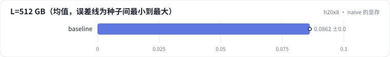

<!-- 本页由 python -m labkit docs 从 ../lesson.yaml 和 results/ 生成，不要手改 -->

[← 先估算](05-estimate.md) · [课程首页](../README.md) · [SDPA →](07-sdpa.md)

# 第 6 步 / 共 15 步：naive 的显存

> 阶段 3 / 6：**四种实现** · 场景：`baseline`

naive 实现，逐点打分，L 从 512 到 8192（16 倍）。看增量峰值显存。

## 这一步跑了什么

| 场景 | 作用 | 说明 | 相对基线改了什么 | 种子（H20） |
| - | - | - | - | - |
| `baseline` | 本步 | 基线：naive（PyTorch 逐步，物化 L × L） | — | 3 |

## 先预测

**L = 8192 时 naive 逐点 attention 的增量峰值显存大约多少？**

- **A.** 不到 1 GB
- **B.** 1 - 10 GB
- **C.** 10 GB 以上

> 先选定一个（记下来），再展开下面的实测。微基准的种子只影响随机输入；耗时差小于 10% 或小于种子间波动，都按“差不多”算。

## 实测

展开实测：H20 · B=4、H=8、L 512-8192、D 64/128、bf16 · 3 种子（已有 3 / 3 个运行）

| 场景 | 类型 | L=512 GB | L=2048 GB | L=8192 GB | L=8192 ms | L=512 GB：各种子 | 断言 |
| - | - | - | - | - | - | - | - |
| `baseline` | 基线 | 0.086 ± 0.000 | 1.38 ± 0.00 | 22.1 ± 0.0 | 47.5 ± 0.0 | s0 0.086 / s1 0.086 / s2 0.086 | 通过 |

运行目录（每个目录里有 `summary.json` 指标、`evidence.json` 证据摘要、`predictions.jsonl` 逐条预测、`log.txt` 日志）：

- `baseline` [s0](../../../results/h20x8/R06/baseline/s0-40f189/) · [s1](../../../results/h20x8/R06/baseline/s1-1f0960/) · [s2](../../../results/h20x8/R06/baseline/s2-db5062/)

---

[← 先估算](05-estimate.md) · [课程首页](../README.md) · [SDPA →](07-sdpa.md)
