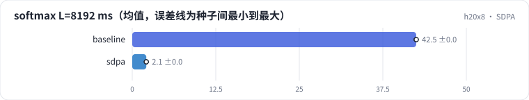

<!-- 本页由 python -m labkit docs 从 ../lesson.yaml 和 results/ 生成，不要手改 -->

[← naive 的显存](06-naive-mem.md) · [课程首页](../README.md) · [torch.compile →](08-compile.md)

# 第 7 步 / 共 15 步：SDPA

> 阶段 3 / 6：**四种实现** · 场景：`sdpa`（对照 `baseline`）

softmax 打分换成 PyTorch SDPA（is_causal=True，走 flash 后端）。SDPA 不支持逐点打分，这个场景只测 softmax。

## 这一步跑了什么

| 场景 | 作用 | 说明 | 相对基线改了什么 | 种子（H20） |
| - | - | - | - | - |
| `baseline` | 对照 | 基线：naive（PyTorch 逐步，物化 L × L） | — | 3 |
| `sdpa` | 本步 | PyTorch SDPA（flash，只有 softmax） | `attn_impl=sdpa`, `attn_kinds=softmax` | 3 |

## 先预测

**L = 8192 时 SDPA 比 naive softmax 快几倍？**

- **A.** 不到 3 倍
- **B.** 3 - 10 倍
- **C.** 10 倍以上

> 先选定一个（记下来），再展开下面的实测。微基准的种子只影响随机输入；耗时差小于 10% 或小于种子间波动，都按“差不多”算。

## 实测

展开实测：H20 · B=4、H=8、L 512-8192、D 64/128、bf16 · 3 种子（已有 6 / 6 个运行）

| 场景 | 类型 | softmax L=8192 ms | 增量显存 GB | TFLOPS | softmax L=8192 ms：与 `baseline` 差 | softmax L=8192 ms：各种子 | 断言 |
| - | - | - | - | - | - | - | - |
| `baseline` | 基线 | 42.49 ± 0.01 | 21.54 ± 0.00 | 6.5 ± 0.0 | — | s0 42.48 / s1 42.48 / s2 42.51 | 通过 |
| `sdpa` | 候选改动 | 2.10 ± 0.01 | 0.03 ± 0.00 | 130.9 ± 0.5 | -40.39 | s0 2.09 / s1 2.10 / s2 2.10 | 通过 |

运行目录（每个目录里有 `summary.json` 指标、`evidence.json` 证据摘要、`predictions.jsonl` 逐条预测、`log.txt` 日志）：

- `baseline` [s0](../../../results/h20x8/R06/baseline/s0-40f189/) · [s1](../../../results/h20x8/R06/baseline/s1-1f0960/) · [s2](../../../results/h20x8/R06/baseline/s2-db5062/)
- `sdpa` [s0](../../../results/h20x8/R06/sdpa/s0-5091ca/) · [s1](../../../results/h20x8/R06/sdpa/s1-544b80/) · [s2](../../../results/h20x8/R06/sdpa/s2-a59ffe/)

---

[← naive 的显存](06-naive-mem.md) · [课程首页](../README.md) · [torch.compile →](08-compile.md)
