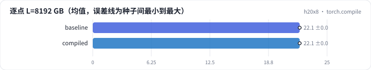

<!-- 本页由 python -m labkit docs 从 ../lesson.yaml 和 results/ 生成，不要手改 -->

[← SDPA](07-sdpa.md) · [课程首页](../README.md) · [手写 Triton →](09-triton.md)

# 第 8 步 / 共 15 步：torch.compile

> 阶段 3 / 6：**四种实现** · 场景：`compiled`（对照 `baseline`）

不改代码，把 naive 交给 torch.compile。编译器（Inductor）会把逐元素操作融合起来，但 QKᵀ 和 AV 两个矩阵乘之间的 L × L 张量能不能消掉，要看它能不能识别出整个 attention 模式。

## 这一步跑了什么

| 场景 | 作用 | 说明 | 相对基线改了什么 | 种子（H20） |
| - | - | - | - | - |
| `baseline` | 对照 | 基线：naive（PyTorch 逐步，物化 L × L） | — | 3 |
| `compiled` | 本步 | torch.compile(naive) | `attn_impl=compiled` | 3 |

## 先预测

**L = 8192 逐点打分，torch.compile 的增量显存比 naive 少多少？**

- **A.** 少不到一半
- **B.** 少一半到 90%
- **C.** 少 90% 以上

> 先选定一个（记下来），再展开下面的实测。微基准的种子只影响随机输入；耗时差小于 10% 或小于种子间波动，都按“差不多”算。

## 实测

展开实测：H20 · B=4、H=8、L 512-8192、D 64/128、bf16 · 3 种子（已有 6 / 6 个运行）

| 场景 | 类型 | 逐点 L=8192 GB | 逐点 L=8192 ms | 逐点 L=8192 GB：与 `baseline` 差 | 逐点 L=8192 GB：各种子 | 断言 |
| - | - | - | - | - | - | - |
| `baseline` | 基线 | 22.08 ± 0.00 | 47.5 ± 0.0 | — | s0 22.08 / s1 22.08 / s2 22.08 | 通过 |
| `compiled` | 候选改动 | 22.08 ± 0.00 | 47.5 ± 0.0 | +0.00 | s0 22.08 / s1 22.08 / s2 22.08 |  |

运行目录（每个目录里有 `summary.json` 指标、`evidence.json` 证据摘要、`predictions.jsonl` 逐条预测、`log.txt` 日志）：

- `baseline` [s0](../../../results/h20x8/R06/baseline/s0-40f189/) · [s1](../../../results/h20x8/R06/baseline/s1-1f0960/) · [s2](../../../results/h20x8/R06/baseline/s2-db5062/)
- `compiled` [s0](../../../results/h20x8/R06/compiled/s0-089e64/) · [s1](../../../results/h20x8/R06/compiled/s1-388c07/) · [s2](../../../results/h20x8/R06/compiled/s2-6eb699/)

---

[← SDPA](07-sdpa.md) · [课程首页](../README.md) · [手写 Triton →](09-triton.md)
