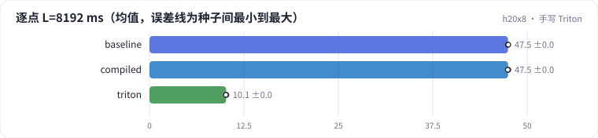

<!-- 本页由 python -m labkit docs 从 ../lesson.yaml 和 results/ 生成，不要手改 -->

[← torch.compile](08-compile.md) · [课程首页](../README.md) · [块大小 →](10-block.md)

# 第 9 步 / 共 15 步：手写 Triton

> 阶段 3 / 6：**四种实现** · 场景：`triton`（对照 `baseline`）

手写的 Triton 融合 kernel（块 64 × 64、4 warp、2 级流水），逐点和 softmax 两种打分。每个结果都和 fp32 参照比相对误差。

## 这一步跑了什么

| 场景 | 作用 | 说明 | 相对基线改了什么 | 种子（H20） |
| - | - | - | - | - |
| `baseline` | 对照 | 基线：naive（PyTorch 逐步，物化 L × L） | — | 3 |
| `compiled` | 参照 | torch.compile(naive) | `attn_impl=compiled` | 3 |
| `triton` | 本步 | 手写 Triton 融合 kernel（块 64 × 64） | `attn_impl=triton` | 3 |

## 先预测

**L = 8192 逐点打分，Triton 比 naive 快几倍？**

- **A.** 不到 3 倍
- **B.** 3 - 10 倍
- **C.** 10 倍以上

> 先选定一个（记下来），再展开下面的实测。微基准的种子只影响随机输入；耗时差小于 10% 或小于种子间波动，都按“差不多”算。

## 实测

展开实测：H20 · B=4、H=8、L 512-8192、D 64/128、bf16 · 3 种子（已有 9 / 9 个运行）

| 场景 | 类型 | 逐点 L=8192 ms | 增量显存 GB | L=2000 相对误差 | 最大相对误差 | 逐点 L=8192 ms：与 `baseline` 差 | 逐点 L=8192 ms：各种子 | 断言 |
| - | - | - | - | - | - | - | - | - |
| `baseline` | 基线 | 47.46 ± 0.03 | 22.079 ± 0.000 | 0.0038 ± 0.0004 | 0.0049 ± 0.0000 | — | s0 47.43 / s1 47.45 / s2 47.50 | 通过 |
| `compiled` | 候选改动 | 47.47 ± 0.04 | 22.079 ± 0.000 | 0.0038 ± 0.0004 | 0.0043 ± 0.0003 | +0.01 | s0 47.51 / s1 47.46 / s2 47.44 |  |
| `triton` | 修复 | 10.14 ± 0.03 | 0.034 ± 0.000 | 0.0024 ± 0.0000 | 0.0024 ± 0.0000 | -37.32 | s0 10.13 / s1 10.18 / s2 10.12 | 通过 |

运行目录（每个目录里有 `summary.json` 指标、`evidence.json` 证据摘要、`predictions.jsonl` 逐条预测、`log.txt` 日志）：

- `baseline` [s0](../../../results/h20x8/R06/baseline/s0-40f189/) · [s1](../../../results/h20x8/R06/baseline/s1-1f0960/) · [s2](../../../results/h20x8/R06/baseline/s2-db5062/)
- `compiled` [s0](../../../results/h20x8/R06/compiled/s0-089e64/) · [s1](../../../results/h20x8/R06/compiled/s1-388c07/) · [s2](../../../results/h20x8/R06/compiled/s2-6eb699/)
- `triton` [s0](../../../results/h20x8/R06/triton/s0-5ec4eb/) · [s1](../../../results/h20x8/R06/triton/s1-03f178/) · [s2](../../../results/h20x8/R06/triton/s2-03ccb8/)

---

[← torch.compile](08-compile.md) · [课程首页](../README.md) · [块大小 →](10-block.md)
