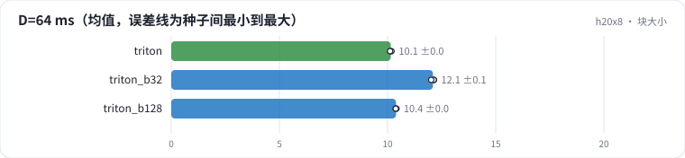

<!-- 本页由 python -m labkit docs 从 ../lesson.yaml 和 results/ 生成，不要手改 -->

[← 手写 Triton](09-triton.md) · [课程首页](../README.md) · [离 roofline 多远 →](11-roofline.md)

# 第 10 步 / 共 15 步：块大小

> 阶段 4 / 6：**块大小与 roofline** · 场景：`triton_b128`（对照 `triton`）

同一个 kernel 换块大小：BLOCK_M 128 + 8 warp，或者 32 × 32。块越大，每块 Q 复用 K / V 的次数越多，但寄存器压力越大、能同时跑的 program 越少。

## 这一步跑了什么

| 场景 | 作用 | 说明 | 相对基线改了什么 | 种子（H20） |
| - | - | - | - | - |
| `triton` | 对照 | 手写 Triton 融合 kernel（块 64 × 64） | `attn_impl=triton` | 3 |
| `triton_b32` | 参照 | Triton，块 32 × 32 | `attn_impl=triton`, `block_m=32`, `block_n=32` | 3 |
| `triton_b128` | 本步 | Triton，块 128 × 64、8 warp | `attn_impl=triton`, `block_m=128`, `num_warps=8` | 3 |

## 先预测

**L = 8192 逐点打分，BLOCK_M = 128 比 64 快多少？**

- **A.** 慢了
- **B.** 差不多（±5%）
- **C.** 快 5% 以上

> 先选定一个（记下来），再展开下面的实测。微基准的种子只影响随机输入；耗时差小于 10% 或小于种子间波动，都按“差不多”算。

## 实测

展开实测：H20 · B=4、H=8、L 512-8192、D 64/128、bf16 · 3 种子（已有 9 / 9 个运行）

| 场景 | 类型 | D=64 ms | D=128 ms | 最大相对误差 | D=64 ms：与 `triton` 差 | D=64 ms：各种子 | 断言 |
| - | - | - | - | - | - | - | - |
| `triton` | 修复 | 10.14 ± 0.03 | 11.63 ± 0.04 | 0.0024 ± 0.0000 | — | s0 10.13 / s1 10.18 / s2 10.12 | 通过 |
| `triton_b32` | 候选改动 | 12.10 ± 0.07 | 14.38 ± 0.06 | 0.0024 ± 0.0000 | +1.95 | s0 12.15 / s1 12.13 / s2 12.01 | 通过 |
| `triton_b128` | 候选改动 | 10.39 ± 0.02 | 15.02 ± 0.02 | 0.0024 ± 0.0000 | +0.25 | s0 10.41 / s1 10.38 / s2 10.38 | 通过 |

运行目录（每个目录里有 `summary.json` 指标、`evidence.json` 证据摘要、`predictions.jsonl` 逐条预测、`log.txt` 日志）：

- `triton` [s0](../../../results/h20x8/R06/triton/s0-5ec4eb/) · [s1](../../../results/h20x8/R06/triton/s1-03f178/) · [s2](../../../results/h20x8/R06/triton/s2-03ccb8/)
- `triton_b32` [s0](../../../results/h20x8/R06/triton_b32/s0-73c426/) · [s1](../../../results/h20x8/R06/triton_b32/s1-15f1be/) · [s2](../../../results/h20x8/R06/triton_b32/s2-d322f3/)
- `triton_b128` [s0](../../../results/h20x8/R06/triton_b128/s0-a925d8/) · [s1](../../../results/h20x8/R06/triton_b128/s1-0c3527/) · [s2](../../../results/h20x8/R06/triton_b128/s2-e7afa1/)

---

[← 手写 Triton](09-triton.md) · [课程首页](../README.md) · [离 roofline 多远 →](11-roofline.md)
