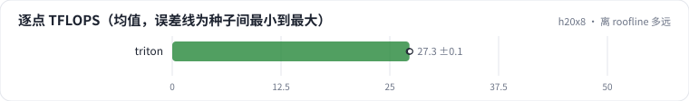

<!-- 本页由 python -m labkit docs 从 ../lesson.yaml 和 results/ 生成，不要手改 -->

[← 块大小](10-block.md) · [课程首页](../README.md) · [attention 在整层里占多少 →](12-layer.md)

# 第 11 步 / 共 15 步：离 roofline 多远

> 阶段 4 / 6：**块大小与 roofline** · 场景：`triton`

Triton 逐点 kernel 在 L = 8192、D = 64 时，算术强度约 2048 FLOP/B，远在拐点右边：上限是 148 TFLOPS。

## 这一步跑了什么

| 场景 | 作用 | 说明 | 相对基线改了什么 | 种子（H20） |
| - | - | - | - | - |
| `sdpa` | 参照 | PyTorch SDPA（flash，只有 softmax） | `attn_impl=sdpa`, `attn_kinds=softmax` | 3 |
| `triton` | 本步 | 手写 Triton 融合 kernel（块 64 × 64） | `attn_impl=triton` | 3 |

## 先预测

**它达到了 roofline 上限的多少？**

- **A.** 不到 20%
- **B.** 20% - 50%
- **C.** 50% 以上

> 先选定一个（记下来），再展开下面的实测。微基准的种子只影响随机输入；耗时差小于 10% 或小于种子间波动，都按“差不多”算。

## 实测

展开实测：H20 · B=4、H=8、L 512-8192、D 64/128、bf16 · 3 种子（已有 6 / 6 个运行）

| 场景 | 类型 | 逐点 TFLOPS | softmax TFLOPS | 逐点占 roofline | 本机矩阵乘 TFLOPS | 逐点 TFLOPS：各种子 | 断言 |
| - | - | - | - | - | - | - | - |
| `sdpa` | 候选改动 | — | 131.6 ± 0.4 | — | 139 ± 0 | — | 通过 |
| `triton` | 修复 | 27.1 ± 0.1 | 124.3 ± 0.7 | 18.3% ± 0.1% | 138 ± 1 | s0 27.1 / s1 27.0 / s2 27.2 | 通过 |

运行目录（每个目录里有 `summary.json` 指标、`evidence.json` 证据摘要、`predictions.jsonl` 逐条预测、`log.txt` 日志）：

- `sdpa` [s0](../../../results/h20x8/R06/sdpa/s0-5091ca/) · [s1](../../../results/h20x8/R06/sdpa/s1-544b80/) · [s2](../../../results/h20x8/R06/sdpa/s2-a59ffe/)
- `triton` [s0](../../../results/h20x8/R06/triton/s0-5ec4eb/) · [s1](../../../results/h20x8/R06/triton/s1-03f178/) · [s2](../../../results/h20x8/R06/triton/s2-03ccb8/)

---

[← 块大小](10-block.md) · [课程首页](../README.md) · [attention 在整层里占多少 →](12-layer.md)
