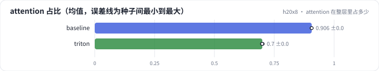

<!-- 本页由 python -m labkit docs 从 ../lesson.yaml 和 results/ 生成，不要手改 -->

[← 离 roofline 多远](11-roofline.md) · [课程首页](../README.md) · [同事改了 kernel →](13-fault.md)

# 第 12 步 / 共 15 步：attention 在整层里占多少

> 阶段 4 / 6：**块大小与 roofline** · 场景：`triton`（对照 `baseline`）

一个 HSTU 层（d_model = 512、8 头、L = 2048）：f1 投影 → 逐点 attention → 门控 → f2 投影，前向。

## 这一步跑了什么

| 场景 | 作用 | 说明 | 相对基线改了什么 | 种子（H20） |
| - | - | - | - | - |
| `baseline` | 对照 | 基线：naive（PyTorch 逐步，物化 L × L） | — | 3 |
| `triton` | 本步 | 手写 Triton 融合 kernel（块 64 × 64） | `attn_impl=triton` | 3 |

## 先预测

**用 Triton kernel 时，attention 占整层前向耗时的多少？**

- **A.** 不到 30%
- **B.** 30% - 60%
- **C.** 60% 以上

> 先选定一个（记下来），再展开下面的实测。微基准的种子只影响随机输入；耗时差小于 10% 或小于种子间波动，都按“差不多”算。

## 实测

展开实测：H20 · B=4、H=8、L 512-8192、D 64/128、bf16 · 3 种子（已有 6 / 6 个运行）

| 场景 | 类型 | attention 占比 | attention ms | 整层 ms | attention 占比：与 `baseline` 差 | attention 占比：各种子 | 断言 |
| - | - | - | - | - | - | - | - |
| `baseline` | 基线 | 90.6% ± 0.0% | 2.95 ± 0.00 | 3.26 ± 0.00 | — | s0 90.6% / s1 90.6% / s2 90.6% | 通过 |
| `triton` | 修复 | 70.0% ± 0.2% | 0.72 ± 0.00 | 1.02 ± 0.00 | -20.6% | s0 69.8% / s1 70.2% / s2 70.0% | 通过 |

运行目录（每个目录里有 `summary.json` 指标、`evidence.json` 证据摘要、`predictions.jsonl` 逐条预测、`log.txt` 日志）：

- `baseline` [s0](../../../results/h20x8/R06/baseline/s0-40f189/) · [s1](../../../results/h20x8/R06/baseline/s1-1f0960/) · [s2](../../../results/h20x8/R06/baseline/s2-db5062/)
- `triton` [s0](../../../results/h20x8/R06/triton/s0-5ec4eb/) · [s1](../../../results/h20x8/R06/triton/s1-03f178/) · [s2](../../../results/h20x8/R06/triton/s2-03ccb8/)

---

[← 离 roofline 多远](11-roofline.md) · [课程首页](../README.md) · [同事改了 kernel →](13-fault.md)
