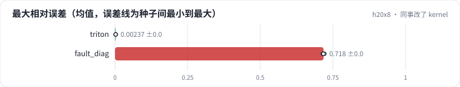

<!-- 本页由 python -m labkit docs 从 ../lesson.yaml 和 results/ 生成，不要手改 -->

[← attention 在整层里占多少](12-layer.md) · [课程首页](../README.md) · [诊断：哪里看到了未来 →](14-diagnose.md)

# 第 13 步 / 共 15 步：同事改了 kernel

> 阶段 5 / 6：**故障** · 场景：`fault_diag`（对照 `triton`）

同事看到 kernel 里"既跳过了右侧整块，又在每块里做因果 mask"，觉得重复了，删掉了块内的因果 mask——"右边的块根本没读，哪来的未来？"。耗时略有下降。

## 这一步跑了什么

| 场景 | 作用 | 说明 | 相对基线改了什么 | 种子（H20） |
| - | - | - | - | - |
| `triton` | 对照 | 手写 Triton 融合 kernel（块 64 × 64） | `attn_impl=triton` | 3 |
| `fault_diag` | 本步 | Triton 的对角块内部没有做因果 mask | `attn_impl=triton`, `diag_causal=False` | 3 |

## 先预测

**和 fp32 参照比，最大相对误差会是多少？**

- **A.** 不到 2%：bf16 噪声
- **B.** 2% - 20%
- **C.** 20% 以上

> 先选定一个（记下来），再展开下面的实测。微基准的种子只影响随机输入；耗时差小于 10% 或小于种子间波动，都按“差不多”算。

## 实测

展开实测：H20 · B=4、H=8、L 512-8192、D 64/128、bf16 · 3 种子（已有 6 / 6 个运行）

| 场景 | 类型 | 最大相对误差 | 逐点 L=8192 误差 | softmax L=512 误差 | 最大相对误差：与 `triton` 差 | 最大相对误差：各种子 | 断言 |
| - | - | - | - | - | - | - | - |
| `triton` | 修复 | 0.002 ± 0.000 | 0.0024 ± 0.0000 | 0.0020 ± 0.0000 | — | s0 0.002 / s1 0.002 / s2 0.002 | 通过 |
| `fault_diag` | 教学故障 | 0.718 ± 0.003 | 0.0795 ± 0.0094 | 0.7170 ± 0.0027 | +0.716 | s0 0.715 / s1 0.721 / s2 0.717 | 通过 |

运行目录（每个目录里有 `summary.json` 指标、`evidence.json` 证据摘要、`predictions.jsonl` 逐条预测、`log.txt` 日志）：

- `triton` [s0](../../../results/h20x8/R06/triton/s0-5ec4eb/) · [s1](../../../results/h20x8/R06/triton/s1-03f178/) · [s2](../../../results/h20x8/R06/triton/s2-03ccb8/)
- `fault_diag` [s0](../../../results/h20x8/R06/fault_diag/s0-bf2daf/) · [s1](../../../results/h20x8/R06/fault_diag/s1-f137de/) · [s2](../../../results/h20x8/R06/fault_diag/s2-030c6d/)

---

[← attention 在整层里占多少](12-layer.md) · [课程首页](../README.md) · [诊断：哪里看到了未来 →](14-diagnose.md)
