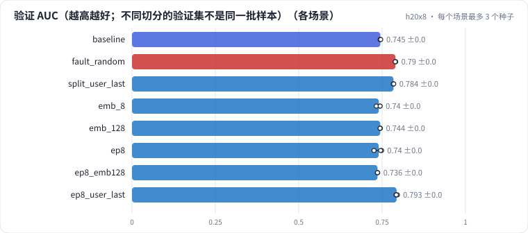

# R0a 推荐训练基线：样本与标签、时间切分、冷启动占比、AUC / GAUC，随机切分的验证虚高

在 MovieLens-1M 上搭一条最朴素的 CTR 训练链路（评分 ≥ 4 记为喜欢，用户 ID + 电影 ID 的 Embedding + MLP，BCE，1 个 epoch），追踪一条样本从 CSV 到 AUC；对比全局时间切分、leave-last-out 和随机切分；看 embedding 维度和 epoch 数的影响。最后诊断一次"随机切分让验证 AUC 涨了 4 个点"。

## 怎么学（只看 GitHub 就够）

按下面“步骤”表从第 1 步往下点。每一页先给问题和选项，**先选定一个再展开“实测”**；实测里有结果表、证据图和运行目录链接。作业进度见 [作业看板](../../jobs/README.md)。参考答案和解析只在私有工作台里。

## 任务

**出发点**：离线 AUC 涨了、线上不涨，最常见的原因不在模型，而在**评估本身**：验证集是怎么切的、里面有多少训练时见不到的用户、训练集里有没有"未来"。这一课先把一条最朴素的 CTR 训练链路走通，再用同一套代码换切分方式，看验证 AUC 会被"切"出多大的差别。

做法：MovieLens-1M（6040 个用户、3706 部电影、100 万条评分，2000-2003 年），评分 ≥ 4 记为喜欢（正例约 58%）。

| 切分 | 训练 / 验证怎么分 | 留出集 |
| - | - | - |
| 全局时间（基线） | 训练 < t80 ≤ 验证 < t90 | 时间 ≥ t90 的行，三种切分**完全相同** |
| leave-last-out | t90 之前，每个用户最后 5 条进验证 | 同上 |
| 随机 | t90 之前的行随机 8:1 | 同上 |

三种切分共用同一个**固定的未来留出集**：它是"线上明天的流量"的替身，换切分时只有它的 AUC 可以横向比较。

## 规模与边界

- **H20 档**：MovieLens-1M 全量；只用用户 ID + 电影 ID，embedding 32 维，MLP 256-128，batch 2048，AdamW lr 1e-3，1 个 epoch（约 390 步）；每个场景 3 个种子。一个运行 1-2 分钟，GPU 基本是空的——这一课不看性能。
- **保留了**：样本、标签、训练集词表（OOV 记 0）、时间切分、AUC / GAUC / LogLoss、按用户 bootstrap、分组指标、参照线。
- **缩小了**：工业 CTR 样本是曝光日志（点击率几个百分点），这里是"评分了的电影里喜不喜欢"（正例 58%）；ID 只有约 1 万个，工业是上亿；没有在线学习。
- **未验证**：曝光偏差、位置偏差；ID 规模大到要分片（TorchRec）之后的训练动态。

## 步骤

<!-- labkit:path -->
| # | 阶段 | 步骤 | 这一步回答的问题 | 场景 | H20 结果 |
| - | - | - | - | - | - |
| 1 | 理解任务 | [场景与痛点](steps/01-pain.md) | 离线 AUC 涨了 4 个点、线上不涨，问题出在模型还是评估？ | — | — |
| 2 | 理解任务 | [流程结构](steps/02-flow.md) |  | — | — |
| 3 | 理解任务 | [追踪一条样本](steps/03-trace.md) |  | — | — |
| 4 | 理解任务 | [代码导读](steps/04-code.md) |  | — | — |
| 5 | 先估算 | [先估算](steps/05-estimate.md) | embedding 表占模型总参数的多少？ | — | — |
| 6 | 切分与验证虚高 | [leave-last-out：每个用户最后 5 条](steps/06-user-last.md) | 和全局时间切分比，验证 AUC 高多少？ | `split_user_last` | 3 / 3 |
| 7 | 切分与验证虚高 | [随机切分](steps/07-fault.md) | 随机切分的"验证 − 留出"AUC 差，比基线的这个差大多少？ | `fault_random` | 3 / 3 |
| 8 | 切分与验证虚高 | [诊断：4 个点从哪来](steps/08-diagnose.md) | 随机切分的验证 AUC 大涨，最主要的原因是什么？ | `fault_random` | 3 / 3 |
| 9 | 容量与 epoch | [embedding 维度 32 → 128](steps/09-emb.md) | d 从 32 到 128，验证 AUC（3 种子均值）会怎样？ | `emb_128` `emb_8` | 6 / 6 |
| 10 | 容量与 epoch | [训 8 个 epoch](steps/10-epochs.md) | 验证 AUC 最高出现在第几个 epoch？（3 种子平均） | `ep8` | 3 / 3 |
| 11 | 容量与 epoch | [8 个 epoch + 128 维](steps/11-epochs-emb.md) | d = 128 时，最后一个 epoch 的验证 AUC 比最好的那个 epoch 低多少？ | `ep8_emb128` | 3 / 3 |
| 12 | 容量与 epoch | [全是老用户时的过拟合](steps/12-epochs-warm.md) | 和全局时间切分（d = 32、8 个 epoch）比，过拟合回落（最好 − 最后）更大吗？ | `ep8_user_last` | 3 / 3 |
| 13 | 带走 | [回顾](steps/13-keycard.md) |  | — | — |
<!-- /labkit:path -->

## 场景与结果

<!-- labkit:results -->

展开结果（先自己预测，再看）

**h20x8**：8 × NVIDIA H20，每张卡一个运行。MovieLens-1M 全量（100 万条评分，rating ≥ 4 记为喜欢）；只用用户 ID + 电影 ID 的 Embedding + MLP（d=32、256-128），1 个 epoch（已有 24 / 24 个运行）

| 场景 | 类型 | 验证 AUC | 验证 GAUC | 留出 AUC（固定未来） | 验证 − 留出 AUC | 验证冷启动用户行占比 | embedding 占比 | 最好 epoch | 训练秒数 | 断言 |
| - | - | - | - | - | - | - | - | - | - | - |
| `baseline` | 基线 | 0.7447 ± 0.0010 (n=3) | 0.7302 ± 0.0002 (n=3) | 0.7531 ± 0.0003 (n=3) | -0.0084 ± 0.0011 (n=3) | 0.7616 ± 0.0000 (n=3) | 0.8538 ± 0.0000 (n=3) | 1.0000 ± 0.0000 (n=3) | 1.2367 ± 0.0208 (n=3) | 通过 |
| `fault_random` | 教学故障 | 0.7899 ± 0.0008 (n=3) | 0.7327 ± 0.0003 (n=3) | 0.7585 ± 0.0004 (n=3) | 0.0314 ± 0.0010 (n=3) | 0.0000 ± 0.0000 (n=3) | 0.8618 ± 0.0000 (n=3) | 1.0000 ± 0.0000 (n=3) | 1.2433 ± 0.0153 (n=3) | 通过 |
| `split_user_last` | 候选改动 | 0.7841 ± 0.0007 (n=3) | 0.6734 ± 0.0020 (n=3) | 0.7595 ± 0.0004 (n=3) | 0.0247 ± 0.0010 (n=3) | 0.0000 ± 0.0000 (n=3) | 0.8619 ± 0.0000 (n=3) | 1.0000 ± 0.0000 (n=3) | 1.2133 ± 0.0451 (n=3) | 通过 |
| `emb_8` | 候选改动 | 0.7402 ± 0.0065 (n=3) | 0.7307 ± 0.0001 (n=3) | 0.7488 ± 0.0052 (n=3) | -0.0085 ± 0.0014 (n=3) | 0.7616 ± 0.0000 (n=3) | 0.6599 ± 0.0000 (n=3) | 1.0000 ± 0.0000 (n=3) | 1.1333 ± 0.0981 (n=3) | 通过 |
| `emb_128` | 候选改动 | 0.7443 ± 0.0006 (n=3) | 0.7298 ± 0.0002 (n=3) | 0.7530 ± 0.0016 (n=3) | -0.0087 ± 0.0011 (n=3) | 0.7616 ± 0.0000 (n=3) | 0.9215 ± 0.0000 (n=3) | 1.0000 ± 0.0000 (n=3) | 1.1533 ± 0.0723 (n=3) | 通过 |
| `ep8` | 候选改动 | 0.7398 ± 0.0124 (n=3) | 0.7245 ± 0.0146 (n=3) | 0.7549 ± 0.0024 (n=3) | -0.0151 ± 0.0107 (n=3) | 0.7616 ± 0.0000 (n=3) | 0.8538 ± 0.0000 (n=3) | 3.6667 ± 2.5166 (n=3) | 5.9400 ± 0.1646 (n=3) | 通过 |
| `ep8_emb128` | 候选改动 | 0.7363 ± 0.0005 (n=3) | 0.7216 ± 0.0007 (n=3) | 0.7488 ± 0.0024 (n=3) | -0.0125 ± 0.0021 (n=3) | 0.7616 ± 0.0000 (n=3) | 0.9215 ± 0.0000 (n=3) | 3.3333 ± 0.5774 (n=3) | 5.9700 ± 0.1480 (n=3) | 通过 |
| `ep8_user_last` | 候选改动 | 0.7934 ± 0.0023 (n=3) | 0.6861 ± 0.0036 (n=3) | 0.7639 ± 0.0018 (n=3) | 0.0295 ± 0.0017 (n=3) | 0.0000 ± 0.0000 (n=3) | 0.8619 ± 0.0000 (n=3) | 6.3333 ± 0.5774 (n=3) | 6.7167 ± 0.1557 (n=3) | 通过 |

<!-- /labkit:results -->

## 证据图

<!-- labkit:figures -->

展开证据图（先自己预测，再看）

- **h20x8**：[主指标](figures/h20x8-metrics.svg)

  

<!-- /labkit:figures -->

## 代码

<!-- labkit:code -->
| 代码段 | 位置 |
| - | - |
| `load_raw` | [projects/recbase/data.py#L33](../../projects/recbase/data.py#L33) |
| `split` | [projects/recbase/data.py#L77](../../projects/recbase/data.py#L77) |
| `encode` | [projects/recbase/data.py#L119](../../projects/recbase/data.py#L119) |
| `checks` | [projects/recbase/data.py#L134](../../projects/recbase/data.py#L134) |
| `build_feats` | [projects/recbase/experiment.py#L134](../../projects/recbase/experiment.py#L134) |
| `stats` | [projects/recbase/features.py#L39](../../projects/recbase/features.py#L39) |
| `auc_gauc` | [projects/recbase/metrics.py#L21](../../projects/recbase/metrics.py#L21) |
| `groups` | [projects/recbase/metrics.py#L113](../../projects/recbase/metrics.py#L113) |
| `reference` | [projects/recbase/metrics.py#L141](../../projects/recbase/metrics.py#L141) |
| `model` | [projects/recbase/model.py#L35](../../projects/recbase/model.py#L35) |
| `loss` | [projects/recbase/model.py#L100](../../projects/recbase/model.py#L100) |
| `optimizer` | [projects/recbase/train.py#L29](../../projects/recbase/train.py#L29) |
| `train_loop` | [projects/recbase/train.py#L95](../../projects/recbase/train.py#L95) |
<!-- /labkit:code -->
