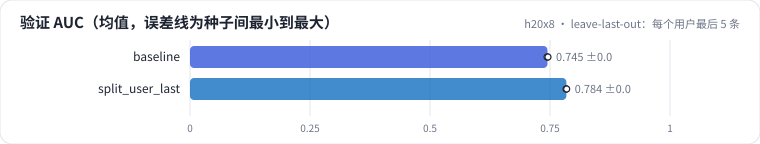

<!-- 本页由 python -m labkit docs 从 ../lesson.yaml 和 results/ 生成，不要手改 -->

[← 先估算](05-estimate.md) · [课程首页](../README.md) · [随机切分 →](07-fault.md)

# 第 6 步 / 共 13 步：leave-last-out：每个用户最后 5 条

> 阶段 3 / 5：**切分与验证虚高** · 场景：`split_user_last`（对照 `baseline`）

学术界序列推荐（SASRec、BERT4Rec）最常用的切分：每个用户按时间排，最后几条做验证 / 测试。这里在 t90 之前，每个用户（行数 ≥ 10 的）留最后 5 条进验证，其余进训练。留出集不变。

## 这一步跑了什么

| 场景 | 作用 | 说明 | 相对基线改了什么 | 种子（H20） |
| - | - | - | - | - |
| `baseline` | 对照 | 基线：全局时间切分（训练 < t80 ≤ 验证 < t90 ≤ 留出），只用 ID，1 个 epoch | — | 3 |
| `split_user_last` | 本步 | t90 之前每个用户最后 5 条进验证（leave-last-out） | `split=user_last` | 3 |

## 先预测

**和全局时间切分比，验证 AUC 高多少？**

- **A.** 高不到 1 个点
- **B.** 高 1 - 3 个点
- **C.** 高 3 个点以上

> 先选定一个（记下来），再展开下面的实测。AUC 差异小于 0.3 个百分点或小于种子间波动，都按“差不多”算。不同切分的验证 AUC 不能直接比，要看固定留出集。

## 实测

展开实测：H20 · MovieLens-1M 全量 · 用户 ID + 电影 ID 的 Embedding + MLP · 3 种子（已有 6 / 6 个运行）

| 场景 | 类型 | 验证 AUC | 验证 GAUC | 留出 AUC | 验证冷启动用户行 | 验证行数 | 验证 AUC：与 `baseline` 差 | 验证 AUC：各种子 | 断言 |
| - | - | - | - | - | - | - | - | - | - |
| `baseline` | 基线 | 0.7447 ± 0.0010 | 0.7302 ± 0.0002 | 0.7531 ± 0.0003 | 76.2% ± 0.0% | 100,024.0 ± 0.0 | — | s0 0.7447 / s1 0.7437 / s2 0.7458 | 通过 |
| `split_user_last` | 候选改动 | 0.7841 ± 0.0007 | 0.6734 ± 0.0020 | 0.7595 ± 0.0004 | 0.0% ± 0.0% | 29,755.0 ± 0.0 | +0.0394 | s0 0.7844 / s1 0.7833 / s2 0.7847 | 通过 |

运行目录（每个目录里有 `summary.json` 指标、`evidence.json` 证据摘要、`predictions.jsonl` 逐条预测、`log.txt` 日志）：

- `baseline` [s0](../../../results/h20x8/R0a/baseline/s0-461376/) · [s1](../../../results/h20x8/R0a/baseline/s1-71c585/) · [s2](../../../results/h20x8/R0a/baseline/s2-570ea7/)
- `split_user_last` [s0](../../../results/h20x8/R0a/split_user_last/s0-ca5532/) · [s1](../../../results/h20x8/R0a/split_user_last/s1-8d3a8f/) · [s2](../../../results/h20x8/R0a/split_user_last/s2-1ccd26/)

## 看完实测再想一步

验证 AUC 和留出 AUC 涨的幅度一样吗？GAUC 呢？

---

[← 先估算](05-estimate.md) · [课程首页](../README.md) · [随机切分 →](07-fault.md)
