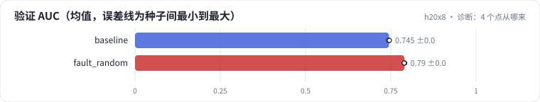

<!-- 本页由 python -m labkit docs 从 ../lesson.yaml 和 results/ 生成，不要手改 -->

[← 随机切分](07-fault.md) · [课程首页](../README.md) · [embedding 维度 32 → 128 →](09-emb.md)

# 第 8 步 / 共 13 步：诊断：4 个点从哪来

> 阶段 3 / 5：**切分与验证虚高** · 场景：`fault_random`（对照 `baseline`）

随机切分让验证 AUC 涨了约 4 个点，固定留出集只涨了一点。按需逐级点开线索，然后点选最主要的原因。

## 这一步跑了什么

| 场景 | 作用 | 说明 | 相对基线改了什么 | 种子（H20） |
| - | - | - | - | - |
| `baseline` | 对照 | 基线：全局时间切分（训练 < t80 ≤ 验证 < t90 ≤ 留出），只用 ID，1 个 epoch | — | 3 |
| `fault_random` | 本步 | t90 之前的行随机 8:1 切分训练 / 验证（留出集不变） | `split=random` | 3 |

## 线索

逐条展开，看到能下判断为止。

线索 1

看固定的未来留出集：验证 AUC 基线 0.7447 ± 0.0010、随机 0.7899 ± 0.0008；留出 AUC 基线 0.7531 ± 0.0003、随机 0.7585 ± 0.0004。验证 − 留出：-0.0084 ± +0.0011 对 +0.0314 ± +0.0010。两个集合是一起涨的吗？

线索 2

看切分体检：验证集冷启动用户行 76.2% ± 0.0% 对 0.0% ± 0.0%；验证行里"同一用户在训练集有更晚评分"的占比 0.0% ± 0.0% 对 98.7% ± 0.0%；训练集含未来：〔待 H20 生成〕 对 〔待 H20 生成〕。

线索 3

拆开看：GAUC 基线 0.7302 ± 0.0002、随机 0.7327 ± 0.0003，几乎不变；只看见过的用户，AUC 基线 0.7854 ± 0.0033、随机 0.7899 ± 0.0008。

## 先预测

**随机切分的验证 AUC 大涨，最主要的原因是什么？**

- **A.** 训练数据用到了 t90 之前，更新鲜，模型真的变强了
- **B.** 验证集换了一批题：几乎没有新用户，而且训练集里有同一用户之后的评分
- **C.** 种子噪声
- **D.** 验证集的正例率变了

> 先选定一个（记下来），再展开下面的实测。AUC 差异小于 0.3 个百分点或小于种子间波动，都按“差不多”算。不同切分的验证 AUC 不能直接比，要看固定留出集。

## 实测

展开实测：H20 · MovieLens-1M 全量 · 用户 ID + 电影 ID 的 Embedding + MLP · 3 种子（已有 6 / 6 个运行）

| 场景 | 类型 | 验证 AUC | 留出 AUC | 验证 GAUC | 冷启动用户行 | 用户在训练集有更晚行为 | 验证 AUC：与 `baseline` 差 | 验证 AUC：各种子 | 断言 |
| - | - | - | - | - | - | - | - | - | - |
| `baseline` | 基线 | 0.7447 ± 0.0010 | 0.7531 ± 0.0003 | 0.7302 ± 0.0002 | 76.2% ± 0.0% | 0.0% ± 0.0% | — | s0 0.7447 / s1 0.7437 / s2 0.7458 | 通过 |
| `fault_random` | 教学故障 | 0.7899 ± 0.0008 | 0.7585 ± 0.0004 | 0.7327 ± 0.0003 | 0.0% ± 0.0% | 98.7% ± 0.0% | +0.0452 | s0 0.7895 / s1 0.7909 / s2 0.7894 | 通过 |

运行目录（每个目录里有 `summary.json` 指标、`evidence.json` 证据摘要、`predictions.jsonl` 逐条预测、`log.txt` 日志）：

- `baseline` [s0](../../../results/h20x8/R0a/baseline/s0-461376/) · [s1](../../../results/h20x8/R0a/baseline/s1-71c585/) · [s2](../../../results/h20x8/R0a/baseline/s2-570ea7/)
- `fault_random` [s0](../../../results/h20x8/R0a/fault_random/s0-2269fc/) · [s1](../../../results/h20x8/R0a/fault_random/s1-6c3980/) · [s2](../../../results/h20x8/R0a/fault_random/s2-b8315b/)

---

[← 随机切分](07-fault.md) · [课程首页](../README.md) · [embedding 维度 32 → 128 →](09-emb.md)
