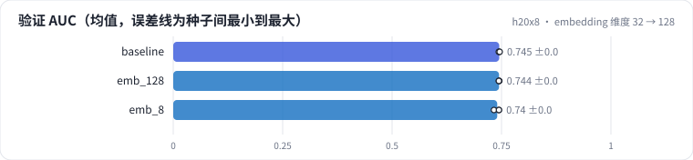

<!-- 本页由 python -m labkit docs 从 ../lesson.yaml 和 results/ 生成，不要手改 -->

[← 诊断：4 个点从哪来](08-diagnose.md) · [课程首页](../README.md) · [训 8 个 epoch →](10-epochs.md)

# 第 9 步 / 共 13 步：embedding 维度 32 → 128

> 阶段 4 / 5：**容量与 epoch** · 场景：`emb_128` `emb_8`（对照 `baseline`）

embedding 维度从 32 改成 128，embedding 参数翻 4 倍，MLP 输入从 64 维变成 256 维。另有一个 8 维的对照。其余不变，1 个 epoch。

## 这一步跑了什么

| 场景 | 作用 | 说明 | 相对基线改了什么 | 种子（H20） |
| - | - | - | - | - |
| `baseline` | 对照 | 基线：全局时间切分（训练 < t80 ≤ 验证 < t90 ≤ 留出），只用 ID，1 个 epoch | — | 3 |
| `emb_128` | 本步 | embedding 维度 32 → 128 | `embedding_dim=128` | 3 |
| `emb_8` | 本步 | embedding 维度 32 → 8 | `embedding_dim=8` | 3 |

## 先预测

**d 从 32 到 128，验证 AUC（3 种子均值）会怎样？**

- **A.** 涨 0.3 个点以上
- **B.** 差不多（±0.3）
- **C.** 跌 0.3 个点以上

> 先选定一个（记下来），再展开下面的实测。AUC 差异小于 0.3 个百分点或小于种子间波动，都按“差不多”算。不同切分的验证 AUC 不能直接比，要看固定留出集。

## 实测

展开实测：H20 · MovieLens-1M 全量 · 用户 ID + 电影 ID 的 Embedding + MLP · 3 种子（已有 9 / 9 个运行）

| 场景 | 类型 | 验证 AUC | 见过的用户 AUC | 没见过的用户 AUC | embedding 参数 | 训练秒数 | 验证 AUC：与 `baseline` 差 | 验证 AUC：各种子 | 断言 |
| - | - | - | - | - | - | - | - | - | - |
| `baseline` | 基线 | 0.7447 ± 0.0010 | 0.7854 ± 0.0033 | 0.7306 ± 0.0001 | 290,048.0 ± 0.0 | 1.2 ± 0.0 | — | s0 0.7447 / s1 0.7437 / s2 0.7458 | 通过 |
| `emb_128` | 候选改动 | 0.7443 ± 0.0006 | 0.7899 ± 0.0020 | 0.7300 ± 0.0002 | 1,160,192.0 ± 0.0 | 1.2 ± 0.1 | -0.0004 | s0 0.7441 / s1 0.7450 / s2 0.7439 | 通过 |
| `emb_8` | 候选改动 | 0.7402 ± 0.0065 | 0.7842 ± 0.0012 | 0.7310 ± 0.0001 | 72,512.0 ± 0.0 | 1.1 ± 0.1 | -0.0045 | s0 0.7439 / s1 0.7327 / s2 0.7442 | 通过 |

运行目录（每个目录里有 `summary.json` 指标、`evidence.json` 证据摘要、`predictions.jsonl` 逐条预测、`log.txt` 日志）：

- `baseline` [s0](../../../results/h20x8/R0a/baseline/s0-461376/) · [s1](../../../results/h20x8/R0a/baseline/s1-71c585/) · [s2](../../../results/h20x8/R0a/baseline/s2-570ea7/)
- `emb_128` [s0](../../../results/h20x8/R0a/emb_128/s0-11cbaa/) · [s1](../../../results/h20x8/R0a/emb_128/s1-36f0f8/) · [s2](../../../results/h20x8/R0a/emb_128/s2-8b6bd2/)
- `emb_8` [s0](../../../results/h20x8/R0a/emb_8/s0-f74be1/) · [s1](../../../results/h20x8/R0a/emb_8/s1-45a527/) · [s2](../../../results/h20x8/R0a/emb_8/s2-c0fb76/)

## 看完实测再想一步

见过的用户和没见过的用户，两组的 AUC 随维度怎么变？

---

[← 诊断：4 个点从哪来](08-diagnose.md) · [课程首页](../README.md) · [训 8 个 epoch →](10-epochs.md)
