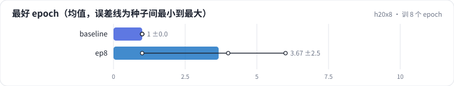
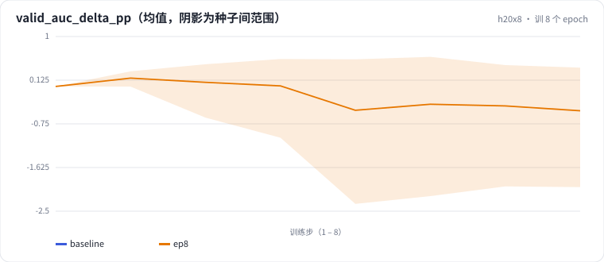

<!-- 本页由 python -m labkit docs 从 ../lesson.yaml 和 results/ 生成，不要手改 -->

[← embedding 维度 32 → 128](09-emb.md) · [课程首页](../README.md) · [8 个 epoch + 128 维 →](11-epochs-emb.md)

# 第 10 步 / 共 13 步：训 8 个 epoch

> 阶段 4 / 5：**容量与 epoch** · 场景：`ep8`（对照 `baseline`）

同一个模型训 8 遍，每遍结束在验证和留出上各评估一次。曲线是"验证 AUC 相对第 1 个 epoch 的变化（百分点）"。工业 CTR 模型通常只训 1 个 epoch。

## 这一步跑了什么

| 场景 | 作用 | 说明 | 相对基线改了什么 | 种子（H20） |
| - | - | - | - | - |
| `baseline` | 对照 | 基线：全局时间切分（训练 < t80 ≤ 验证 < t90 ≤ 留出），只用 ID，1 个 epoch | — | 3 |
| `ep8` | 本步 | 训 8 个 epoch（每个 epoch 末在验证 / 留出上各评估一次） | `epochs=8` | 3 |

## 先预测

**验证 AUC 最高出现在第几个 epoch？（3 种子平均）**

- **A.** 第 1 个
- **B.** 第 2 - 3 个
- **C.** 第 4 个以后

> 先选定一个（记下来），再展开下面的实测。AUC 差异小于 0.3 个百分点或小于种子间波动，都按“差不多”算。不同切分的验证 AUC 不能直接比，要看固定留出集。

## 实测

展开实测：H20 · MovieLens-1M 全量 · 用户 ID + 电影 ID 的 Embedding + MLP · 3 种子（已有 6 / 6 个运行）

| 场景 | 类型 | 最好 epoch | 最好验证 AUC | 最后验证 AUC | 最后比最好低 | 见过的用户 AUC | 没见过的用户 AUC | 最后验证 AUC：与 `baseline` 差 | 最后验证 AUC：各种子 | 断言 |
| - | - | - | - | - | - | - | - | - | - | - |
| `baseline` | 基线 | 1 ± 0 | 0.7447 ± 0.0010 | 0.7447 ± 0.0010 | 0.0000 ± 0.0000 | 0.7854 ± 0.0033 | 0.7306 ± 0.0001 | — | s0 0.7447 / s1 0.7437 / s2 0.7458 | 通过 |
| `ep8` | 候选改动 | 4 ± 3 | 0.7485 ± 0.0025 | 0.7398 ± 0.0124 | 0.0087 ± 0.0100 | 0.8064 ± 0.0022 | 0.7160 ± 0.0183 | -0.0049 | s0 0.7485 / s1 0.7455 / s2 0.7256 | 通过 |

运行目录（每个目录里有 `summary.json` 指标、`evidence.json` 证据摘要、`predictions.jsonl` 逐条预测、`log.txt` 日志）：

- `baseline` [s0](../../../results/h20x8/R0a/baseline/s0-461376/) · [s1](../../../results/h20x8/R0a/baseline/s1-71c585/) · [s2](../../../results/h20x8/R0a/baseline/s2-570ea7/)
- `ep8` [s0](../../../results/h20x8/R0a/ep8/s0-10b284/) · [s1](../../../results/h20x8/R0a/ep8/s1-7db94e/) · [s2](../../../results/h20x8/R0a/ep8/s2-13bd2c/)

## 看完实测再想一步

把种子切到 s2，再和 s0 比：两条曲线从第几个 epoch 开始分开？留出 AUC 跟着分开了吗？

---

[← embedding 维度 32 → 128](09-emb.md) · [课程首页](../README.md) · [8 个 epoch + 128 维 →](11-epochs-emb.md)
