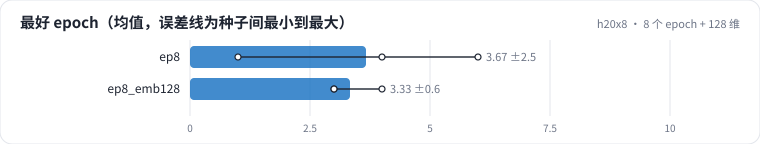
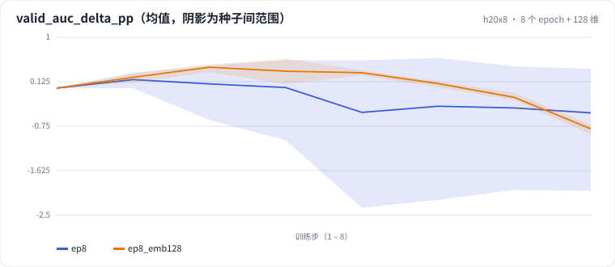

<!-- 本页由 python -m labkit docs 从 ../lesson.yaml 和 results/ 生成，不要手改 -->

[← 训 8 个 epoch](10-epochs.md) · [课程首页](../README.md) · [全是老用户时的过拟合 →](12-epochs-warm.md)

# 第 11 步 / 共 13 步：8 个 epoch + 128 维

> 阶段 4 / 5：**容量与 epoch** · 场景：`ep8_emb128`（对照 `ep8`）

容量加大：d = 128，同样训 8 遍。embedding 参数是 d = 32 的 4 倍，每个用户平均一百多条训练行，要拟合 128 个数。

## 这一步跑了什么

| 场景 | 作用 | 说明 | 相对基线改了什么 | 种子（H20） |
| - | - | - | - | - |
| `ep8` | 对照 | 训 8 个 epoch（每个 epoch 末在验证 / 留出上各评估一次） | `epochs=8` | 3 |
| `ep8_emb128` | 本步 | 8 个 epoch + embedding 128 维 | `epochs=8`, `embedding_dim=128` | 3 |

## 先预测

**d = 128 时，最后一个 epoch 的验证 AUC 比最好的那个 epoch 低多少？**

- **A.** 不到 0.2 个点
- **B.** 0.2 - 1 个点
- **C.** 1 个点以上

> 先选定一个（记下来），再展开下面的实测。AUC 差异小于 0.3 个百分点或小于种子间波动，都按“差不多”算。不同切分的验证 AUC 不能直接比，要看固定留出集。

## 实测

展开实测：H20 · MovieLens-1M 全量 · 用户 ID + 电影 ID 的 Embedding + MLP · 3 种子（已有 6 / 6 个运行）

| 场景 | 类型 | 最好 epoch | 最后比最好低（验证） | 最后比最好低（留出） | 验证 − 训练 logloss | 最后比最好低（验证）：与 `ep8` 差 | 最后比最好低（验证）：各种子 | 断言 |
| - | - | - | - | - | - | - | - | - |
| `ep8` | 候选改动 | 4 ± 3 | 0.0087 ± 0.0100 | 0.0020 ± 0.0015 | 0.1088 ± 0.0026 | — | s0 0.0022 / s1 0.0037 / s2 0.0202 | 通过 |
| `ep8_emb128` | 候选改动 | 3 ± 1 | 0.0125 ± 0.0009 | 0.0096 ± 0.0032 | 0.1443 ± 0.0068 | +0.0038 | s0 0.0117 / s1 0.0122 / s2 0.0135 | 通过 |

运行目录（每个目录里有 `summary.json` 指标、`evidence.json` 证据摘要、`predictions.jsonl` 逐条预测、`log.txt` 日志）：

- `ep8` [s0](../../../results/h20x8/R0a/ep8/s0-10b284/) · [s1](../../../results/h20x8/R0a/ep8/s1-7db94e/) · [s2](../../../results/h20x8/R0a/ep8/s2-13bd2c/)
- `ep8_emb128` [s0](../../../results/h20x8/R0a/ep8_emb128/s0-45b123/) · [s1](../../../results/h20x8/R0a/ep8_emb128/s1-be0cfc/) · [s2](../../../results/h20x8/R0a/ep8_emb128/s2-8ce887/)

## 看完实测再想一步

两条曲线从第几个 epoch 开始分开？

---

[← 训 8 个 epoch](10-epochs.md) · [课程首页](../README.md) · [全是老用户时的过拟合 →](12-epochs-warm.md)
