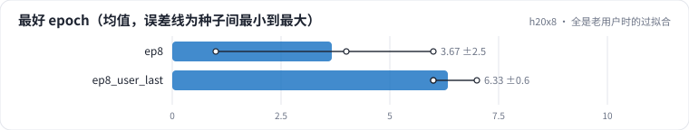
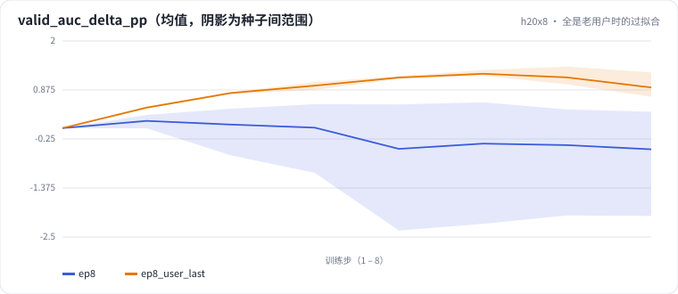

<!-- 本页由 python -m labkit docs 从 ../lesson.yaml 和 results/ 生成，不要手改 -->

[← 8 个 epoch + 128 维](11-epochs-emb.md) · [课程首页](../README.md) · [回顾 →](13-keycard.md)

# 第 12 步 / 共 13 步：全是老用户时的过拟合

> 阶段 4 / 5：**容量与 epoch** · 场景：`ep8_user_last`（对照 `ep8`）

换成 leave-last-out 切分训 8 遍：验证集里全是有训练历史的用户，用户 ID 向量对每一行都起作用。

## 这一步跑了什么

| 场景 | 作用 | 说明 | 相对基线改了什么 | 种子（H20） |
| - | - | - | - | - |
| `ep8` | 对照 | 训 8 个 epoch（每个 epoch 末在验证 / 留出上各评估一次） | `epochs=8` | 3 |
| `ep8_user_last` | 本步 | 8 个 epoch + leave-last-out 切分（验证集全是老用户） | `epochs=8`, `split=user_last` | 3 |

## 先预测

**和全局时间切分（d = 32、8 个 epoch）比，过拟合回落（最好 − 最后）更大吗？**

- **A.** 更大（多 0.2 个点以上）
- **B.** 差不多（±0.2）
- **C.** 更小（少 0.2 个点以上）

> 先选定一个（记下来），再展开下面的实测。AUC 差异小于 0.3 个百分点或小于种子间波动，都按“差不多”算。不同切分的验证 AUC 不能直接比，要看固定留出集。

## 实测

展开实测：H20 · MovieLens-1M 全量 · 用户 ID + 电影 ID 的 Embedding + MLP · 3 种子（已有 6 / 6 个运行）

| 场景 | 类型 | 最好 epoch | 最后比最好低 | 最后验证 AUC | 留出 AUC | 最后比最好低：与 `ep8` 差 | 最后比最好低：各种子 | 断言 |
| - | - | - | - | - | - | - | - | - |
| `ep8` | 候选改动 | 4 ± 3 | 0.0087 ± 0.0100 | 0.7398 ± 0.0124 | 0.7549 ± 0.0024 | — | s0 0.0022 / s1 0.0037 / s2 0.0202 | 通过 |
| `ep8_user_last` | 候选改动 | 6 ± 1 | 0.0034 ± 0.0018 | 0.7934 ± 0.0023 | 0.7639 ± 0.0018 | -0.0053 | s0 0.0048 / s1 0.0014 / s2 0.0041 | 通过 |

运行目录（每个目录里有 `summary.json` 指标、`evidence.json` 证据摘要、`predictions.jsonl` 逐条预测、`log.txt` 日志）：

- `ep8` [s0](../../../results/h20x8/R0a/ep8/s0-10b284/) · [s1](../../../results/h20x8/R0a/ep8/s1-7db94e/) · [s2](../../../results/h20x8/R0a/ep8/s2-13bd2c/)
- `ep8_user_last` [s0](../../../results/h20x8/R0a/ep8_user_last/s0-20351a/) · [s1](../../../results/h20x8/R0a/ep8_user_last/s1-015873/) · [s2](../../../results/h20x8/R0a/ep8_user_last/s2-03c1eb/)

## 看完实测再想一步

种子之间的回落差多少？

---

[← 8 个 epoch + 128 维](11-epochs-emb.md) · [课程首页](../README.md) · [回顾 →](13-keycard.md)
