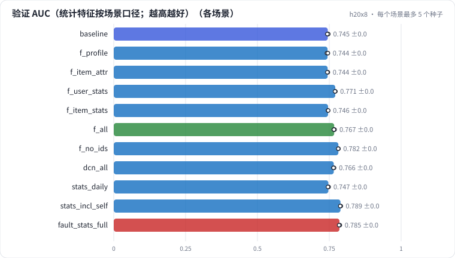

# R0b 特征改进与泄漏诊断：种子噪声线、逐组加特征、GAUC 与分组、统计特征的时点口径，全量统计穿越

在 R0a 的基线上逐组加特征（用户画像、电影属性、用户历史统计、电影历史统计），先用 5 个种子量出噪声线，再用 GAUC 和分组判断每一份收益来自哪里；去掉 ID 看记忆和泛化；把统计特征的口径换成天级、含本行标签、全量聚合，看离线分数和"线上能拿到的特征"差多少。最后诊断一次"全量统计穿越"。

## 怎么学（只看 GitHub 就够）

按下面“步骤”表从第 1 步往下点。每一页先给问题和选项，**先选定一个再展开“实测”**；实测里有结果表、证据图和运行目录链接。作业进度见 [作业看板](../../jobs/README.md)。参考答案和解析只在私有工作台里。

## 任务

**出发点**："加了一个统计特征，AUC 涨了 3 个点"——这句话在推荐团队里出现时，第一反应应该是**查口径**，而不是庆祝。统计特征（历史点击率、历史曝光数）是精排里最有用的一类特征，也是最容易穿越的一类：离线一次性把全量日志聚合好再拼回样本，样本就"看到了"自己的标签和未来。

这一课在 R0a 的基线（全局时间切分、只用 ID）上做三件事：

| 步骤 | 做法 | 看什么 |
| - | - | - |
| 噪声线 | 基线跑 5 个种子 | 多大的差才算差 |
| 逐组加特征 | 画像 / 属性 / 用户统计 / 电影统计，时点正确 | AUC、GAUC、分组：收益来自哪类用户、哪种排序 |
| 换统计口径 | 天级 / 含本行标签 / 全量 | 同一批验证行，换成"线上能拿到的特征"后掉多少 |

每个运行同时报三套分数：验证集（按场景口径算特征）、**同一批验证行换成线上口径**（valid_serving）、固定未来留出集（永远是线上口径）。

## 规模与边界

- **H20 档**：数据、切分、模型骨架和 R0a 基线完全相同（MovieLens-1M 全量、全局时间切分、embedding 32 维、MLP 256-128、1 个 epoch）。基线和"全部特征"各 5 个种子，其余 3 个种子。
- **保留了**：时点正确（point-in-time）的统计 join，同一秒的行互相看不见；平滑 (正例 + α × 先验) / (次数 + α)；次数的 log2 分桶；四种口径和"线上口径"的映射；按用户分组的 GAUC 和分组指标。
- **缩小了**：统计窗口是"全部历史"，没有 7 天 / 30 天窗口和衰减；特征只有 5 组；没有交叉特征工程。
- **未验证**：实时特征链路（Flink 等）的延迟；特征穿越在曝光日志、多目标模型上的表现。

## 步骤

<!-- labkit:path -->
| # | 阶段 | 步骤 | 这一步回答的问题 | 场景 | H20 结果 |
| - | - | - | - | - | - |
| 1 | 理解任务 | [场景与痛点](steps/01-pain.md) | 加一个统计特征涨 3 个点，是真的还是穿越？ | — | — |
| 2 | 理解任务 | [流程结构](steps/02-flow.md) |  | — | — |
| 3 | 理解任务 | [追踪一条样本的四种口径](steps/03-trace.md) |  | — | — |
| 4 | 理解任务 | [代码导读](steps/04-code.md) |  | — | — |
| 5 | 先估算 | [先估算](steps/05-estimate.md) | 一个用户此前评了 3 部电影，全部 ≥ 4 分。平滑后的"用户喜欢率"约多少？ | — | — |
| 6 | 噪声线 | [只换种子](steps/06-noise.md) | 5 个种子的验证 AUC，最高 − 最低约多少？ | `baseline` | 5 / 5 |
| 7 | 逐组加特征 | [加用户画像](steps/07-profile.md) | 加用户画像，验证 AUC 会怎样？ | `f_profile` `f_item_attr` | 6 / 6 |
| 8 | 逐组加特征 | [加用户历史统计](steps/08-user-stats.md) | 加用户历史统计，验证 AUC 涨多少？ | `f_user_stats` | 3 / 3 |
| 9 | 逐组加特征 | [同一改动，看 GAUC](steps/09-gauc.md) | 加用户历史统计，验证 GAUC 涨多少？ | `f_user_stats` | 3 / 3 |
| 10 | 逐组加特征 | [收益落在哪类用户](steps/10-group.md) | 训练集没见过的用户这一组，AUC 涨多少？ | `f_user_stats` | 3 / 3 |
| 11 | 逐组加特征 | [加电影历史统计](steps/11-item-stats.md) | 加电影历史统计，验证 AUC 会怎样？ | `f_item_stats` | 3 / 3 |
| 12 | 逐组加特征 | [5 组全加](steps/12-all.md) | 5 组全加，比只加用户统计又多多少？ | `f_all` | 5 / 5 |
| 13 | 逐组加特征 | [去掉 ID](steps/13-no-ids.md) | 去掉 ID，验证 AUC 会怎样？ | `f_no_ids` | 3 / 3 |
| 14 | 逐组加特征 | [换成 DCN-v2](steps/14-dcn.md) | 换成 DCN-v2，验证 AUC 会怎样？ | `dcn_all` | 3 / 3 |
| 15 | 统计的时效 | [T+1 天级统计](steps/15-daily.md) | 改成天级统计，"训练集没见过的用户"这一组 AUC 掉多少？ | `stats_daily` | 3 / 3 |
| 16 | 口径泄漏 | [全量统计](steps/16-fault.md) | 全量统计的验证 AUC，比时点正确的"全部特征"高多少？ | `fault_stats_full` | 3 / 3 |
| 17 | 口径泄漏 | [诊断：全量统计的分数从哪来](steps/17-diagnose.md) | 全量统计的验证 AUC 更高，最主要的原因是什么？ | `fault_stats_full` | 3 / 3 |
| 18 | 口径泄漏 | [只多算了本行的标签](steps/18-self.md) | 同一批验证行，"场景口径 − 线上口径"的 AUC 差有多大？ | `stats_incl_self` | 3 / 3 |
| 19 | 带走 | [回顾](steps/19-keycard.md) |  | — | — |
<!-- /labkit:path -->

## 场景与结果

<!-- labkit:results -->

展开结果（先自己预测，再看）

**h20x8**：8 × NVIDIA H20，每张卡一个运行。数据、切分和 R0a 基线完全相同（全局时间切分，固定未来留出集）；基线和"全部特征"各跑 5 个种子，用来量噪声线（已有 37 / 37 个运行）

| 场景 | 类型 | 验证 AUC | 验证 GAUC | 同一批验证行·线上口径 AUC | 留出 AUC（线上口径） | 验证 − 线上口径 AUC | 没见过的用户 AUC | 用户统计含未来的行占比 | 训练秒数 | 断言 |
| - | - | - | - | - | - | - | - | - | - | - |
| `baseline` | 基线 | 0.7449 ± 0.0015 (n=5) | 0.7304 ± 0.0004 (n=5) | 0.7449 ± 0.0015 (n=5) | 0.7533 ± 0.0003 (n=5) | 0.0000 ± 0.0000 (n=5) | 0.7308 ± 0.0004 (n=5) | 0.0000 ± 0.0000 (n=5) | 1.2500 ± 0.0367 (n=5) | 通过 |
| `f_profile` | 候选改动 | 0.7440 ± 0.0022 (n=3) | 0.7302 ± 0.0002 (n=3) | 0.7440 ± 0.0022 (n=3) | 0.7521 ± 0.0030 (n=3) | 0.0000 ± 0.0000 (n=3) | 0.7310 ± 0.0006 (n=3) | 0.0000 ± 0.0000 (n=3) | 1.2500 ± 0.1039 (n=3) |  |
| `f_item_attr` | 候选改动 | 0.7445 ± 0.0011 (n=3) | 0.7310 ± 0.0002 (n=3) | 0.7445 ± 0.0011 (n=3) | 0.7536 ± 0.0014 (n=3) | 0.0000 ± 0.0000 (n=3) | 0.7308 ± 0.0003 (n=3) | 0.0000 ± 0.0000 (n=3) | 1.3200 ± 0.0100 (n=3) |  |
| `f_user_stats` | 候选改动 | 0.7708 ± 0.0007 (n=3) | 0.7292 ± 0.0003 (n=3) | 0.7708 ± 0.0007 (n=3) | 0.7681 ± 0.0010 (n=3) | 0.0000 ± 0.0000 (n=3) | 0.7632 ± 0.0009 (n=3) | 0.0000 ± 0.0000 (n=3) | 1.1833 ± 0.1361 (n=3) | 通过 |
| `f_item_stats` | 候选改动 | 0.7459 ± 0.0003 (n=3) | 0.7324 ± 0.0002 (n=3) | 0.7459 ± 0.0003 (n=3) | 0.7549 ± 0.0007 (n=3) | 0.0000 ± 0.0000 (n=3) | 0.7322 ± 0.0001 (n=3) | 0.0000 ± 0.0000 (n=3) | 1.2367 ± 0.0153 (n=3) | 通过 |
| `f_all` | 修复 | 0.7670 ± 0.0014 (n=5) | 0.7330 ± 0.0005 (n=5) | 0.7670 ± 0.0014 (n=5) | 0.7676 ± 0.0009 (n=5) | 0.0000 ± 0.0000 (n=5) | 0.7585 ± 0.0013 (n=5) | 0.0000 ± 0.0000 (n=5) | 1.6080 ± 0.0084 (n=5) | 通过 |
| `f_no_ids` | 候选改动 | 0.7817 ± 0.0004 (n=3) | 0.7258 ± 0.0003 (n=3) | 0.7817 ± 0.0004 (n=3) | 0.7787 ± 0.0001 (n=3) | 0.0000 ± 0.0000 (n=3) | 0.7760 ± 0.0001 (n=3) | 0.0000 ± 0.0000 (n=3) | 1.4900 ± 0.0100 (n=3) |  |
| `dcn_all` | 候选改动 | 0.7656 ± 0.0014 (n=3) | 0.7333 ± 0.0002 (n=3) | 0.7656 ± 0.0014 (n=3) | 0.7665 ± 0.0014 (n=3) | 0.0000 ± 0.0000 (n=3) | 0.7568 ± 0.0010 (n=3) | 0.0000 ± 0.0000 (n=3) | 1.8233 ± 0.0351 (n=3) |  |
| `stats_daily` | 候选改动 | 0.7469 ± 0.0013 (n=3) | 0.7329 ± 0.0005 (n=3) | 0.7469 ± 0.0013 (n=3) | 0.7551 ± 0.0008 (n=3) | 0.0000 ± 0.0000 (n=3) | 0.7336 ± 0.0012 (n=3) | 0.0000 ± 0.0000 (n=3) | 1.6133 ± 0.0379 (n=3) | 通过 |
| `stats_incl_self` | 候选改动 | 0.7891 ± 0.0012 (n=3) | 0.7449 ± 0.0004 (n=3) | 0.7778 ± 0.0008 (n=3) | 0.7757 ± 0.0005 (n=3) | 0.0113 ± 0.0004 (n=3) | 0.7853 ± 0.0004 (n=3) | 0.0000 ± 0.0000 (n=3) | 1.7200 ± 0.1836 (n=3) | 通过 |
| `fault_stats_full` | 教学故障 | 0.7853 ± 0.0015 (n=3) | 0.7361 ± 0.0005 (n=3) | 0.7706 ± 0.0008 (n=3) | 0.7627 ± 0.0006 (n=3) | 0.0147 ± 0.0008 (n=3) | 0.7824 ± 0.0004 (n=3) | 0.9891 ± 0.0000 (n=3) | 1.6400 ± 0.0100 (n=3) | 通过 |

<!-- /labkit:results -->

## 证据图

<!-- labkit:figures -->

展开证据图（先自己预测，再看）

- **h20x8**：[主指标](figures/h20x8-metrics.svg)

  

<!-- /labkit:figures -->

## 代码

<!-- labkit:code -->
| 代码段 | 位置 |
| - | - |
| `load_raw` | [projects/recbase/data.py#L33](../../projects/recbase/data.py#L33) |
| `split` | [projects/recbase/data.py#L77](../../projects/recbase/data.py#L77) |
| `encode` | [projects/recbase/data.py#L119](../../projects/recbase/data.py#L119) |
| `checks` | [projects/recbase/data.py#L134](../../projects/recbase/data.py#L134) |
| `build_feats` | [projects/recbase/experiment.py#L134](../../projects/recbase/experiment.py#L134) |
| `stats` | [projects/recbase/features.py#L39](../../projects/recbase/features.py#L39) |
| `auc_gauc` | [projects/recbase/metrics.py#L21](../../projects/recbase/metrics.py#L21) |
| `groups` | [projects/recbase/metrics.py#L113](../../projects/recbase/metrics.py#L113) |
| `reference` | [projects/recbase/metrics.py#L141](../../projects/recbase/metrics.py#L141) |
| `model` | [projects/recbase/model.py#L35](../../projects/recbase/model.py#L35) |
| `loss` | [projects/recbase/model.py#L100](../../projects/recbase/model.py#L100) |
| `optimizer` | [projects/recbase/train.py#L29](../../projects/recbase/train.py#L29) |
| `train_loop` | [projects/recbase/train.py#L95](../../projects/recbase/train.py#L95) |
<!-- /labkit:code -->
