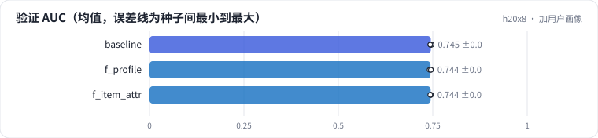

<!-- 本页由 python -m labkit docs 从 ../lesson.yaml 和 results/ 生成，不要手改 -->

[← 只换种子](06-noise.md) · [课程首页](../README.md) · [加用户历史统计 →](08-user-stats.md)

# 第 7 步 / 共 19 步：加用户画像

> 阶段 4 / 7：**逐组加特征** · 场景：`f_profile` `f_item_attr`（对照 `baseline`）

在 ID 之外加用户画像：性别、年龄段（7 档）、职业（21 种）、邮编首位。另有一个"加电影属性（题材、上映年代）"的对照。验证集里约四分之三的行是训练集没见过的用户——画像是他们唯一的个人信息。

## 这一步跑了什么

| 场景 | 作用 | 说明 | 相对基线改了什么 | 种子（H20） |
| - | - | - | - | - |
| `baseline` | 对照 | 基线：只用用户 ID + 电影 ID（= R0a 基线），5 个种子 | — | 5 |
| `f_profile` | 本步 | + 用户画像（性别、年龄段、职业、邮编首位） | `feature_groups=['ids', 'user_profile']` | 3 |
| `f_item_attr` | 本步 | + 电影属性（题材多值、上映年代） | `feature_groups=['ids', 'item_attr']` | 3 |

## 先预测

**加用户画像，验证 AUC 会怎样？**

- **A.** 涨 0.3 个点以上
- **B.** 差不多（±0.3）
- **C.** 跌 0.3 个点以上

> 先选定一个（记下来），再展开下面的实测。AUC 差异小于 0.3 个百分点（GAUC 小于 0.5）或小于种子间波动，都按“差不多”算。

## 实测

展开实测：H20 · MovieLens-1M 全量 · 在 R0a 基线上逐组加特征、换统计口径 · 3-5 种子（已有 11 / 11 个运行）

| 场景 | 类型 | 验证 AUC | 验证 GAUC | 没见过的用户 AUC | 长尾电影 AUC | 验证 AUC：与 `baseline` 差 | 验证 AUC：各种子 | 断言 |
| - | - | - | - | - | - | - | - | - |
| `baseline` | 基线 | 0.7449 ± 0.0015 | 0.7304 ± 0.0004 | 0.7308 ± 0.0004 | 0.7177 ± 0.0041 | — | s0 0.7447 / s1 0.7437 / s2 0.7458 / s3 0.7469 / s4 0.7433 | 通过 |
| `f_profile` | 候选改动 | 0.7440 ± 0.0022 | 0.7302 ± 0.0002 | 0.7310 ± 0.0006 | 0.7128 ± 0.0057 | -0.0009 | s0 0.7414 / s1 0.7455 / s2 0.7451 |  |
| `f_item_attr` | 候选改动 | 0.7445 ± 0.0011 | 0.7310 ± 0.0002 | 0.7308 ± 0.0003 | 0.7179 ± 0.0028 | -0.0004 | s0 0.7446 / s1 0.7455 / s2 0.7433 |  |

运行目录（每个目录里有 `summary.json` 指标、`evidence.json` 证据摘要、`predictions.jsonl` 逐条预测、`log.txt` 日志）：

- `baseline` [s0](../../../results/h20x8/R0b/baseline/s0-461376/) · [s1](../../../results/h20x8/R0b/baseline/s1-71c585/) · [s2](../../../results/h20x8/R0b/baseline/s2-570ea7/) · [s3](../../../results/h20x8/R0b/baseline/s3-a5952b/) · [s4](../../../results/h20x8/R0b/baseline/s4-e7e664/)
- `f_profile` [s0](../../../results/h20x8/R0b/f_profile/s0-5d2bde/) · [s1](../../../results/h20x8/R0b/f_profile/s1-88ceb7/) · [s2](../../../results/h20x8/R0b/f_profile/s2-4a9e7a/)
- `f_item_attr` [s0](../../../results/h20x8/R0b/f_item_attr/s0-de0e6b/) · [s1](../../../results/h20x8/R0b/f_item_attr/s1-4439ed/) · [s2](../../../results/h20x8/R0b/f_item_attr/s2-58188d/)

## 看完实测再想一步

三个场景的差和种子间波动比，哪个大？

---

[← 只换种子](06-noise.md) · [课程首页](../README.md) · [加用户历史统计 →](08-user-stats.md)
